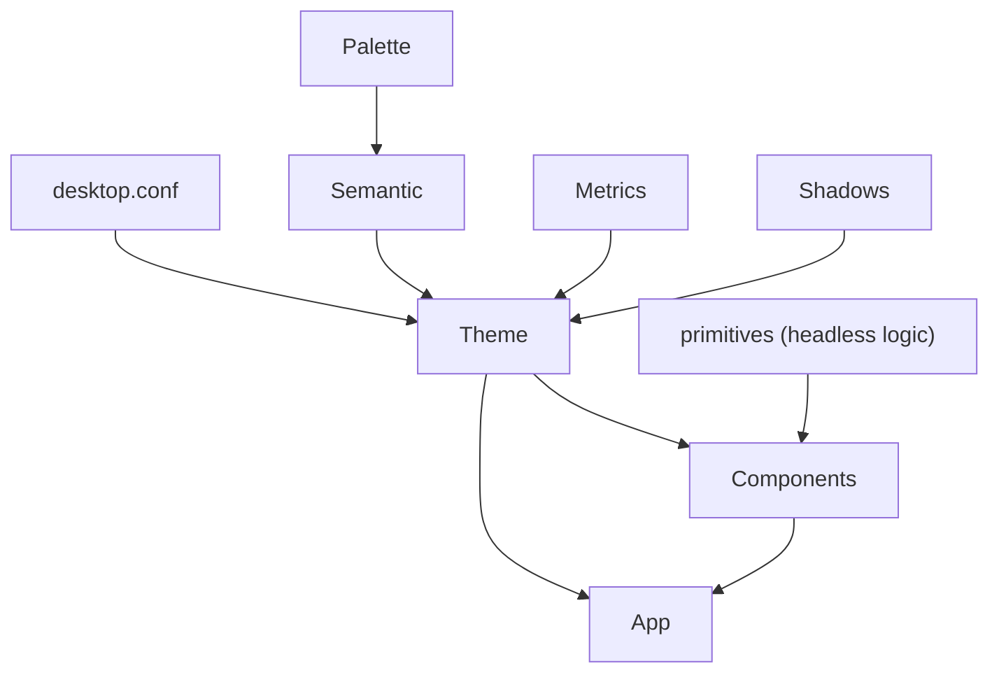

# Design

## Target

The [GNOME HIG](https://developer.gnome.org/hig/), with libadwaita as the reference. Look there first for sizes, colors, motion and behavior. Where the HIG, iced's limits or our judgment say otherwise, do the other thing. Deviations go in the **iced mapping** section of the page under [docs/hig-inferences/](docs/hig-inferences/README.md).

Components carry their libadwaita names only so they are easy to find.

Responsive behavior has a second reference: Mantine (AppShell) and Bootstrap, for breakpoints, collapsing and shell layout. The HIG decides; these fill gaps. See [adaptive layouts](docs/hig-inferences/design-language/adaptive-layouts.md#other-references).

## Principles

- Adwaita appearance, adaptive layouts, client-side decorations that follow the desktop, accessible contrast, calm motion that respects reduced motion.
- A small set of components with one shape.
- Desktop behavior comes from one shared config file, so apps behave alike.
- Not goals: API, behavior or pixel compatibility with libadwaita or GTK; porting every widget.

## Structure

### Theme

Three layers, each overridable ([theming](docs/lib/theming.md)):

| Layer        | Type                    | Holds                                                           |
| ------------ | ----------------------- | --------------------------------------------------------------- |
| Named colors | `Palette`               | libadwaita variable names, light and dark                       |
| Semantic     | `Semantic`              | surfaces, status swatches, opacities; text on fills by contrast |
| Metrics      | `Metrics`, `Typography` | spacing, radii (capped at HIG maxima), sizes, text scale        |

`Theme` implements iced's `theme::Base` and every widget `Catalog`, so stock widgets are restyled. Colors, radii and opacities resolve at draw time, layout tokens at view-build time.

Surfaces can be translucent (`with_transparency`) and tinted (`with_tint`, off by default). Tints derived from a surface keep its alpha.

### Layers

The library is five layers, plus the theme and the window logic. Each has one job, and a layer imports only the layers listed (`cargo test` checks it).

| Layer         | Job                                                                                         | May import                                                    |
| ------------- | ------------------------------------------------------------------------------------------- | ------------------------------------------------------------- |
| `layouts/`    | where things go and how they flow: grid, flex, overlay, dock, split, clip, virtualize, motion | `binds`, `primitives`, `styles`                               |
| `primitives/` | headless rules and state machines: `(state, input) -> next state`, no iced widgets or events  | nothing                                                       |
| `binds/`      | iced events turned into primitive input (focus, shortcuts). No rules                         | `primitives`, `styles`                                        |
| `components/` | themed atoms with no information of their own; usable by third-party widgets                | `layouts`, `binds`, `primitives`, `styles`                    |
| `metas/`      | choose (`MetaComponent`) or join (`ComposedComponent`) whole widgets                         | `components`, `layouts`, `binds`, `primitives`, `styles`      |
| `widgets/`    | what the user sees and uses; composed of the above, with their own layout and density       | everything above, and `windows`                               |
| `styles/`     | `Catalog` style functions                                                                    | the theme                                                     |
| `windows/`    | window state, chrome and frame logic                                                         | `layouts`, `styles`                                           |

The rule that decides where code goes: a primitive is a pure, controlled rule. A component shows state through props (`.selected(bool)`) and reports intent through callbacks (`.on_press(Msg)`). The app owns the state and wires the two in `update`. `Selection` is the model. There is no handle type: the handle is the primitive plus that vocabulary, so swapping `ItemRow` for `ItemCard` keeps the behavior.

### Components

Each is a builder: `new(..)`, properties, slots, `on_*` events, controlled state, `Into<Element>`. The API of each is its man page, generated from its doc comments. See [components](docs/lib/components.md).

Differences from a stock widget:

- `Card` is one chainable surface; each shadow layer is its own rounded shape.
- Wrappers forward overlays and keep their content's tree position stable.
- Text on colored fills follows CSS `color-contrast()`.

### Primitives

`src/primitives/` holds behavior with no widgets and no look: pure, controlled, unit-tested (iced geometry types such as `Rectangle` and `Size` are allowed; widgets and events are not). A component is a primitive plus a look. List: [primitives](docs/lib/primitives.md).

### Dialogs and overlays

A dialog is a modal layer over its parent window. The parent is faded and disabled. The library opens no OS window for a dialog.

- `Overlay`: a layer over a base. Rules in `layouts::overlay::rule`.
- `Dock`: a surface on an edge. Modes: `Push` (makes room) and `Overlay` (floats over a faded base).
- `FocusScope`, `focus_return`: Tab trap, initial focus, focus return. Every `Overlay` is one.
- A window that must outlive the main window is a separate process: `windows::Detached`.

See [windows and menus](docs/lib/windows-and-menus.md).

### Desktop config

`~/.config/iced-adaptive-design/desktop.conf` (and system files) sets shared behavior: scheme, accent, density, transparency, tint, shadows, motion per trigger, decorations, breakpoints, menus, sidebar, rows, toasts. Apps opt out per setting with `Config::opt_out` (discouraged, reported at startup, forbidden by `[policy]`). See [desktop config](docs/lib/desktop-config.md).

A versioned registry (types, defaults, `since`, deprecation) lets apps of different toolkit versions share one file: unknown keys are ignored, never deleted. See [config registry](docs/lib/config-registry.md).

### Shortcuts

A wrapper publishes the bound message. Menus register the accelerators they show. A standard set covers GNOME's usual ones. A widget shows a shortcut only when it is available. See [windows and menus](docs/lib/windows-and-menus.md).

### Windows

No server-side decorations by default. Header bars are continuous. Window buttons follow the desktop's `button-layout` and icon theme. Corners follow the real window state; surfaces on a corner take the window radius.

### Adaptive layout

Breakpoints: 576, 768, 992, 1200, 1400 (`breakpoints`). A split view collapses below 768 px, or when the content beside the sidebar would be under 520 px. The collapsed sidebar is a drawer or the parent page of a stack. Mobile mode (no window buttons, full-page menus) is below 576 px.

Crossing a breakpoint slides the sidebar out of (or into) the layout on the drawer's spring, and the content gives way instead of being covered. The in-flow sidebar, the drawer and a pushed `Dock` share one geometry (`primitives::dock`). Every layout number is a named fallback that the config can override.

### Motion

Libadwaita's easings and springs. Every animation is a trigger with its own setting and a `none` fallback. Reduced motion disables all of them.

## Coverage

| libadwaita                                                                 | here                                                                        |
| -------------------------------------------------------------------------- | --------------------------------------------------------------------------- |
| StatusPage, Banner, Avatar, Spinner, ToastOverlay                          | `status_page`, `banner`, `avatar`, `spinner`, `Toast` + `toast_stack`       |
| Dialog, AlertDialog, AboutDialog, ShortcutsDialog                          | `dialog_in_window`, `AlertDialog`, `AboutDialog`, `shortcuts_dialog`        |
| ActionRow, SwitchRow, ComboRow, ExpanderRow, EntryRow, SpinRow, ButtonRow  | same names; `boxed_list`, `Card`                                            |
| PreferencesGroup / Page / Dialog                                           | `PreferencesGroup`, `PreferencesPage`, `preferences_dialog`                 |
| NavigationView, NavigationSplitView, OverlaySplitView, Sidebar             | `navigation_view`, `NavigationSplitView`, `OverlaySplitView`, `SidebarList` |
| ViewSwitcher, TabBar, Carousel                                             | `view_switcher`, `Tabs`, `carousel`                                         |
| BottomSheet                                                                | `Dock` (`DockMode::Overlay`, bottom)                                        |
| ToolbarView, HeaderBar, Window, SplitButton, ToggleGroup                   | `toolbar_view`, `HeaderBar`, `window`, `split_button`, `toggle_group`       |
| Clamp, WrapBox, Bin, Breakpoint                                            | `clamp`, `wrap_box`, `bin`, `Breakpoint`                                    |
| Entry, CheckButton, Scale, TextView                                        | `entry`, `check_button`, `scale`, `text_view`                               |

Beyond libadwaita: `NumberInput`, `DateInput`, `DateRangeInput`, `ColorInput`, `ColorPicker`, `Autocomplete`, `MultiSelect`, `Tree`, `Timeline`, `Splitter`, `Spoiler`, `Dock`, `FocusScope`, tables with virtualization and async loading.

Not implemented: TabOverview, dynamic breakpoint setters, a full symbolic icon theme (a small built-in set plus the desktop's window-control icons).

## Known limitations

- iced cannot ellipsize text. Overflow is clipped at its container.
- No exit animations for dialogs and toasts (the app unmounts them).
- The carousel takes mouse drag only. A `Dock` has no drag gesture.
- Quads draw before text within one iced layer. Overlapping surfaces need separate layers.
- `iced::window::screenshot` does not capture `text_editor` text.
- iced buttons are not focusable, so focus handling covers entries and editors only.
- A window cannot be made a true child of another; use a modal dialog or a separate process.
