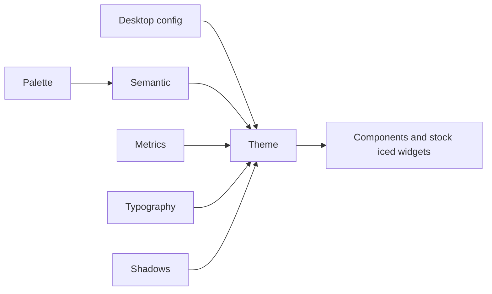

# Design

#### Target

We target the [GNOME HIG](https://developer.gnome.org/hig/), using libadwaita for reference. The
reference is where we look first for sizes, colors, motion and behavior; it is not something we
stay compatible with. Where the HIG, iced's limits or our own judgment call for something
different, we do the different thing. Deviations are *usually* recorded in the **iced mapping**
section of the relevant file under [docs/hig-inferences/](docs/hig-inferences/README.md).

Components are named after their libadwaita counterparts only so they are easy to recognize.
**Responsive behavior** has a second reference: Mantine (notably its AppShell) and Bootstrap are
alternative references for breakpoints, collapsing and shell layout, used to fill gaps Adwaita
leaves or where its choices are not optimal (libadwaita collapses a sidebar at 400sp, for
example). The HIG still decides; these inform. See
[adaptive layouts](docs/hig-inferences/design-language/adaptive-layouts.md#other-references).

#### Principles

* Follow the HIG: Adwaita-style appearance, adaptive layouts, client-side decorations that follow
  the desktop, accessible contrast, calm motion that respects reduced motion.
* A small set of components with one shape, usable from code or a declarative layer.
* Desktop behavior is shared through one config file, so apps behave like each other.
* Not goals: API, behavior or pixel compatibility with libadwaita or GTK; porting every widget.

## Structure

#### Theme

Three overridable layers (see [theming](docs/lib/theming.md)):

| Layer | Type | Holds |
|---|---|---|
| Named colors | `Palette` | libadwaita-style variable names, light and dark |
| Semantic | `Semantic` | Surfaces, status swatches, opacities; text on fills chosen by contrast |
| Metrics | `Metrics`, `Typography` | Spacing, radii (capped at HIG maxima), sizes, text scale |

`Theme` implements iced's `theme::Base` and every widget `Catalog`, so stock widgets are restyled.
Colors, radii and opacities resolve at draw time; layout tokens at view-build time.

#### Components

Each is a builder with `new(..)`, properties, slots, `on_*` events, controlled state and
`Into<Element>`. `catalog::COMPONENTS` lists them and `prelude` imports them. See
[components](docs/lib/components.md).

Some behavior is deliberately different from a stock widget:

* `Card` is one chainable surface; each shadow layer is its own rounded shape.
* Wrapper widgets forward overlays and keep their content's tree position stable.
* Text color on colored fills follows CSS `color-contrast()`.

#### Desktop config

`~/.config/iced-libadwaita/desktop.conf` (and system files) sets shared behavior: scheme, accent,
density, shadows, motion per trigger, decorations, breakpoints, menus, sidebar, rows, toasts.
Apps opt out per setting with `Config::opt_out` (discouraged, reported at startup, can be
forbidden by `[policy]`). See [desktop-config](docs/lib/desktop-config.md).

#### Windows

No server-side decorations by default. Header bars are continuous, window buttons follow the
desktop's `button-layout` and icon theme, rounded corners follow the real window state, and
surfaces touching a corner take the window radius.

#### Adaptive layout

Breakpoints follow the scale of popular UI kits (Bootstrap, Mantine): 576, 768, 992, 1200, 1400
(`breakpoints`). Content must never feel squeezed, so a split view collapses below 768px *or*
whenever the content beside the sidebar would be under 520px; the collapsed sidebar is a drawer
or the first page of a stack. Mobile mode (no window buttons, full-page menus) is below 576px.
Crossing a breakpoint slides the sidebar out of (or into) the layout on the drawer's spring,
displacing the content rather than covering it. Every layout number is a named
fallback constant that the desktop config can override. Rows wrap their control when they cannot
share a line.

#### Motion

Libadwaita's easings and springs with its parameters. Every animation is a trigger with its own
animation and a `None` fallback; reduced motion disables all of them.

## Coverage

| libadwaita (reference) | here |
|---|---|
| StatusPage, Banner, Avatar, Spinner, ToastOverlay | `status_page`, `banner`, `avatar`, `spinner`, `Toast` + `toast_stack` |
| Dialog, AlertDialog, AboutDialog, ShortcutsDialog | `dialog_in_window`, `AlertDialog`, `AboutDialog`, `shortcuts_dialog` |
| ActionRow, SwitchRow, ComboRow, ExpanderRow, EntryRow, SpinRow, ButtonRow | the same names; `boxed_list`, `Card` |
| PreferencesGroup / Page / Dialog | `PreferencesGroup`, `PreferencesPage`, `preferences_dialog` |
| NavigationView, NavigationSplitView, OverlaySplitView, Sidebar | `navigation_view`, `NavigationSplitView`, `OverlaySplitView`, `SidebarList` |
| ViewSwitcher, TabBar, Carousel, BottomSheet | `view_switcher`, `tab_bar`, `carousel`, `bottom_sheet_in_window` |
| ToolbarView, HeaderBar, Window, SplitButton, ToggleGroup | `toolbar_view`, `HeaderBar`, `window`, `split_button` / `SplitButtonAction`, `toggle_group` |
| Clamp, WrapBox, Bin, Breakpoint | `clamp`, `wrap_box`, `bin`, `Breakpoint` |
| Entry, CheckButton, Scale, TextView | `entry`, `check_button`, `scale`, `text_view` (GTK4 equivalents) |

Not implemented: TabOverview, dynamic breakpoint setters, a full symbolic icon theme (a small
built-in set plus the desktop's window-control icons).

## Known limitations

* iced cannot ellipsize text; overflowing text is clipped at its container.
* No exit animations for dialogs and toasts (the app unmounts them); no navigation-page transition
  inside a stack beyond the push/pop slide.
* The carousel takes mouse drag only; the bottom sheet has no drag gesture.
* Quads draw before text within one iced layer, so overlapping surfaces need separate layers.
* `iced::window::screenshot` does not capture `text_editor` text, so the editor cannot be
  confirmed by screenshot.
