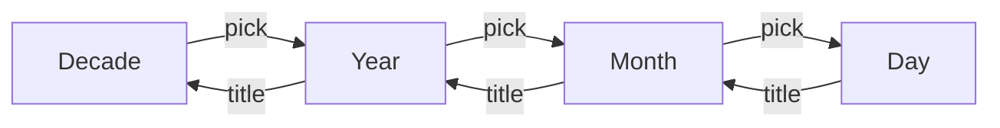

# DateInput

libadwaita and GTK 4 have no date picker. `GtkCalendar` is a bare month grid with no entry.

## What it is

An entry with the calendar button in its left section. The button opens a calendar in a popover, or a dialog with `dialog(true)`.

## Parameters

| Param               | Meaning                                                        | Default     |
| ------------------- | -------------------------------------------------------------- | ----------- |
| `selected`, `min`, `max` | chosen date, bounds                                       | none        |
| `level`, `calendar`, `min_level`, `max_level` | calendar level (month, year, decade) | month, month, decade |
| `today`             | the date "Today" jumps to                                      | system date (UTC) |
| `dialog(bool)`      | open as a dialog                                               | popover     |
| `scrim`             | fade the window (dialog)                                       | on          |
| `close_on_outside`  | a press outside closes the dialog                              | on          |
| `revealed`, `disabled`, `width`, `open_initially` |                                  |             |

Events: `on_input(text)`, `on_pick(date)`, `on_view(first-of-month)`, `on_nav(CalendarView)`.

## Behavior

- Text is `YYYY-MM-DD` (also `/` or `.`). An unparsable date, or one outside `min`/`max`, is the error state (once `revealed`).
- The calendar is a Monday-first month grid. Days outside `min`/`max` are disabled. The chosen day is accent-colored.
- **Levels** (after Mantine's `DatePicker` and Firefox's picker):
  - The title zooms out: month, year, decade. It is inert at `max_level`.
  - The arrows step one month, year or ten years.
  - A month or year cell drills back down. At `min_level` a pick selects instead: `min_level(Year)` is a month picker, `Decade` a year picker. `on_pick` gets the first day of the period.
  - "Today" returns to the current month (or year). It is dimmed when already there or outside the bounds.
  - Months and years entirely outside `min`/`max` are disabled.
  - Stepping clamps the day (31 Jan plus a month is 28 or 29 Feb).
- The popover stays open while you page or pick. A press outside or Escape closes it.
- Controlled: the app owns the text, the calendar position (`CalendarView`) and the chosen date.

For an interval use [`DateRangeInput`](date-range.md).

## iced mapping

An `Entry` with a `Popover` (`keep_open(true)`) in its left section. Date arithmetic is the dependency-free `Date` type. Navigation is the headless `primitives::calendar`.

## Deviations

No arrow-key stepping of the text. No keyboard navigation of the cells. No two-month view. The current day is the UTC date. English month names, Monday first. Mantine's `numberOfColumns`, `getDayProps`, `presets` are not modeled.
