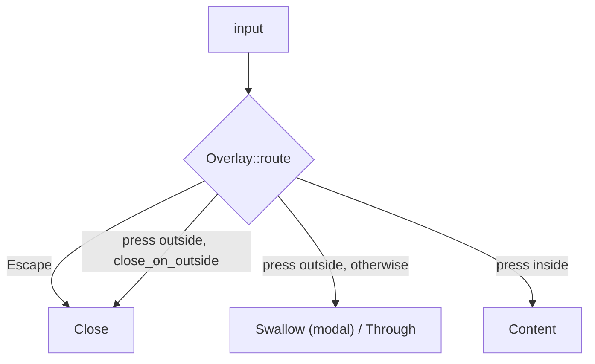

# Dialog

libadwaita: [`Dialog`](https://gnome.pages.gitlab.gnome.org/libadwaita/doc/main/class.Dialog.html)

## What it is

A container over its parent window: a centered floating dialog, or a bottom sheet by available size (1.5).

## Behavior

- Not resizable. `content-width`, `content-height`, `follows-content-size`. Never larger than the parent window.
- `can-close`, `close-attempt`. Closes by button or shortcut. The header bar shows the dialog title and only a close button.
- Floating radius is `--window-radius` (15 px). Shadow and dim layer per shadows.md.
- The backdrop dims the window. A floating dialog has a shadow.

CSS node: `dialog`.

## A dialog is not a window

It is a layer over its parent. The parent is faded and disabled. The library opens no OS window for a dialog. An app that wants a dialog in its own window opens it itself. A window that must outlive the main window is a separate process (`window::Detached`).

## iced mapping

`dialog_in_window(base, dialog, on_backdrop, radius)`. Width is `Fill` up to a maximum with a 12 px margin, so it fits a 360 px window. `on_backdrop: None` makes a press outside do nothing. Radius 15 (`Metrics::radius_window`).

## Overlay

`widget::Overlay::new(base, layer)` is the layer under every dialog and every overlay `Dock`.

| Param              | Meaning                                              | Default |
| ------------------ | ---------------------------------------------------- | ------- |
| `scrim`            | fade the base                                        | on      |
| `modal`            | the base takes no input                              | on      |
| `on_outside`       | message for a press outside                          | none    |
| `docked(side, size)` | dock the layer to an edge instead of centering it  | centered |
| `along(length, align)` | length and place along that edge                 | whole edge |
| `margin`           | px off the docked edge                               | 0       |
| `initial_focus`    | child that takes focus                               | first   |
| `window_radius`    | rounds the fade to the window corners                | 0       |

- `close_on_outside` (default true) is in the rules (`primitives::overlay::Overlay`). A press outside sends `on_outside`. The app decides what that does: a dialog closes, a window may only come forward.
- The layer is a focus scope ([focus](focus.md)): Tab stays inside, the first field takes focus, closing returns focus to what had it.
- `overlay_stack` nests layers. `primitives::overlay::Stack` sends Escape to the top layer only and marks lower modal layers inert.
- `Popover` with `Presentation::Dialog`, and the pickers' `dialog(true)`, use the same rules: scrim on, `close_on_outside` true.

## Deviations

No exit animation (the app unmounts the dialog).
