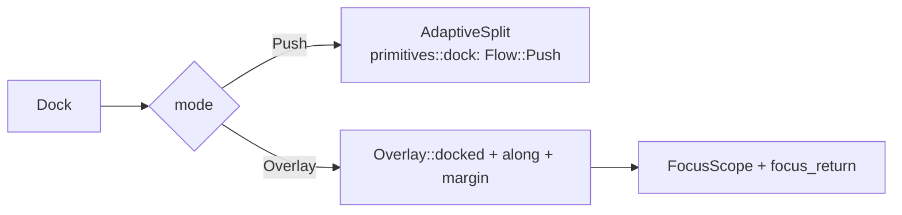

# Dock

libadwaita: [`BottomSheet`](https://gnome.pages.gitlab.gnome.org/libadwaita/doc/main/class.BottomSheet.html) is the bottom case. A footer, a banner and a drawer are the others.

## What it is

A surface docked to an edge of a base. One widget for a bottom sheet, a drawer, a footer bar and a banner. An overlay dock is a dialog attached to an edge.

## Parameters

| Param        | Values                                                      | Default      |
| ------------ | ----------------------------------------------------------- | ------------ |
| `side`       | `Bottom`, `Top`, `Left`, `Right`                            | `Bottom`     |
| `size`       | across the edge: `Auto`, `Fixed(px)`, `Fraction(f)`, `FullScreen` | `Auto` |
| `length`     | along the edge: same values                                 | `FullScreen` |
| `align`      | position of a shorter dock: `Start`, `Center`, `End`        | `Start`      |
| `margin`     | px off the docked edge, that edge only                      | `0` (flush)  |
| `mode`       | `Push`, `Overlay`                                           | `Push`       |
| `scope`      | `Content`, `Window`                                         | `Content`    |
| `border`     | hairline on non-flush sides                                 | on           |
| `scrim`      | fade the base (`Overlay`)                                   | on           |
| `open`       | show it                                                     | `true`       |
| `on_outside` | message for a press outside (`Overlay`)                     | none         |
| `initial_focus` | child that takes focus on opening (`Overlay`)            | first        |

## Behavior

- **Flush.** `margin` 0: the surface sits on the edge, edge to edge along it. A margin lifts it off that edge only. Its corners on that edge round.
- **FullScreen.** `size(FullScreen)` covers the base. Every border is flush: no margin, no border, square corners (the window radius for a window dock).
- **Border.** One pixel, in the border color, on the sides that are not flush:
  - the docked edge, once it stands off;
  - the opposite side, when `size` does not reach it;
  - the ends along the edge, when the dock is shorter and not aligned to that end.
- **Push.** In flow. It slides in and the base gives up exactly the room it takes. It takes the whole edge; `length`, `align`, `margin` and `border` do not apply. Same geometry as the split-view sidebar.
- **Overlay.** Over a faded, disabled base, on an [Overlay](dialog.md#overlay). It slides in from its edge on the sheet spring. A press outside sends `on_outside`.
- **Scope.** `Window` docks to the window: corners on the window's corners take `window_radius`. Wrap the window's root for it. `Content` docks to the base as given.
- **Open.** `open(bool)` shows or hides it. The base keeps its place in the tree.



```rust
Dock::new(root, sheet)
    .open(self.open)
    .mode(DockMode::Overlay)
    .scope(DockScope::Window)
    .on_outside(Msg::Close)
```

## iced mapping

`Push` is `AdaptiveSplit` with `side` and `extent`. The geometry is `primitives::dock` (`arrange`, `Flow`). `Overlay` is `widget::Overlay::docked(side, size).along(length, align).margin(px)`. The panel's inner corners take the theme radius. The border is drawn around the surface's bounds grown past the flush sides and clipped, so those sides stay open.

## Deviations

No drag handle, no drag to dismiss, no bottom bar. It animates in only.
