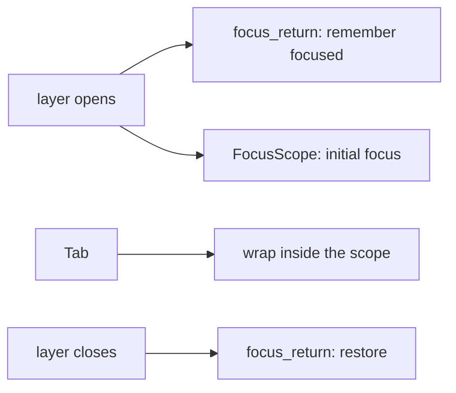

# FocusScope and focus_return

No libadwaita widget: GTK has focus chains and `AdwDialog` handles focus itself. After Mantine's [`use-focus-trap`](https://mantine.dev/hooks/use-focus-trap/), [`use-focus-return`](https://mantine.dev/hooks/use-focus-return/) and [`use-focus-within`](https://mantine.dev/hooks/use-focus-within/). The rules are `primitives::focus`.

## What it is

Keyboard focus for part of the window. iced only has each widget's `Focusable` state, in tree order. These wrappers read and set which focusable widget inside them is focused. No ids are needed, except to name an initial one.

## Parameters

| Param              | Meaning                                         | Default |
| ------------------ | ----------------------------------------------- | ------- |
| `trap(bool)`       | Tab and Shift+Tab wrap inside                   | on      |
| `auto_focus(bool)` | take focus when the scope appears               | on      |
| `initial_focus(id)` | the child that takes it, by widget id          | first   |
| `on_focus_change(f)` | focus entered (`true`) or left (`false`)      | none    |

`focus_return(content, active)` wraps a base and its layer. When `active` turns off, focus goes back to what had it when it turned on, once.

## Behavior

- **Trap.** `trap_step(focused, total, dir)`. Tab goes to the next, Shift+Tab to the previous. Both wrap. With nothing focused, Tab goes to the first and Shift+Tab to the last.
- **Initial focus.** `initial_focus(id)` resolves to a place in the scope (`index_of`). Give the child the same id: `entry(..).id(id)`. An id that is not found falls back to the first.
- **Components take `initial_focus`.** `Overlay`, `Dock` and `Popover` pass it to the scope they make. `ColorInput` declares its code entry.
- **Every `Overlay` is a trap with initial focus and a return.** So is every dialog and overlay dock.
- **Search bar.** The gallery's search is a scope with `trap(false)`: the field takes focus when the search opens.



```rust
FocusScope::new(entry("Search", &self.q).id("search").on_input(Msg::Q))
    .trap(false)
    .initial_focus("search")
```

## iced mapping

Wrapper widgets that run a probe (count focusables, read ids, find the focused one) and a focusing operation from `update`.

## Deviations

iced buttons are not focusable. Entries and editors are.
