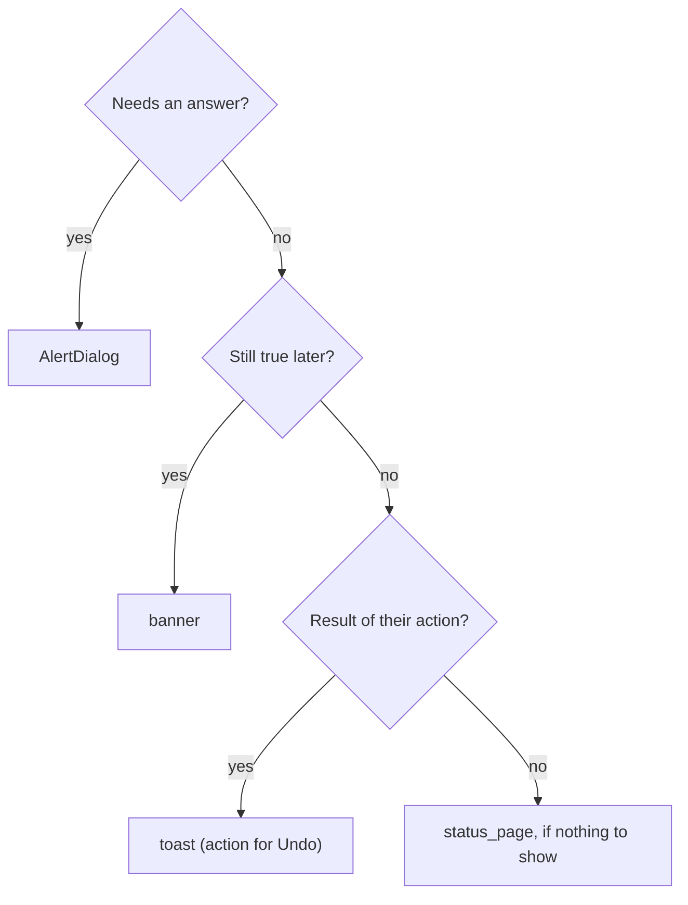

# Choosing components

Pick by the job. The API of a component is its man page, `iad-<alias>(3)` (see the [README](README.md)). The gallery shows its states: `cargo run -p iced-adaptive-design-gallery`.

## Telling the user something

| Need                                  | Use                             | Why                                   |
| ------------------------------------- | ------------------------------- | ------------------------------------- |
| A problem that stays                  | `banner`                        | Stays until fixed. One action.        |
| A short result of their action        | `toast` (add `action` for Undo) | Dismisses itself. Never the only record. |
| Several results at once               | `toast_stack`                   | One column, newest nearest the edge.  |
| A question that needs an answer       | `AlertDialog`                   | Blocks. 2–3 responses.                |
| Nothing to show, or an error state    | `status_page`                   | Explain. Offer one action.            |

A toast is never the only way to learn something important. Use a banner or a dialog.

## Overlays

| Need                                          | Use                                              |
| --------------------------------------------- | ------------------------------------------------ |
| Block the window for a decision or short task | a dialog: `dialog_in_window`, `AlertDialog`, …   |
| A task that belongs to the current page       | `Dock`, `DockMode::Overlay`, bottom (a sheet)    |
| A drawer on a side                            | `Dock`, `DockMode::Overlay`, left or right       |
| A pane that makes room for itself             | `Dock`, `DockMode::Push`                         |
| A choice that does not interrupt              | popover or menu                                  |
| Pick a date or a color                        | `DateInput`, `ColorInput` (popover, or `dialog(true)`) |

- Commands go in a `Menu`. Values go in a `dropdown` or `ComboRow`.
- Dialogs and overlay docks fade and disable what is behind them. A press outside closes them (`close_on_outside`, default on).
- A dialog is not an OS window. See [windows and menus](windows-and-menus.md).

## Choosing a value

| Need                                   | Use                                                  |
| -------------------------------------- | ---------------------------------------------------- |
| One on/off setting                     | `Switch`, in a `SwitchRow` in settings (applies at once) |
| One choice in a form submitted later   | `check_button`; one of a few: `radio_button`        |
| One of 2–4 short options, always shown | `toggle_group`                                       |
| One of more or longer options          | `dropdown`, `ComboRow`                               |
| An exact number                        | `NumberInput`, `SpinRow`                             |
| An approximate number                  | `scale`, `SliderRow`                                 |
| A range                                | `range_slider`; add two `NumberInput`s for exact ends |
| A date, a date range                   | `DateInput`, `DateRangeInput`                        |
| A color                                | `ColorInput`; an accent: `accent_picker`             |
| An action with alternatives            | `split_button`; if the alternative changes what the button does: `SplitButtonAction` |

Disable what is unavailable. Do not hide it. Say why in a subtitle when it is not obvious.

`NumberInput` takes `decimals(n)` (fixed point, never float), `min`, `max`, `step`. Dragging on it changes the value: up raises it. Shift is ten times, Alt is the last digit. `drag(NumberDrag::Select)` makes dragging select text instead.

## Text

`EntryRow::text` for one line, `EntryRow::multiline` for growing paragraphs, and `EntryRow::number`, `date`, `switch`, `select`, `multiselect` or `chips` for application forms. `EntryRow::new(label, EntryInput::Custom(input))` composes a custom input. Low-level `entry`, `password_entry` and `text_view` components are for building custom widgets.

## Settings and lists

- `PreferencesPage` > `PreferencesGroup` > rows. One group per topic, each with a title.
- A row that opens something has a chevron. A row that toggles has the control on it.
- Rows that belong to one row: `ExpanderRow`.
- `boxed_list` for any list of rows. Anything else goes in a `Card`.

## Buttons

- `suggested`: the one main action of a view.
- `destructive`: only for data loss.
- Flat in toolbars. `pill` for a standalone call to action. `link_button` for going to a place.
- Text buttons use verbs. Icon buttons need a tooltip.

## Navigation

| Need                              | Use                                           |
| --------------------------------- | --------------------------------------------- |
| Top-level destinations            | `SidebarList` in a `NavigationSplitView`      |
| Peer views of the same content    | `view_switcher`                               |
| Many open documents               | `Tabs`                                        |
| A location you can go up from     | `path_bar`                                    |
| A few steps                       | `carousel`                                    |

## Colors

State and status come from `Role` (accent, success, warning, error, destructive), never from fixed hues. See [theming](theming.md).
