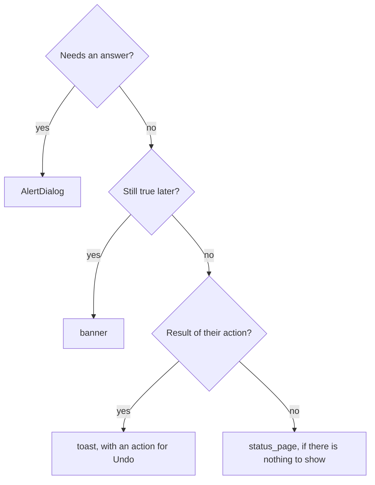

# Choosing components

Pick by the job, then check the [gallery](../../examples/gallery/README.md) for the states.

#### Telling the user something

| Need | Use | Why |
|---|---|---|
| A persistent problem on the page | `banner` | Stays until fixed; one action |
| A brief result of something they did | `toast` (add `action` for Undo) | Self-dismissing; never the only record |
| Several results at once | `toast_stack` | One column, newest nearest the edge |
| A question needing an answer | `AlertDialog` | Blocks, with 2-3 responses |
| Nothing to show yet or an error state | `status_page` | Explain and offer one action |

A toast must not be the only way to learn something important; use a banner or dialog for that.

#### Overlays

* **Dialog** (`dialog_in_window`): blocks the window for a decision or short task.
* **Bottom sheet**: a task that belongs to the current page, mostly on narrow windows.
* **Popover / menu**: a choice that does not interrupt; use `Menu` for commands, `dropdown` or
  `ComboRow` for choosing a value.

#### Choosing a value

* One on/off setting: `Switch` (in a `SwitchRow` for settings, applies immediately).
* One choice in a form that is submitted later: `check_button`; one of a few: `radio_button`.
* One of 2-4 short options, always visible: `toggle_group`; more or longer: `dropdown` / `ComboRow`.
* A number: `scale` for approximate, `SpinRow` for exact.
* An action with alternatives: `split_button`; where the alternative *changes what the button
  does* (merge, squash, rebase): `SplitButtonAction`.
* Disable what is unavailable instead of hiding it, and show why in a subtitle when it is not obvious.

#### Text

`entry` for one line, `password_entry`, `text_view` for paragraphs. Mark validation with
`EntryState`, not a custom color. In settings use `EntryRow`.

#### Settings and lists

* Preferences: `PreferencesPage` > `PreferencesGroup` > rows. One group per topic, a title on each.
* A row that opens something has a chevron; a row that toggles has the control on the row.
* More rows that belong to one: `ExpanderRow`.
* `boxed_list` for any list of rows; put anything else in a `Card`.

#### Buttons

* `suggested` for the one main action per view, `destructive` only for data loss, flat in
  toolbars, `pill` for a standalone call to action, `link_button` for navigation to a place.
* Text buttons use verbs; icon buttons need a tooltip.

#### Navigation

* Top-level destinations: sidebar (`SidebarList`) in a `NavigationSplitView`.
* Peer views of the same content: `view_switcher`; many open documents: `tab_bar`.
* A location you can move up: `path_bar`. A few steps: `carousel`.

#### Colors

State and status come from `Role` (accent, success, warning, error, destructive), never from
fixed hues; see [theming.md](theming.md).
