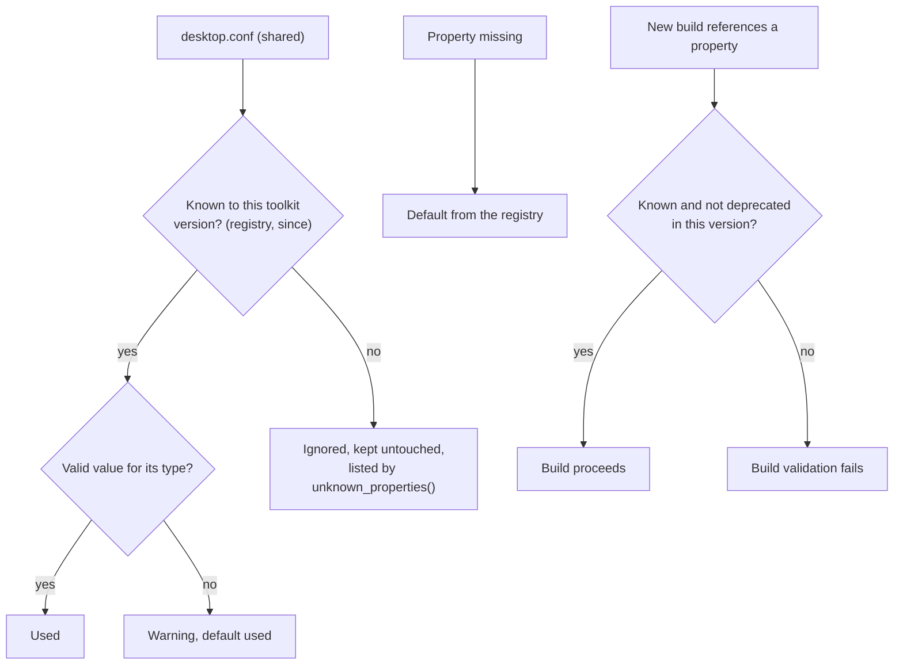

# Configuration registry

The shared desktop configuration ([desktop-config.md](desktop-config.md)) is read by many
applications at once, each linked statically against its own toolkit version. The **versioned
registry** (`config_history`, `PROPERTIES`) is what keeps that safe. It is read-only and bundled
with the toolkit.

#### What it records

| Metadata | Purpose |
|---|---|
| `section`, `key` | the property identifier |
| `ty` | the value type: `Bool`, `Number { min, max }`, `Choice([...])`, `Text` |
| `default` | the value used when the property is missing |
| `since` | the first toolkit version that supports it |
| `deprecated` | the first version in which **new builds** must not reference it |
| `replacement` | a newer property to use instead; informational only |

#### Rules

* An application reads **only the properties its bundled toolkit knows** (those with `since` at or
  below its version).
* **Unknown properties are ignored, never deleted or rewritten.** A newer toolkit may have written
  them. They are not warnings; `Config::unknown_properties()` lists them for a settings tool.
* **Missing properties use their defaults.** Invalid values of known properties are warnings and
  fall back to the default.
* **Deprecation never removes historical support.** An application built with an older toolkit
  keeps using the property. Releases only append to the registry and set `deprecated`.
* **New builds that reference a deprecated property fail validation**
  (`validate_build_properties`, called from a `build.rs`). So do builds that reference a property the toolkit does not know.
* **No automatic translation or migration** between a deprecated property and its replacement.
  Different toolkit generations may use independent values.
* A user's `desktop.conf` is runtime input, not a build artifact: it is never validated at build
  time and never fails a build.

#### Keeping it honest

The tests tie the registry to the parser: every registered property is read with its own default
without a warning, and a file made of all the defaults reads back as the built-in defaults.
Every animation trigger must have a `[motion]` entry. When you add a property to the parser, add it
to the registry in the same change.

A settings UI can list the active properties as the latest and the historical ones as deprecated,
with their version metadata.
