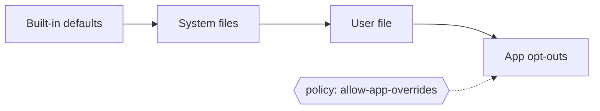

# Desktop config

Desktop behavior is set once per desktop, in a shared file, so every iced-adaptive-design app behaves the same. Apps read these settings. They do not hard-code them. Code: `iced_adaptive_design::config`. Sample: [desktop.ron.example](desktop.ron.example). Man page: `iad-desktop.ron(5)`.

## Where and in what order

[RON](https://github.com/ron-rs/ron): a map of sections to maps of keys, `//` comments (see `desktop.ron.example`). Numbers are numbers and flags are booleans. Lowest to highest priority:

1. built-in defaults (the HIG defaults)
2. system files: `$XDG_CONFIG_DIRS/iced-adaptive-design/desktop.ron` (default `/etc/xdg`)
3. the user file: `$XDG_CONFIG_HOME/iced-adaptive-design/desktop.ron` (`~/.config`)
4. the app's opt-outs, if the desktop allows them



An app that needs its own look (custom colors, paddings, tokens for its own objects) uses the [app theme config](theme-config.md), not an opt-out.

Later wins per key. `ICED_ADAPTIVE_DESIGN_CONFIG=/path.ron` replaces 2 and 3 with one file (testing). Invalid or unknown values are ignored with a warning (`Config::warnings`).

## Settings

Defaults are in parentheses. Every key is optional.

### `[appearance]`

| Key                                          | Values                                    | Drives                                               |
| -------------------------------------------- | ----------------------------------------- | ---------------------------------------------------- |
| `color-scheme`                               | system, light, dark (system)              | `Theme::from_config`. System follows the settings portal, then shared toolkit settings |
| `accent`                                     | system, a name, `#rrggbb` (system)        | the accent. System is the default (blue) for now   |
| `flat-headerbars`                            | bool (true)                               | continuous, Nautilus-style header bars               |
| `density`                                    | comfort, compact                          | `Metrics`                                            |
| `text-scale`                                 | 0.5 … 3.0 (1.0)                           | `Typography` base size                               |
| `transparency`                               | 0 … 1 (0)                                 | `Theme::with_transparency`: surface alpha            |
| `tint`                                       | none, `#rrggbb`, `#rrggbbaa` (none)       | `Theme::with_tint`: a color mixed into surfaces, its alpha the strength |
| `shadows`, `shadow-scale`, `shadow-intensity` | true, 1.0, 1.0                           | `Shadows`                                            |

### `[motion]`

| Key                                                                                                   | Values                  | Drives                                         |
| ----------------------------------------------------------------------------------------------------- | ----------------------- | ---------------------------------------------- |
| `animations`                                                                                          | system, on, off (system) | `animation::enabled()`                        |
| `reduced-motion`                                                                                      | bool (false)            | every trigger resolves to `none`               |
| `page-change`, `page-push`, `popover`, `selection`, `drawer`, `dialog`, `sheet`, `toast`, `reveal`, `switch`, `carousel`, `layout` | default, none (default) | that trigger's animation                       |
| `transition-close`, `transition-open`                                                                 | ms (30)                 | `transition::Budgets::current()`               |
| `tooltip-delay`                                                                                       | ms (1000)               | how long the pointer rests before a tooltip shows |

`sheet` is the slide and fade of an overlay `Dock`. `layout` is the sidebar sliding at a breakpoint.

### `[window-decorations]`

| Key                | Values                          | Drives                                          |
| ------------------ | ------------------------------- | ----------------------------------------------- |
| `decorations`      | csd, ssd (csd)                  | `windows::settings()`; transparent base for csd  |
| `button-layout`    | system, a GTK-style string (system) | `DecorationLayout::detect()`: a fixed value here, else the theme's `[window-decorations] button-layout`, else `appmenu:close` |
| `min-width`, `min-height` | px (360, 200)            | minimum window size                             |
| `mobile-max-width` | px (575, `sm` − 1)              | `breakpoints::is_mobile`, menu `Auto`                |

### `[breakpoints]`

| Key                           | Values                                  | Drives                                                          |
| ----------------------------- | --------------------------------------- | --------------------------------------------------------------- |
| `sm`, `md`, `lg`, `xl`, `xxl` | px (576, 768, 992, 1200, 1400), increasing | `breakpoints::WidthClass`. Mobile and collapse widths follow `sm − 1`, `md − 1` |

### `[navigation]`

| Key                                                          | Values            | Drives                                                   |
| ------------------------------------------------------------ | ----------------- | -------------------------------------------------------- |
| `collapse-width`                                             | px (767, `md` − 1) | `NavigationSplitView::adapt`: collapse at or below      |
| `min-content-width`                                          | px (520)          | also collapse when the content would be narrower         |
| `sidebar-fraction`, `sidebar-min-width`, `sidebar-max-width` | 0.25, 180, 280    | sidebar width: fraction of the window, clamped           |
| `drawer-max-fraction`                                        | 0.85              | most of the window a drawer takes                        |

### `[layout]`

| Key               | Values                          | Drives                                           |
| ----------------- | ------------------------------- | ------------------------------------------------ |
| `page-max-width`  | px (600)                        | readable width of pages and preference lists     |
| `mobile-sidebar`  | drawer, parent-page (drawer)    | `NavigationSplitView` default                    |

### `[menus]`, `[shortcuts]`

| Section     | Key            | Values                             | Drives                                                      |
| ----------- | -------------- | ---------------------------------- | ----------------------------------------------------------- |
| `[menus]`   | `presentation` | auto, dropdown, full-page (auto)   | `MenuPresentation::resolve`                                 |
| `[shortcuts]` | `enabled`    | bool (true)                        | shortcuts work and are shown                                |
| `[shortcuts]` | `hints`      | auto, always, never (auto)         | accelerator hints in menus. Auto hides them in the touch full-page menu |

### `[toasts]`, `[popovers]`

| Section      | Key        | Values                                                                              | Drives                                           |
| ------------ | ---------- | ----------------------------------------------------------------------------------- | ------------------------------------------------ |
| `[toasts]`   | `timeout` | integer milliseconds, 0–4294967295 (3000); 0 disables auto-dismiss | `Toast::timeout` default |
| `[toasts]`   | `position` | top-left, top-center, top-right, bottom-left, bottom-center, bottom-right (bottom-center) | `Toast::position` default                  |
| `[toasts]`   | `target`   | window, content (content)                                                           | where `toast_overlay` is placed                  |
| `[popovers]` | `bounds`   | content, window (content)                                                           | `Popover::bounds` default: the content area a popover opened from, or the window |

### `[rows]`, `[icons]`, `[policy]`

| Section     | Key                   | Values                    | Drives                                                        |
| ----------- | --------------------- | ------------------------- | ------------------------------------------------------------- |
| `[rows]`    | `collapse`            | stacked, flex (stacked)   | a wrapped suffix                                              |
| `[rows]`    | `wrap-basis`          | px (128)                  | when a suffix wraps                                           |
| `[rows]`    | `expander-indent`     | px (24)                   | indent of rows in an `ExpanderRow`. `ExpanderRow::indent(px)` overrides per row; 0 is libadwaita's |
| `[icons]`   | `theme`               | system, a name (system)   | system icon lookup for every widget                                    |
| `[policy]`  | `allow-app-overrides` | bool (true)               | may apps opt out                                              |

Every number used for adaptive layout is a named fallback constant (`breakpoints::MD`, `widgets::MIN_CONTENT_WIDTH`, `widgets::SIDEBAR_MAX_WIDTH`). The config overrides it. Widgets read the installed config, never the constant.

## Using it

```rust
iad::config::install(iad::config::Config::load());     // once, at startup
let theme = iad::Theme::from_config(&iad::config::current());
let presentation = iad::widgets::MenuPresentation::resolve(window_width);
```

Widgets read the installed config themselves: `Metrics::desktop()`, mobile breakpoint, animation switch, button layout, icon theme, mobile sidebar default. Without one, libadwaita's defaults apply. Reload with `Config::load()` and `install` (on a timer or a file watch).

## Opting out

Discouraged, not forbidden. An app overrides a setting explicitly:

```rust
let cfg = iad::config::Config::load().opt_out(|o| {
    o.mobile_sidebar(iad::CollapsedSidebar::FullPage);   // ignores the user's choice
});
iad::config::install(cfg);
```

The app then differs from every other app and ignores what the user set. Keep it rare.

- It is never silent: `install` prints one line to stderr. `Config::overridden()` lists the settings.
- A desktop forbids it with `[policy] allow-app-overrides=false`. The opt-outs are ignored and listed in `Config::denied()`.
- A widget's own setter for a desktop-level behavior (`.collapsed_sidebar(..)`) is the same kind of opt-out.

Icon selection uses `[icons] theme`: an installed XDG theme name, or `system` to follow shared toolkit settings (falling back to `hicolor`). Theme changes take effect after configuration installation and redraw, invalidating cached lookups. See [system icons](icons.md).

## Shared theme utilities

The library's `utils` module provides one application setup path:

- `utils::theme()` builds a `Theme` from the installed global configuration.
- `utils::theme_settings()` returns the effective color scheme and icon-theme name.
- Run `utils::detect_theme().map(Message::SystemTheme)` at startup.
- Include `utils::follow_theme().map(Message::SystemTheme)` in the application's subscription; handling that message redraws with `utils::theme()`.

Color-scheme detection uses iced's native settings/portal integration: the portal's light/dark is the only thing the toolkit reads from the system. Nothing is read from GSettings or GTK settings files. The icon theme, window button layout and animations come from the config (`[icons] theme`, `[window-decorations] button-layout`, `[motion] animations`), and the look itself from a theme file (see `theme-config.md`). Fixed values in global configuration remain authoritative. The gallery uses the same API for its header System/Light/Dark button.

`components::ThemeToggle::new(mode).on_toggle(Message::Appearance)` cycles `ThemeMode::System` (the default), `Light`, `Dark`, then back to `System`. Handle it with `utils::set_scheme_override(mode.scheme_override())`; `utils::theme()` and `Theme::from_config` then use that app-level choice. `set_scheme_override(None)` resumes following the desktop. This process-local override never changes desktop preferences or writes the shared configuration, and respects `allow-app-overrides`.
