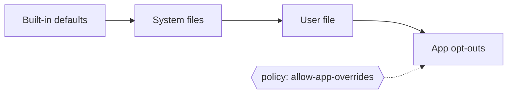

# Desktop config

Desktop-level behavior is defined **once per desktop**, in a shared config file, so every
iced-libadwaita app behaves the same way. Apps do not hard-code these decisions; they read them.
`iced_libadwaita::config`; example file: [desktop.conf.example](desktop.conf.example).

## Where and in what order

GLib key-file format (`[section]` / `key=value`, `#` comments), no dependencies. Lowest to highest priority:

1. built-in defaults (the HIG defaults);
2. system files: `$XDG_CONFIG_DIRS/iced-libadwaita/desktop.conf` (default `/etc/xdg`);
3. the user file: `$XDG_CONFIG_HOME/iced-libadwaita/desktop.conf` (`~/.config`);
4. the **app's opt-outs**, if the desktop allows them.



Later files win per key. `ICED_LIBADWAITA_CONFIG=/path.conf` replaces 2 and 3 with one file
(testing). Invalid or unknown values are ignored with a warning (`Config::warnings`).

## Settings

| Section | Key | Values (default) | Drives |
|---|---|---|---|
| appearance | `color-scheme` | system / light / dark (system) | `Theme::from_config` (system = `color-scheme`) |
| | `accent` | system / blue … slate (system) | accent (system = GNOME `accent-color`) |
| | `flat-headerbars` | bool (true) | continuous Nautilus-style header bars |
| | `auto-contrast` | bool (true) | text on colored fills chosen by contrast (CSS `color-contrast()`) |
| | `density` | default / compact | `Metrics` used by all widgets |
| | `text-scale` | 0.5 … 3.0 (1.0) | `Typography` base size |
| | `shadows`, `shadow-scale`, `shadow-intensity` | true, 1.0, 1.0 | `Shadows` |
| motion | `animations` | system / on / off (system) | `animation::enabled()` |
| | `reduced-motion` | bool (false) | every trigger resolves to `none` (prefers-reduced-motion) |
| | `page-change`, `page-push`, `popover`, `selection`, `drawer`, `dialog`, `sheet`, `toast`, `reveal`, `switch`, `carousel`, `layout` | default / none (default) | that trigger's animation, per [motion triggers](../hig-inferences/design-language/animations.md#triggers) |
| windows | `decorations` | csd / ssd (csd) | `window::settings()`, transparent base |
| | `button-layout` | system / GTK string (system) | `DecorationLayout::detect()` |
| breakpoints | `sm`, `md`, `lg`, `xl`, `xxl` | px (576, 768, 992, 1200, 1400; must increase) | `breakpoints::WidthClass`; mobile and collapse widths follow `sm - 1`, `md - 1` |
| windows | `mobile-max-width` | px (575, just under the `sm` breakpoint) | `window::is_mobile`, menu `Auto` |
| navigation | `collapse-width` | px (767, just under `md`) | `NavigationSplitView::adapt`: collapse at or below |
| | `min-content-width` | px (520) | the sidebar also collapses when the content would be narrower |
| | `sidebar-fraction`, `sidebar-min-width`, `sidebar-max-width` | 0.25, 180, 280 | sidebar width: fraction of the window, clamped |
| | `drawer-max-fraction` | 0.85 | the most of the window a drawer may take |
| windows | `min-width`, `min-height` | px (360, 200) | `window::settings()` minimum size |
| layout | `page-max-width` | px (600) | the readable width pages and preference lists are clamped to |
| | `mobile-sidebar` | drawer / first-page (drawer) | `NavigationSplitView` default |
| menus | `presentation` | auto / dropdown / full-page (auto) | `MenuPresentation::resolve` |
| shortcuts | `enabled` | bool (true) | keyboard shortcuts work and are shown at all |
| | `hints` | auto / always / never (auto) | accelerator hints in menus; auto hides them in the touch full-page menu |
| toasts | `position` | top-left / top-center / top-right / bottom-left / bottom-center / bottom-right (bottom-center) | `Toast::position` default |
| | `target` | window / content (content) | `widget::toast_target()`: where the app places `toast_overlay` |
| rows | `collapse` | stacked / flex (stacked) | rows' wrapped suffix |
| | `wrap-basis` | px (128) | when a suffix wraps |
| icons | `theme` | system / name (system) | window-control icon lookup |
| policy | `allow-app-overrides` | bool (true) | may apps opt out? |

Every number the library uses for adaptive layout is a **fallback constant** in code (named, e.g.
`breakpoints::MD`, `widget::MIN_CONTENT_WIDTH`, `widget::SIDEBAR_MAX_WIDTH`) that the config overrides.
Widgets read the installed config, never the constant directly.

## Using it

```rust
adw::config::install(adw::config::Config::load());     // once, at startup
let theme = adw::Theme::from_config(&adw::config::current());
let presentation = adw::widget::MenuPresentation::resolve(window_width);
```

Widgets read the installed config themselves (`Metrics::desktop()`, mobile breakpoint, animation
switch, button layout, icon theme, mobile sidebar default). Not installing one means libadwaita's
defaults. Reload by calling `Config::load()` + `install` again (e.g. on a timer or file watch).

## Opting out (highly discouraged, not forbidden)

An app that needs custom or fixed behavior overrides a setting explicitly:

```rust
let cfg = adw::config::Config::load().opt_out(|o| {
    o.mobile_sidebar(adw::CollapsedSidebar::FullPage);   // ignores the user's choice
});
adw::config::install(cfg);
```

This makes the app behave differently from every other app on the desktop and ignores what the user
configured, so it should be rare and justified. It is never silent: `install` prints one line to
stderr, and `Config::overridden()` lists the opted-out settings. A desktop can forbid opt-outs
with `[policy] allow-app-overrides=false`: they are then ignored and listed in `Config::denied()`.
Using a widget's own setter for a desktop-level behavior (e.g. `.collapsed_sidebar(..)`) is the
same kind of opt-out.
