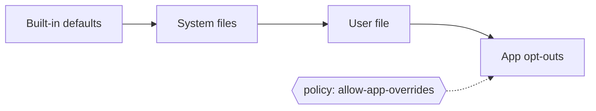

# Desktop config

Desktop behavior is set once per desktop, in a shared file, so every iced-adaptive-design app behaves the same. Apps read these settings. They do not hard-code them. Code: `iced_adaptive_design::config`. Sample: [desktop.conf.example](desktop.conf.example). Man page: `iad-desktop.conf(5)`.

## Where and in what order

GLib key-file format: `[section]`, `key=value`, `#` comments. No dependencies. Lowest to highest priority:

1. built-in defaults (the HIG defaults)
2. system files: `$XDG_CONFIG_DIRS/iced-adaptive-design/desktop.conf` (default `/etc/xdg`)
3. the user file: `$XDG_CONFIG_HOME/iced-adaptive-design/desktop.conf` (`~/.config`)
4. the app's opt-outs, if the desktop allows them



An app that needs its own look (custom colors, paddings, tokens for its own objects) uses the [app theme config](theme-config.md), not an opt-out.

Later wins per key. `ICED_ADAPTIVE_DESIGN_CONFIG=/path.conf` replaces 2 and 3 with one file (testing). Invalid or unknown values are ignored with a warning (`Config::warnings`).

## Settings

Defaults are in parentheses. Every key is optional.

### `[appearance]`

| Key                                          | Values                                    | Drives                                               |
| -------------------------------------------- | ----------------------------------------- | ---------------------------------------------------- |
| `color-scheme`                               | system, light, dark (system)              | `Theme::from_config`. System reads GNOME's `color-scheme` |
| `accent`                                     | system, a name, `#rrggbb` (system)        | the accent. System reads GNOME's `accent-color`      |
| `flat-headerbars`                            | bool (true)                               | continuous, Nautilus-style header bars               |
| `auto-contrast`                              | bool (true)                               | text on colored fills by contrast (`color-contrast()`) |
| `density`                                    | comfort, compact                          | `Metrics`                                            |
| `text-scale`                                 | 0.5 … 3.0 (1.0)                           | `Typography` base size                               |
| `transparency`                               | 0 … 1 (0)                                 | `Theme::with_transparency`: surface alpha            |
| `tint`                                       | none, `#rrggbb`, `#rrggbbaa` (none)       | `Theme::with_tint`: a color mixed into surfaces, its alpha the strength |
| `shadows`, `shadow-scale`, `shadow-intensity` | true, 1.0, 1.0                           | `Shadows`                                            |

### `[motion]`

| Key                                                                                                   | Values                  | Drives                                         |
| ----------------------------------------------------------------------------------------------------- | ----------------------- | ---------------------------------------------- |
| `animations`                                                                                          | system, on, off (system) | `animation::enabled()`                        |
| `reduced-motion`                                                                                      | bool (false)            | every trigger resolves to `none`               |
| `page-change`, `page-push`, `popover`, `selection`, `drawer`, `dialog`, `sheet`, `toast`, `reveal`, `switch`, `carousel`, `layout` | default, none (default) | that trigger's animation                       |
| `transition-close`, `transition-open`                                                                 | ms (30)                 | `transition::Budgets::current()`               |

`sheet` is the slide and fade of an overlay `Dock`. `layout` is the sidebar sliding at a breakpoint.

### `[windows]`

| Key                | Values                          | Drives                                          |
| ------------------ | ------------------------------- | ----------------------------------------------- |
| `decorations`      | csd, ssd (csd)                  | `windows::settings()`; transparent base for csd  |
| `button-layout`    | system, a GTK string (system)   | `DecorationLayout::detect()`                    |
| `min-width`, `min-height` | px (360, 200)            | minimum window size                             |
| `mobile-max-width` | px (575, `sm` − 1)              | `breakpoints::is_mobile`, menu `Auto`                |

### `[breakpoints]`

| Key                           | Values                                  | Drives                                                          |
| ----------------------------- | --------------------------------------- | --------------------------------------------------------------- |
| `sm`, `md`, `lg`, `xl`, `xxl` | px (576, 768, 992, 1200, 1400), increasing | `breakpoints::WidthClass`. Mobile and collapse widths follow `sm − 1`, `md − 1` |

### `[navigation]`

| Key                                                          | Values            | Drives                                                   |
| ------------------------------------------------------------ | ----------------- | -------------------------------------------------------- |
| `collapse-width`                                             | px (767, `md` − 1) | `NavigationSplitView::adapt`: collapse at or below      |
| `min-content-width`                                          | px (520)          | also collapse when the content would be narrower         |
| `sidebar-fraction`, `sidebar-min-width`, `sidebar-max-width` | 0.25, 180, 280    | sidebar width: fraction of the window, clamped           |
| `drawer-max-fraction`                                        | 0.85              | most of the window a drawer takes                        |

### `[layout]`

| Key               | Values                          | Drives                                           |
| ----------------- | ------------------------------- | ------------------------------------------------ |
| `page-max-width`  | px (600)                        | readable width of pages and preference lists     |
| `mobile-sidebar`  | drawer, parent-page (drawer)    | `NavigationSplitView` default                    |

### `[menus]`, `[shortcuts]`

| Section     | Key            | Values                             | Drives                                                      |
| ----------- | -------------- | ---------------------------------- | ----------------------------------------------------------- |
| `[menus]`   | `presentation` | auto, dropdown, full-page (auto)   | `MenuPresentation::resolve`                                 |
| `[shortcuts]` | `enabled`    | bool (true)                        | shortcuts work and are shown                                |
| `[shortcuts]` | `hints`      | auto, always, never (auto)         | accelerator hints in menus. Auto hides them in the touch full-page menu |

### `[toasts]`, `[popovers]`

| Section      | Key        | Values                                                                              | Drives                                           |
| ------------ | ---------- | ----------------------------------------------------------------------------------- | ------------------------------------------------ |
| `[toasts]`   | `position` | top-left, top-center, top-right, bottom-left, bottom-center, bottom-right (bottom-center) | `Toast::position` default                  |
| `[toasts]`   | `target`   | window, content (content)                                                           | where `toast_overlay` is placed                  |
| `[popovers]` | `bounds`   | content, window (content)                                                           | `Popover::bounds` default: the content area a popover opened from, or the window |

### `[rows]`, `[icons]`, `[policy]`

| Section     | Key                   | Values                    | Drives                                                        |
| ----------- | --------------------- | ------------------------- | ------------------------------------------------------------- |
| `[rows]`    | `collapse`            | stacked, flex (stacked)   | a wrapped suffix                                              |
| `[rows]`    | `wrap-basis`          | px (128)                  | when a suffix wraps                                           |
| `[rows]`    | `expander-indent`     | px (24)                   | indent of rows in an `ExpanderRow`. `ExpanderRow::indent(px)` overrides per row; 0 is libadwaita's |
| `[icons]`   | `theme`               | system, a name (system)   | window-control icon lookup                                    |
| `[policy]`  | `allow-app-overrides` | bool (true)               | may apps opt out                                              |

Every number used for adaptive layout is a named fallback constant (`breakpoints::MD`, `widgets::MIN_CONTENT_WIDTH`, `widgets::SIDEBAR_MAX_WIDTH`). The config overrides it. Widgets read the installed config, never the constant.

## Using it

```rust
iad::config::install(iad::config::Config::load());     // once, at startup
let theme = iad::Theme::from_config(&iad::config::current());
let presentation = iad::widgets::MenuPresentation::resolve(window_width);
```

Widgets read the installed config themselves: `Metrics::desktop()`, mobile breakpoint, animation switch, button layout, icon theme, mobile sidebar default. Without one, libadwaita's defaults apply. Reload with `Config::load()` and `install` (on a timer or a file watch).

## Opting out

Discouraged, not forbidden. An app overrides a setting explicitly:

```rust
let cfg = iad::config::Config::load().opt_out(|o| {
    o.mobile_sidebar(iad::CollapsedSidebar::FullPage);   // ignores the user's choice
});
iad::config::install(cfg);
```

The app then differs from every other app and ignores what the user set. Keep it rare.

- It is never silent: `install` prints one line to stderr. `Config::overridden()` lists the settings.
- A desktop forbids it with `[policy] allow-app-overrides=false`. The opt-outs are ignored and listed in `Config::denied()`.
- A widget's own setter for a desktop-level behavior (`.collapsed_sidebar(..)`) is the same kind of opt-out.
