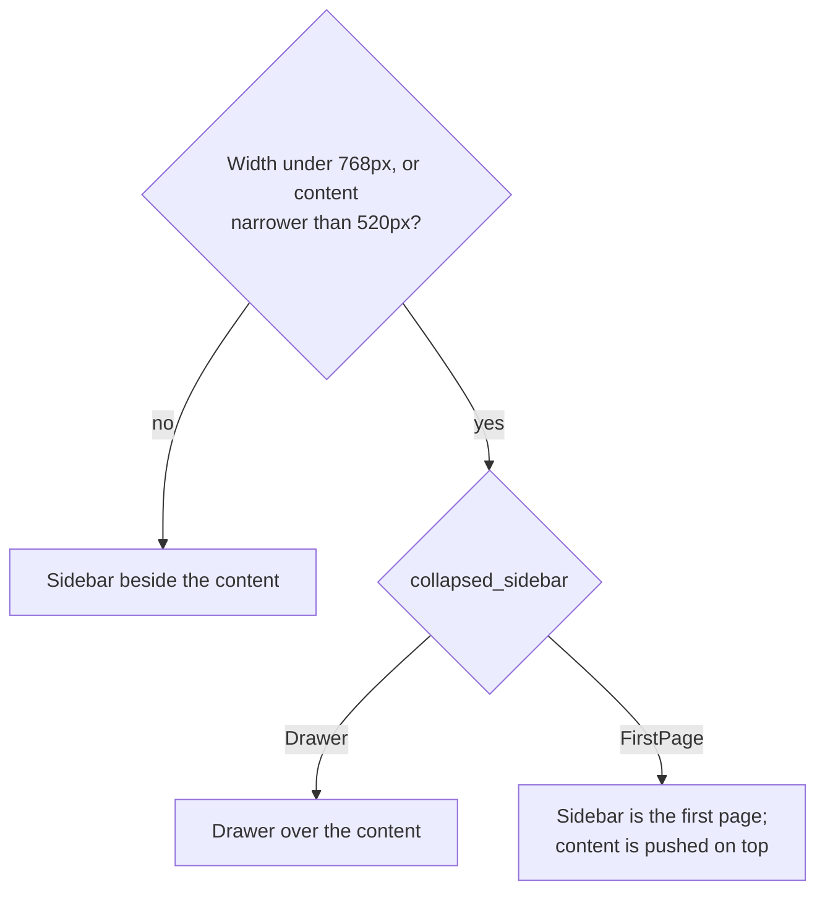

# Layout

#### Structure of a window

`toolbar_view(content).top_bar(header_bar())` is the unit; a `NavigationSplitView` puts a sidebar
unit beside a content unit, each with its own header bar. Page content goes in `page(..)` (scrolls,
is clamped to a readable width, has the standard padding) or `PreferencesPage` for settings.

#### Adapting to width

- Build the window with `responsive` and pass the width to `NavigationSplitView::adapt(width)`.
  The sidebar is 25% of the width clamped to 180-280 and **collapses below 768px (Bootstrap's
  `md`), or whenever the content beside it would be narrower than 520px**: content must never
  feel squeezed. Branch on `split_collapsed(width)` in your own layout so you agree with it.



- Collapsed, choose what the sidebar becomes: `Drawer` (default, over the content, never the whole
  screen) or `FirstPage` (the landing page of a stack, in the content color, content pushed on
  top with a back button). Use `FirstPage` for settings-like apps.
- Crossing a breakpoint is not a jump: the sidebar slides out of the layout (or in) on the same
  spring as the drawer, displacing the content instead of covering it (`Trigger::Layout`,
  `[motion] layout`). Every threshold is configurable (`[breakpoints]`, `[navigation]`); the
  constants are fallbacks. In `FirstPage` mode the flip is not animated.
- In `FirstPage` show the sidebar as `SidebarStyle::Cards` (rows with icon, title, description and
  chevron); beside the content or in a drawer use `SidebarStyle::List`.
- Mobile mode is `window::is_mobile(width)` (below 576px, Bootstrap's `sm`): hide window controls,
  use full-page menus. Width classes (`breakpoints::WidthClass`) follow Bootstrap/Mantine
  (576, 768, 992, 1200, 1400).

#### Choosing between layouts

When narrow and wide differ in kind (a bottom tab bar against a sidebar with actions in the
header), do not squeeze one set of widgets. Build each layout alone and let `adaptive` choose by
width class (`breakpoints::WidthClass`, so thresholds follow `[breakpoints]`):

```rust
let layouts = Layouts::new()
    .layout(..WidthClass::Md, Layout::Narrow)
    .layout(WidthClass::Md.., Layout::Wide);   // a tablet layout is one more entry
```

- Keep an `Adaptive` in your state; feed it `resize(width, now)` and the transition events, and
  render with `adaptive(&state).layout(key, || build())`: only the shown layout is built.
- It changes layout only after the width is 16px past a threshold (`.hysteresis(16.0)`, the
  default; `.hysteresis(Duration::from_millis(200))` waits instead for the new layout to hold),
  then runs
  `Close(old)` then `Open(new)` as an ordered [transition](motion.md#ordered-transitions)
  instead of cutting. `subscription` ticks only while a deadline is pending.
- Layouts hold visual state only. Current page and open overlays live in your state, so a layout
  change loses nothing. A page that exists in one layout only is the application's to handle:
  navigate when the close or open command names the layout being moved to.
- `NavigationSplitView::adapt` is still right for a sidebar that collapses; `adaptive` sits above
  it and picks whole layouts, one of which may contain a split view.
- `Adaptive::force(key)` pins a layout for a gallery or a test.

#### Rows and content

- Rows wrap their control below the title when they cannot share a line; the control then goes
  full width (`Stacked`, default) or keeps its size (`Flex`). Opt out per row with
  `wrap_suffix(false)`. Text wraps; it is never shrunk.
- `clamp(content, max)` keeps text lines readable on wide windows; `wrap_box` flows chips and
  buttons onto new lines.
- `Card` is one surface for any number of children; `Card::push` shares one border and shadow
  with hairlines between children, so do not stack cards to make a group.

#### Nested pages

When a topic has several distinct groups of options, give it its own page: a row with a chevron
in the parent list, a back button in the header. Do not make a page for a single control.
