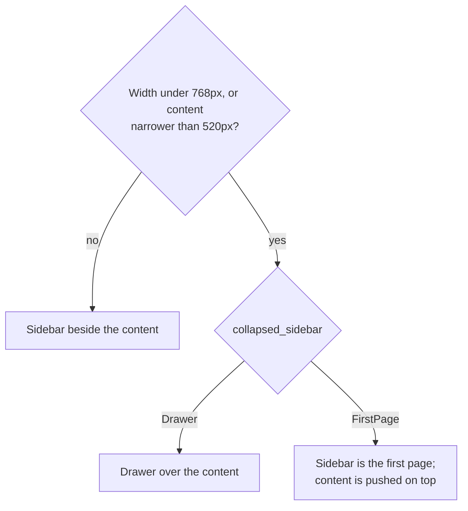

# Layout

#### Structure of a window

`toolbar_view(content).top_bar(header_bar())` is the unit; a `NavigationSplitView` puts a sidebar
unit beside a content unit, each with its own header bar. Page content goes in `page(..)` (scrolls,
is clamped to a readable width, has the standard padding) or `PreferencesPage` for settings.

#### Adapting to width

* Build the window with `responsive` and pass the width to `NavigationSplitView::adapt(width)`.
  The sidebar is 25% of the width clamped to 180-280 and **collapses below 768px (Bootstrap's
  `md`), or whenever the content beside it would be narrower than 520px**: content must never
  feel squeezed. Branch on `split_collapsed(width)` in your own layout so you agree with it.

* Collapsed, choose what the sidebar becomes: `Drawer` (default, over the content, never the whole
  screen) or `FirstPage` (the landing page of a stack, in the content color, content pushed on
  top with a back button). Use `FirstPage` for settings-like apps.
* Crossing a breakpoint is not a jump: the new layout fades in (`Trigger::Layout`, `[motion] layout`).
  Every threshold is configurable (`[breakpoints]`, `[navigation]`); the constants are fallbacks.
* In `FirstPage` show the sidebar as `SidebarStyle::Cards` (rows with icon, title, description and
  chevron); beside the content or in a drawer use `SidebarStyle::List`.
* Mobile mode is `window::is_mobile(width)` (below 576px, Bootstrap's `sm`): hide window controls,
  use full-page menus. Width classes (`breakpoints::WidthClass`) follow Bootstrap/Mantine
  (576, 768, 992, 1200, 1400).

#### Rows and content

* Rows wrap their control below the title when they cannot share a line; the control then goes
  full width (`Stacked`, default) or keeps its size (`Flex`). Opt out per row with
  `wrap_suffix(false)`. Text wraps; it is never shrunk.
* `clamp(content, max)` keeps text lines readable on wide windows; `wrap_box` flows chips and
  buttons onto new lines.
* `Card` is one surface for any number of children; `Card::push` shares one border and shadow
  with hairlines between children, so do not stack cards to make a group.

#### Nested pages

When a topic has several distinct groups of options, give it its own page: a row with a chevron
in the parent list, a back button in the header. Do not make a page for a single control.
