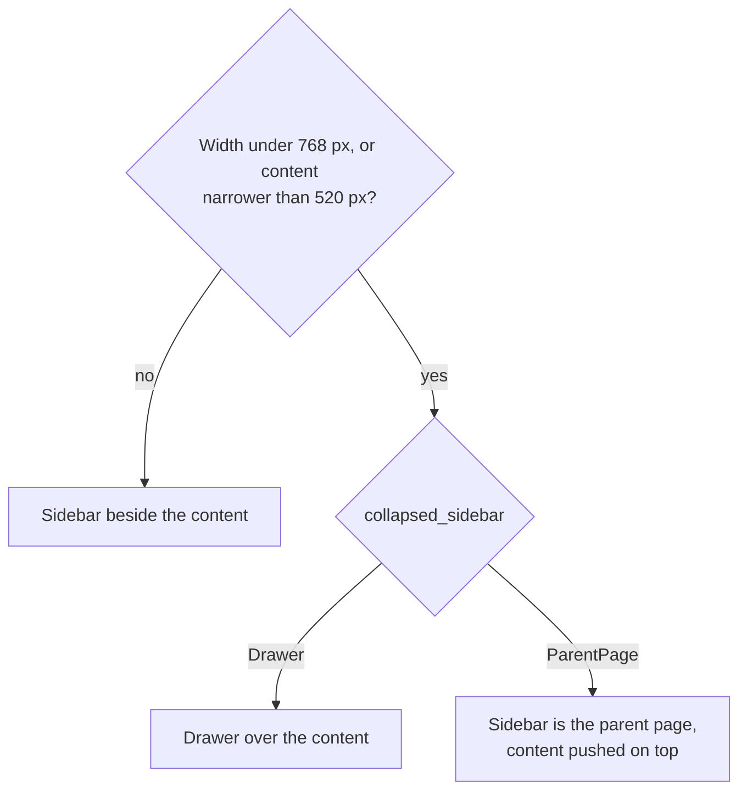
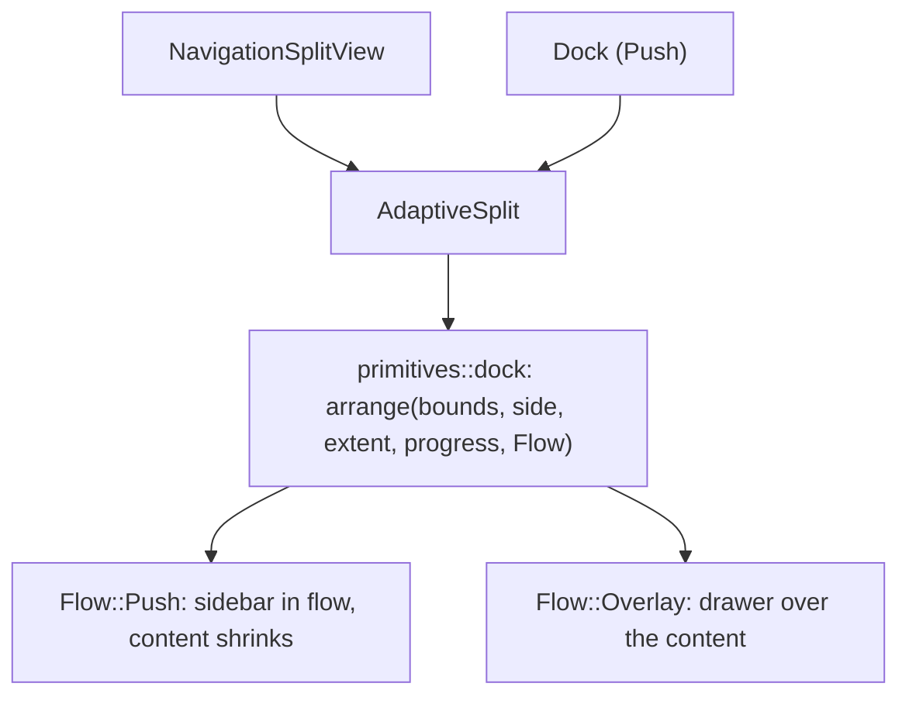

# Layout

## Structure of a window

`toolbar_view(content).top_bar(header_bar())` is the unit. A `NavigationSplitView` puts a sidebar unit beside a content unit, each with its own header bar. Page content goes in `page(..)` (scrolls, clamped to a readable width, standard padding) or `PreferencesPage` for settings.

## The sidebar



- Build the window with `responsive`. Pass the width to `NavigationSplitView::adapt(width)`.
- Sidebar width: 25% of the window, clamped to 180–280. A drawer takes at most 85%.
- It collapses below 768 px (Bootstrap `md`), or when the content beside it would be under 520 px. Branch on `split_collapsed(width)` in your own layout to agree with it.
- Collapsed: `Drawer` (default) slides over the content, never the whole window. `ParentPage` is the landing page of a stack: the sidebar in the content color, the content pushed on top with a back button. Use `ParentPage` for settings-like apps.
- Show the sidebar as `SidebarStyle::Cards` in `ParentPage` (icon, title, description, chevron). Use `SidebarStyle::List` beside the content or in a drawer.
- Crossing a breakpoint slides the sidebar out of or into the layout on the drawer's spring. The content gives way. It is not covered. (`Trigger::Layout`, `[motion] layout`.) In `ParentPage` the change is not animated.
- Every threshold is configurable: `[breakpoints]`, `[navigation]`. The constants are fallbacks.
- Mobile mode: `window::is_mobile(width)`, below 576 px (Bootstrap `sm`). Hide window controls. Use full-page menus.
- Width classes (`breakpoints::WidthClass`): 576, 768, 992, 1200, 1400.

### How it is built



- `AdaptiveSplit` holds the sidebar once and moves it between two places: in flow (`Flow::Push`) and drawer (`Flow::Overlay`). Both use the sidebar spring (damping 1, mass 0.5, stiffness 500).
- `side(Side)` puts the sidebar on any edge. `extent(Extent)` sizes it: `Auto`, `Px`, `Fraction`.
- The sidebar pane carries the sidebar color. Its outer corners take the window radius (`window_radius`).
- The list inside is `SidebarList`: rows from `SidebarItem`s, `SidebarPadding` `Sm`, `Md` (default), `Lg`. It is transparent; the pane supplies the color.
- A popover opened from the content stays in the content area (`content_area`), not under the sidebar.

```rust
let sidebar = SidebarList::new(items).window_radius(corner);
NavigationSplitView::new(sidebar, content)
    .adapt(width)
    .show_sidebar(self.drawer_open)
    .on_close_drawer(Msg::CloseDrawer)
    .window_radius(corner)
```

## Choosing between layouts

When narrow and wide differ in kind (a bottom tab bar against a sidebar with actions in the header), do not squeeze one set of widgets. Build each layout alone. `adaptive` picks by width class:

```rust
let layouts = Layouts::new()
    .layout(..WidthClass::Md, Layout::Narrow)
    .layout(WidthClass::Md.., Layout::Wide);   // a tablet layout is one more entry
```

- Keep an `Adaptive` in your state. Feed it `resize(width, now)` and the transition events. Render with `adaptive(&state).layout(key, || build())`. Only the shown layout is built.
- It changes only after the width is 16 px past a threshold (`.hysteresis(16.0)`; `.hysteresis(Duration::from_millis(200))` waits instead). Then it runs `Close(old)` then `Open(new)` as an ordered [transition](motion.md#ordered-transitions).
- Layouts hold visual state only. Current page and open overlays live in your state, so a change loses nothing. A page that exists in one layout only is the app's to handle: navigate when the command names the layout being moved to.
- `NavigationSplitView::adapt` is for a sidebar that collapses. `adaptive` sits above it and picks whole layouts. One of them may contain a split view.
- A layout declares the widths it supports. The width picks the first layout whose range holds it, and keeps the current one while its range still does.
- `Adaptive::pin(Some(key))` is accepted only where `key`'s range holds the width (`Err(OutOfRange)` otherwise). A resize out of the range drops the pin. `pin(None)` releases it. `force(key)` skips the checks (gallery, tests).
- `SidebarList::follow(&adaptive, |layout| (style, padding))` ties the sidebar's presentation to the layout shown: roomy `Lg` rows in a mobile drawer, dense `Sm` on desktop. Describe the destinations once.

The gallery's Layout page has an AppShell (header, navbar, drawer, footer) with three layouts. It opens in its own process. The drawer is a `Dock`: from the right on desktop, a bottom sheet elsewhere (`DockMode::Overlay`).

## Docks

`Dock` attaches a surface to an edge. See [windows and menus](windows-and-menus.md#dock).

| Need                                   | Dock                                          |
| -------------------------------------- | --------------------------------------------- |
| Pane beside the content                | `Push`, left or right, `Fixed` size           |
| Footer or banner                       | `Push`, bottom or top                         |
| Bottom sheet                           | `Overlay`, bottom                             |
| Floating bar                           | `Overlay`, `length`, `align`, `margin`        |
| Full-window layer                      | `Overlay`, `FullScreen`                       |

## Rows and content

- Rows wrap their control below the title when they cannot share a line. The control goes full width (`Stacked`, default) or keeps its size (`Flex`). Opt out per row: `wrap_suffix(false)`. Text wraps. It is never shrunk.
- `clamp(content, max)` keeps lines readable on wide windows. `wrap_box` flows chips and buttons onto new lines.
- `Card` is one surface for any number of children. `Card::push` shares one border and shadow with hairlines between children. Do not stack cards to make a group.

## Nested pages

When a topic has several groups of options, give it a page: a chevron row in the parent list, a back button in the header. Not for a single control.
