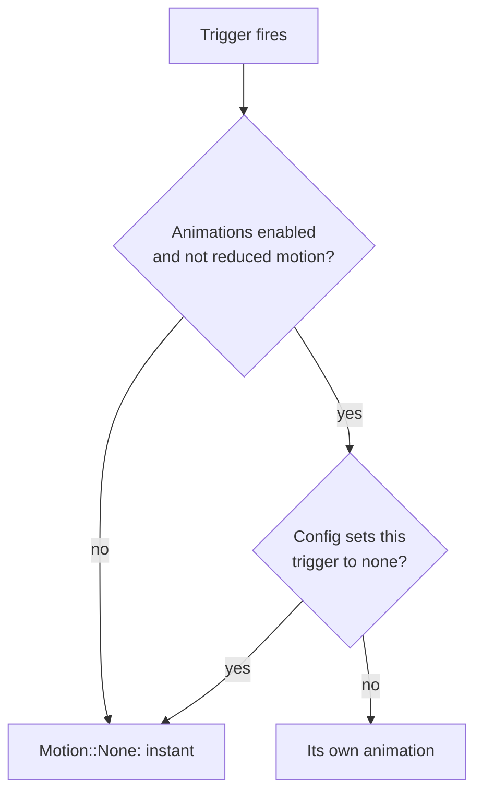

# Motion

Motion explains change; it should be quick and never required to understand the interface.

* Components animate themselves (switch, reveal, drawer, dialogs, sheets, toasts, popovers,
  page changes, navigation push, carousel). The app needs no subscription or timers.
* Every animation is a **trigger** with its own animation and a `None` fallback. Under reduced
  motion (`enable-animations` off, or `[motion] reduced-motion=true`) all triggers are `None` and
  changes are instant. Individual triggers can be set to `none` in the desktop config.
* Do not add animation in the app for things components already do. If you must animate
  something yourself, use `animation::Tween` with a `Spec`, and gate it with
  `Trigger::…::spec(..)` or `animation::enabled()` so reduced motion is respected.
* Use springs for things the user moves (drawer, sheet, carousel), short eased transitions for
  state changes.

Parameters and the full trigger table: [animations](../hig-inferences/design-language/animations.md).
