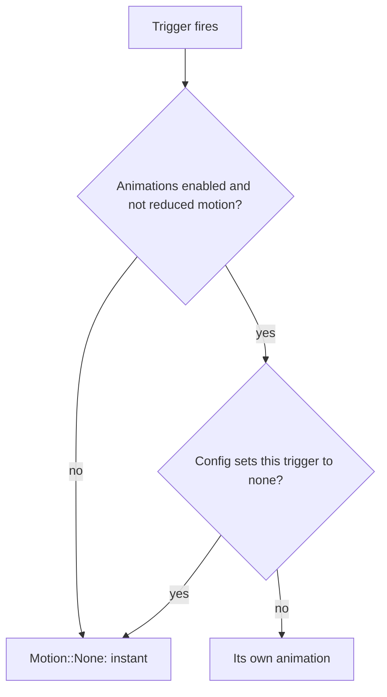
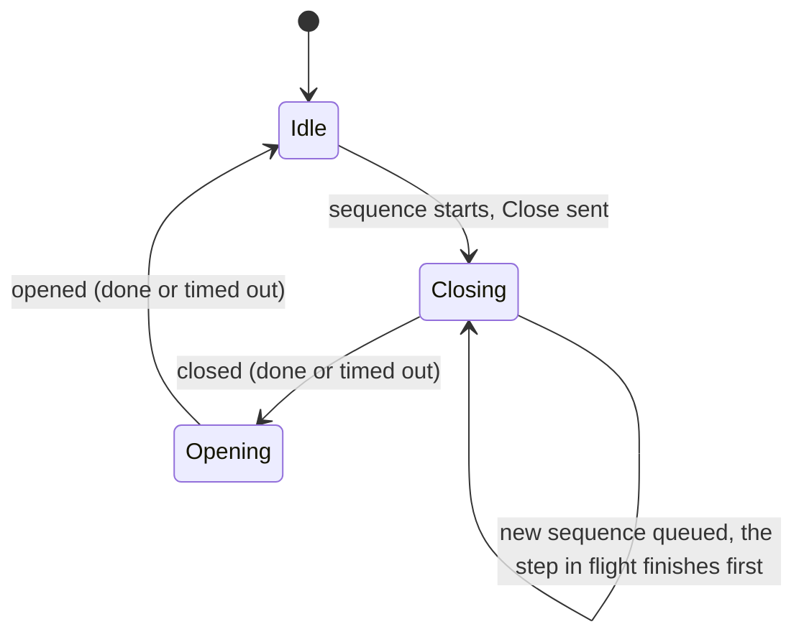

# Motion

Motion explains change. It is quick and never needed to understand the interface.

- Components animate themselves: switch, reveal, drawer, dialogs, docks, toasts, popovers, page changes, navigation push, carousel. The app needs no subscription or timers.
- Every animation is a trigger with its own animation and a `None` fallback. Under reduced motion (`[motion] animations=false`, or `[motion] reduced-motion=true`) all triggers are `None`: changes are instant. Set one trigger to `none` in the config to turn off only that one.
- Do not animate in the app what a component already animates. To animate something yourself, use `animation::Tween` with a `Spec`. Gate it with `Trigger::…::spec(..)` or `animation::enabled()`, so reduced motion is respected.
- Springs for things the user moves (drawer, dock, carousel). Short eased transitions for state changes.

Every trigger is a key of the `[motion]` section: see `iad-desktop.conf(5)`.

## Surfaces and hierarchical boundaries

`layouts::boundary::Boundary` is a widget in the actual iced tree, not a separate geometry tree. `Boundary::surface(container, style)` resolves the final style once for surface painting and clipping; apply layout props first and supply the effective style, including child presentation overrides. `Boundary::new(content, radius)` instead supplies explicit clipping geometry without a background.

During synchronous draw, update and mouse traversal, each boundary pushes a normalized `SurfaceShape` (bounds and four corner radii) onto a scoped ancestor stack. `current_surface()` reads the nearest surface; `current_boundary()` retains the intersection of every ancestor, not an independently guessed radius. Scopes restore between siblings and on unwind. There is no separate global persistent geometry registry. Because iced updates have no theme argument, a styled boundary keeps its last drawn radius in its own widget-tree state and combines it with current layout bounds; before its first draw, pointer targeting is disabled. Explicit-radius boundaries work immediately.

Nested boundaries constrain drawing and pointer targeting together. Translated motion maps inherited shapes into child coordinates. Hit tests use the analytic intersection; rendering uses conservative inward-rounded rectangular bands at **1 logical pixel** precision. This is a staircase approximation, not a native antialiased rounded mask. Rounded regions require repeated child draws/layers, so large radii and nested boundaries cost more; custom drawing must be replay-safe and honor the supplied viewport.

`Card` uses this shared surface contract: its final `container_props` style owns content clipping, border and elevation geometry, including asymmetric corners. The border paints after children and elevation stays outside the content clip; `container_props.clip(false)` cannot disable the boundary. A carousel inside a card inherits that boundary rather than guessing the card's corners.

Overlays are explicit **portals**: a boundary forwards them outside its ancestor surface stack, including nested overlays. A popup that needs clipping installs its own boundary. `with_portal` restores the previous scope afterward; it does not undo renderer layers already open, so portal drawing must occur separately.

## Target-specific effects

An ancestor boundary constrains a subtree; it does not reveal an arbitrary child's silhouette. Unknown targets receive no guessed foreground mask or validation ring. Share the target's final style resolver rather than copying a theme radius:

- `Entrance::container` and `PageTransition::container` apply the supplied container style and derive fade corners from that same resolver with the current theme. They replace the supplied container's style. `fade_shape` supplies explicit foreground bounds and four corners instead.
- `PushStack::containers` shares the root surface style with its dimmer; each page owns its actual background, border and shadow. `root_shape` supplies explicit root geometry. Plain `push_stack` adds no guessed backing or dimmer.
- `Highlight::button` composes selection through the native button style, retaining target-owned geometry. Floating indicators and validation outlines have their own target-specific resolvers; see [typed child presentation](child-props.md).

Foreground and background geometry are separate. `Entrance::scrim_shape` describes the background being dimmed, not the entering foreground. Opt-in `surface_scrim()` uses the nearest scoped parent surface and paints nothing outside such a scope; explicit scrim geometry takes precedence. It never supplies a foreground fade shape. Plain entrances do not dim automatically.

These fades are **window-color covers, not true composited opacity**. They suit known filled rounded-rectangle surfaces, not arbitrary transparent silhouettes or shadows; page transitions do not blend retained old and new pages. Without known foreground geometry, `entrance(...).fade()` and `page_transition(...)` draw content unmasked. Animation/input timing and page keys/scroll restoration remain independent of mask painting.

`Entrance::scrim(radius)` supplies background geometry only; it never determines foreground fade geometry. `DrawerLayer::window_radius(radius)` supplies explicit uniform scrim corners; free `highlight(...)` takes explicit corners. These are target-geometry inputs, not shape discovery. Push stacks use their targets' real backing and shadows, not synthetic compatibility surfaces.

Dialog `Popover` uses `scrim_shape` for actual background bounds/corners or `window_radius` for explicit uniform corners. Without either it paints no scrim, while modal input and dismissal remain unchanged. Pass the actual current window state, including square maximized/fullscreen geometry, rather than a floating-window metric.

## Ordered transitions

Components do not report when their animation ends, so "the old layout leaves, then the new one arrives" cannot use fixed delays. `transition` is a protocol and a state machine (`transition::Transitions`) that keeps the order and the time. It is plain data in your state. Every call takes the current `Instant`, so it needs no window to test.

| Direction             | Message                                     | Meaning                                                            |
| --------------------- | ------------------------------------------- | ------------------------------------------------------------------ |
| coordinator to target | `Close { target, within, closing_for, .. }` | Close within `within`; `closing_for` is the layout being moved to. |
| coordinator to target | `Open { target, within, opening_for, .. }`  | Open within `within`; `opening_for` is the layout being moved to.  |
| target to coordinator | `Closed` / `Opened { target, generation }`  | Done; sent once per command.                                       |

- The outcome is `Done` or `TimedOut`, decided by the coordinator, which owns the clock. At the deadline it **hard-closes** (stops rendering) or **hard-opens** (renders) the target itself, so a stuck target never blocks the next step. Any outcome lets the sequence continue; outcomes are only logged (`take_records`) for tuning budgets.
- Every command has a generation; a late, duplicate or unknown report is ignored.
- A zero budget (animations disabled, reduced motion, `layout=none`) settles in the same call.
- A sequence is steps, each one action or a group run together; its longest duration is known up front (`Sequence::budget`). A new sequence replaces steps that have not started but never interrupts the one in flight.
- Budgets are `[motion] transition-close` and `transition-open` (milliseconds, default 30).
- Use it for layouts. Popovers, docks and panels are components a layout uses. They animate themselves.
- State is the app's. The protocol moves layouts, not data. If a page cannot exist in the layout being moved to, the app navigates when it sees `closing_for` or `opening_for`.
