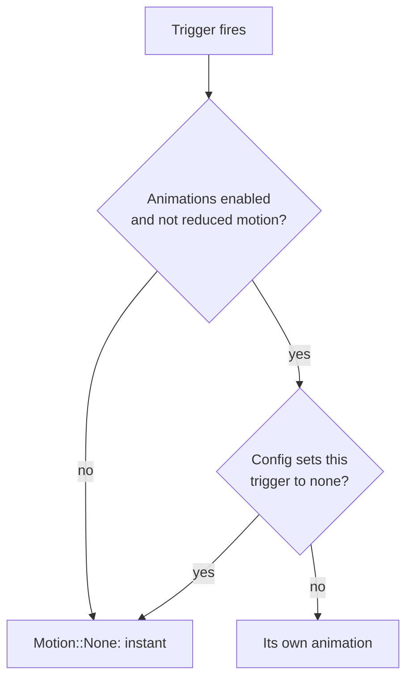
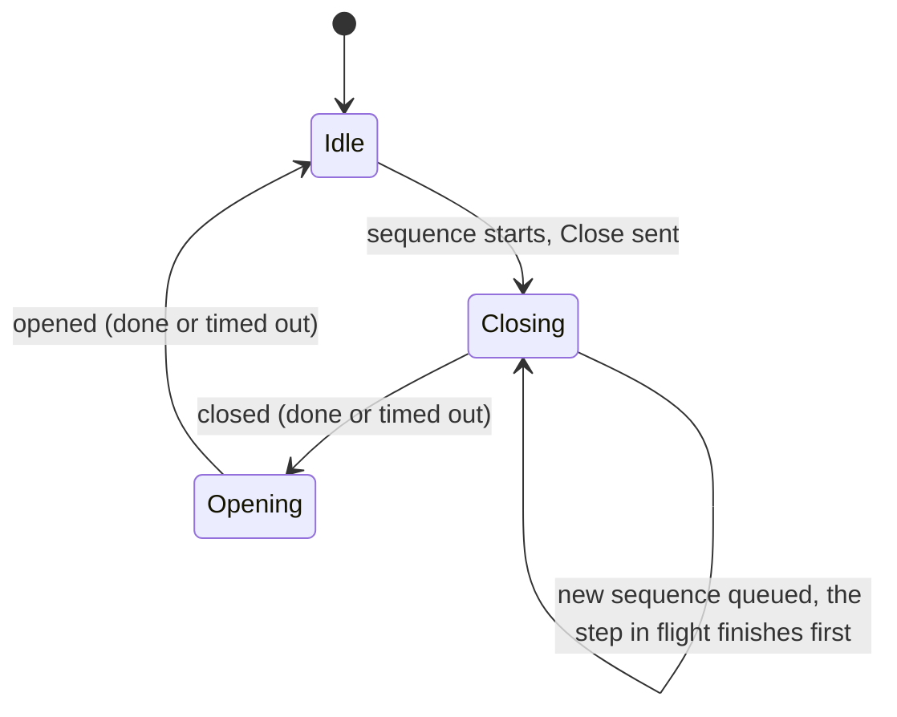

# Motion

Motion explains change. It is quick and never needed to understand the interface.

- Components animate themselves: switch, reveal, drawer, dialogs, docks, toasts, popovers, page changes, navigation push, carousel. The app needs no subscription or timers.
- Every animation is a trigger with its own animation and a `None` fallback. Under reduced motion (`enable-animations` off, or `[motion] reduced-motion=true`) all triggers are `None`: changes are instant. Set one trigger to `none` in the config to turn off only that one.
- Do not animate in the app what a component already animates. To animate something yourself, use `animation::Tween` with a `Spec`. Gate it with `Trigger::…::spec(..)` or `animation::enabled()`, so reduced motion is respected.
- Springs for things the user moves (drawer, dock, carousel). Short eased transitions for state changes.

Every trigger is a key of the `[motion]` section: see `iad-desktop.conf(5)`.

#### Ordered transitions

Components do not report when their animation ends, so "the old layout leaves, then the new one arrives" cannot use fixed delays. `transition` is a protocol and a state machine (`transition::Transitions`) that keeps the order and the time. It is plain data in your state. Every call takes the current `Instant`, so it needs no window to test.

| Direction             | Message                                     | Meaning                                                            |
| --------------------- | ------------------------------------------- | ------------------------------------------------------------------ |
| coordinator to target | `Close { target, within, closing_for, .. }` | Close within `within`; `closing_for` is the layout being moved to. |
| coordinator to target | `Open { target, within, opening_for, .. }`  | Open within `within`; `opening_for` is the layout being moved to.  |
| target to coordinator | `Closed` / `Opened { target, generation }`  | Done; sent once per command.                                       |

- The outcome is `Done` or `TimedOut`, decided by the coordinator, which owns the clock. At the deadline it **hard-closes** (stops rendering) or **hard-opens** (renders) the target itself, so a stuck target never blocks the next step. Any outcome lets the sequence continue; outcomes are only logged (`take_records`) for tuning budgets.
- Every command has a generation; a late, duplicate or unknown report is ignored.
- A zero budget (animations disabled, reduced motion, `layout=none`) settles in the same call.
- A sequence is steps, each one action or a group run together; its longest duration is known up front (`Sequence::budget`). A new sequence replaces steps that have not started but never interrupts the one in flight.
- Budgets are `[motion] transition-close` and `transition-open` (milliseconds, default 30).
- Use it for layouts. Popovers, docks and panels are components a layout uses. They animate themselves.
- State is the app's. The protocol moves layouts, not data. If a page cannot exist in the layout being moved to, the app navigates when it sees `closing_for` or `opening_for`.
