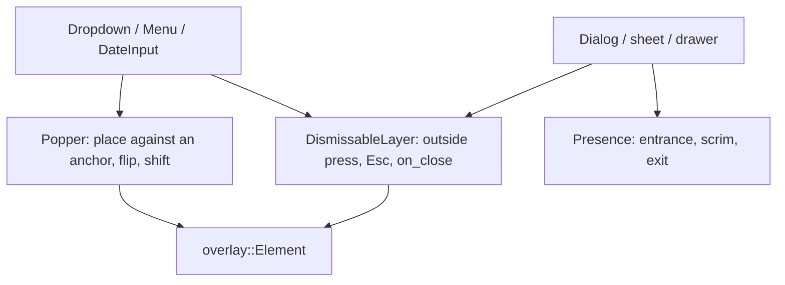

# Primitives

The headless half lives in `src/primitives/` (pure logic, no widgets: `Selection`, `When` and the responsive pick, and soon anchored placement and dismissal); `src/widget/` applies it to the screen. Components are built from a small set of primitives, in the manner of Radix UI: each primitive owns one behavior, is **controlled** (the app owns the state), and carries no look of its own. A component is a primitive plus a look. Before writing a component, find its primitives here; before writing a primitive, check that none of these does it.

| Group               | Primitive                                                         | What it owns                                                                    | Built on it                                                              |
| ------------------- | ----------------------------------------------------------------- | ------------------------------------------------------------------------------- | ------------------------------------------------------------------------ |
| **Disclosure**      | `Collapsible`, `reveal`                                           | Header always shown, body slides (250 ms)                                       | `ExpanderRow`, `Accordion`                                               |
| **Selection**       | `Selection`                                                       | Which keys are on: single (required or not) or multiple. Pure                   | `Accordion`; to adopt: `MultiSelect`, `ToggleGroup`, tabs, view switcher |
| **Validation**      | `validation` (`Validity`, `present`, `chain`)                     | When a field shows valid/invalid (`:user-invalid`: only once touched or submitted), required, chaining validators. Pure | `Field`; `Entry::presentation`                                           |
| **Responsive**      | `MetaComponent` + `Trigger` (breakpoint, selected, grouped with `|` `&` `!`), `Adaptive`                           | Which presentation to build, by container (meta) or window (adaptive) size      | `ResponsiveTable`, `SidebarList::cards_below`, app shell                 |
| **Surface**         | `Card`, `FlexRow`, `divider`                                      | One bordered/shadowed surface; two-slot wrapping line; hairlines                | rows, `boxed_list`, groups, cards                                        |
| **Motion**          | `Progress`, `Spec`, presets                                       | Springs and timed easing, reduced motion                                        | everything that animates                                                 |
| **Layering** (todo) | portal/overlay, anchored placement, dismissable layer, `entrance` | Drawing above the tree, placing beside an anchor, outside-press/Esc/scrim close | `Dropdown`, `Menu`, dialogs, sheets, toasts, `DateInput`, `MultiSelect`  |

#### Layering: the next refactor

`Dropdown` (its private `Popover` overlay), `Menu`, `drawer_layer`, `entrance`, `AdaptiveSplit` and `toast_overlay` each implement some of: render above the tree, position against an anchor or an edge, close on an outside press or Escape, fade a scrim. Radix splits these into **Portal**, **Popper** (anchored placement with flip and shift), **DismissableLayer** and **Presence**. The same split here:

The pure placement function (`widget::anchor`) is already being written for the anchored popover; the plan is that `Dropdown` and `Menu` take it, then a `DismissableLayer` is extracted from `Dropdown::Popover` and `drawer_layer`'s scrim handling.

#### Rules

- Logic goes in `src/primitives/` with its tests; a widget that needs a decision calls it rather than re-deriving it. Widget-level primitives (`Collapsible`, `MetaComponent`) are thin wrappers that apply one.
- A primitive has no style. Its component supplies colors, metrics and typography.
- Pure decisions (which presentation, which keys, where to place) are plain functions with unit tests; the widget only applies them.
- State is controlled: `open`, `selected`, `value` come in; `on_*` messages go out.
