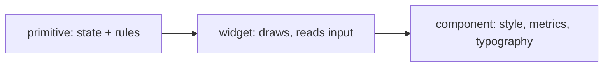
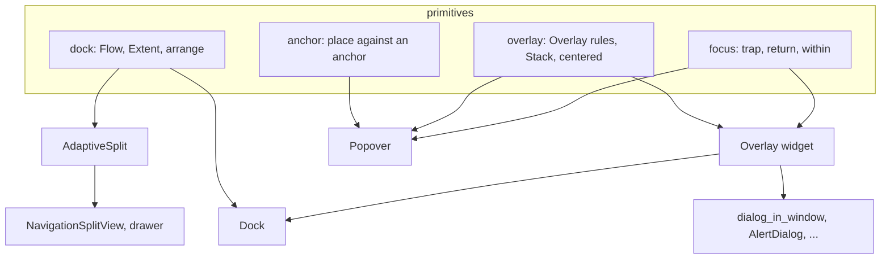

# Primitives

`src/primitives/` holds behavior with no widgets and no look. Each primitive is pure, controlled (the app owns the state) and unit-tested. A widget applies it. A component is a primitive plus a look.

Before you write a component, find its primitives here. Before you write a primitive, check that none does it.

| Module          | Owns                                                                                              | Used by                                          |
| --------------- | ------------------------------------------------------------------------------------------------- | ------------------------------------------------ |
| `selection`     | which keys are on: single, required single, multiple                                              | `toggle_group`, lists                            |
| `validation`    | when a field shows valid or invalid; chaining validators                                          | `Field`, `Form`, every input                     |
| `form`          | submit, reset, next, back; when errors reveal                                                     | `Form`, `Stepper`                                |
| `stepper`       | step statuses from an active index, click rules, connector fill                                   | `Stepper`, `Timeline`                            |
| `lookup`        | a query answered later: debounce, stale responses dropped, cache, highlight                       | `Autocomplete`                                   |
| `pagination`    | page, page size, "21–40 of 187", page-number window                                               | pagination                                       |
| `infinite`      | a list that grows by page: one request in flight, stale responses dropped                         | `InfiniteList`                                   |
| `loading`       | keys in flight with errors and retry; a list fetched in chunks                                    | `Tree`, tables                                   |
| `virtualize`    | which rows to build for a scroll offset, and the spacers                                          | `Tree`, `ResponsiveTable`                        |
| `sorting`       | asc, desc, unsorted; multi-column; stable sort                                                    | tables                                           |
| `tree`          | nodes, open branches, selection, checking, search, filter, keyboard                               | `Tree`, `TreeRow`                                |
| `reorder`       | draft order, preview and edit views, what a drag means                                            | `ReorderableList`                                |
| `tabs`          | which tab a click or arrow activates; skips disabled                                              | `Tabs`, segmented control                        |
| `splitter`      | panes with draggable handles: fixed and flex sizes, limits, collapse                              | `Splitter`                                       |
| `spoiler`       | show part of the height or data; build only what is shown                                         | `Spoiler`                                        |
| `resize`        | a handle drag as a size: grips, limits, snapping                                                  | `Resizable`                                      |
| `responsive`    | which presentation a width gets (`When`)                                                          | `MetaComponent`, adaptive layout                 |
| `meta`          | which variant shows; breakpoint or selection triggers                                             | `MetaComponent`                                  |
| `meta_parent`   | what each child announced; who a notification reaches                                             | `MetaParentComponent`                            |
| `synced`        | lines that carry a time: the one active at a position, where to scroll                            | `SyncedText`                                     |
| `histogram`     | values counted into bins over a range; which bins a selection covers                              | `BarChart::histogram`                            |
| `anchor`        | where a surface sits against an anchor: side, align, offset, flip, shift, size                    | `Popover`, `Menu`, `Anchored`                    |
| `dock`          | a panel on an edge: push or overlay, slide-in geometry on all four sides, extent                  | `AdaptiveSplit` (split view, drawer), `Dock`     |
| `overlay`       | a layer over another: scrim, modality, close on outside or Escape, a stack of layers, centering   | `Overlay`, `Dock`, `Popover` as dialog, dialogs  |
| `focus`         | Tab trap that wraps, initial focus, focus return, focus within                                    | `FocusScope`, `focus_return`, `Overlay`          |
| `numeric`       | fixed-point numbers (never float): parse, format, min, max, step, validate; drag scrub, precision | `NumberInput`                                    |
| `color_picker`  | a color as H, S, V, A; 8-bit RGB and HSL; text forms; parsing                                     | `ColorPicker`, `ColorInput`, `accent_picker`     |
| `date`          | dates, month math, parsing, validation (no dependencies)                                          | `DateInput`, `DateRangeInput`                    |
| `calendar`      | navigation by level: month, year, decade                                                          | `DateInput`, `DateRangeInput`                    |
| `range`         | a value with two ends: thumbs, collisions, `DateRange` (pick, text, parse)                        | `RangeSlider`, `DateRangeInput`                  |
| `sections`      | the space an input reserves for left and right sections                                           | `Entry`                                          |
| `notifications` | the queue behind stacked toasts                                                                   | `toast_stack_from`                               |
| `relative`      | wording for a distance in time, from an explicit `now`                                            | rows                                             |
| `animation`     | easing, timed and spring animation, `Tween`, `Progress`, `Trigger`                                | every animated widget                            |
| `transition`    | ordered close then open of layouts: `Sequence`, `Transitions`                                     | `adaptive`                                       |

## Overlay and dock

- `overlay::Overlay`: `scrim` (default true), `modal` (true), `close_on_outside` (true), `close_on_escape` (true). `route(input)` returns `Close`, `Content`, `Swallow` or `Through`.
- `overlay::Stack`: open layers, bottom to top. Escape goes to the top one. `inert(key)` is true for a layer covered by a modal one.
- `dock::arrange(bounds, side, extent, progress, Flow)` gives the panel, the visible part and the content rectangle. `Flow::Push` shrinks the content. `Flow::Overlay` does not.
- `focus::trap_step(focused, total, dir)` wraps. `focus::index_of(ids, target)` maps an `initial_focus` id to a place in the scope.

## Rules

- Animated widgets do not write their own frame loop or translate-and-clip. `Progress` holds the value, `motion::advance` runs it on each redraw and asks for the next frame or a relayout, `motion::draw_translated` draws a child sliding and gives it the right viewport.
- Logic goes in `src/primitives/` with its tests. A widget that needs a decision calls the primitive. It does not re-derive it. Widget-level helpers (`Collapsible`, `MetaComponent`) are thin wrappers that apply one.
- A primitive has no style. Its component supplies colors, metrics and typography.
- Fixed-point, not float, for anything the user types as a number.
