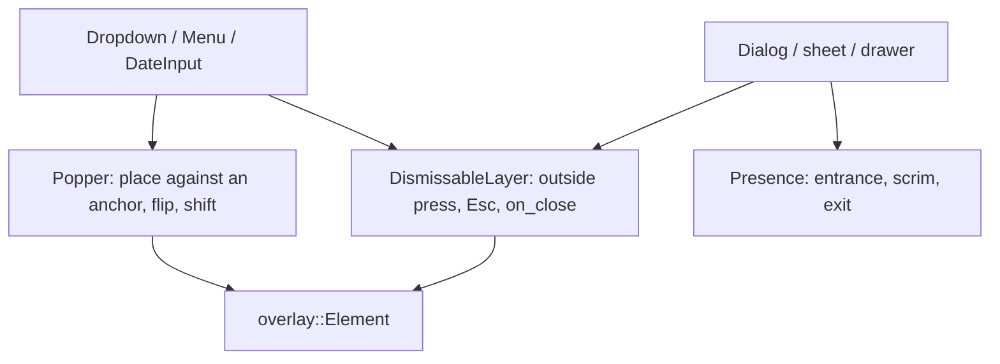

# Primitives

The headless half lives in `src/primitives/` (pure logic, no widgets: `selection`, `meta` and `responsive`, `validation`, `anchor`, `date`, `sections`); `src/widget/` applies it to the screen. Components are built from a small set of primitives, in the manner of Radix UI: each primitive owns one behavior, is **controlled** (the app owns the state), and carries no look of its own. A component is a primitive plus a look. Before writing a component, find its primitives here; before writing a primitive, check that none of these does it.

| Group               | Primitive (`src/primitives/`)                                              | What it owns                                                                                                | Built on it                                                                         |
| ------------------- | -------------------------------------------------------------------------- | ----------------------------------------------------------------------------------------------------------- | ----------------------------------------------------------------------------------- |
| **Disclosure**      | `Collapsible`, `reveal` (widgets)                                          | Header always shown, body slides (250 ms)                                                                   | `ExpanderRow`, `Accordion`                                                          |
| **Selection**       | `selection::Selection`                                                     | Which keys are on: single (required or not) or multiple                                                     | `Accordion`, `MultiSelect::selecting`; to adopt: `ToggleGroup`, tabs, view switcher |
| **Validation**      | `validation` (`Validity`, `Interaction`, `present`, `chain`)               | When a field shows valid/invalid (`:user-invalid`: only once touched or submitted), required, chained rules | `Field`, `Entry::presentation`, `DateInput::revealed`                               |
| **Responsive**      | `meta` (`Trigger`: breakpoint, selected, `\|` `&` `!`), `responsive::When` | Which variant shows: by container size, by app selection, or a group of both                                | `MetaComponent`, `ResponsiveTable`, `SidebarList::cards_below`                      |
| **Placement**       | `anchor::place` (side, align, offset, flip, shift)                         | Where a popover sits against its anchor and the viewport                                                    | `Dropdown`, `MultiSelect`, `DateInput`                                              |
| **Dates**           | `date` (`Date`, `parse`, `validate`, month grid)                           | Dependency-free calendar arithmetic and date validity                                                       | `DateInput`                                                                         |
| **Sections**        | `sections` (`slot_width`, `text_padding`)                                  | Space an entry reserves for its left/right sections                                                         | `Entry::left_section` / `right_section`                                             |
| **Surface**         | `Card`, `FlexRow`, `divider` (widgets)                                     | One bordered/shadowed surface; two-slot wrapping line; hairlines                                            | rows, `boxed_list`, groups, cards                                                   |
| **Motion**          | `Progress`, `Spec`, presets                                                | Springs and timed easing, reduced motion                                                                    | everything that animates                                                            |
| **Layering** (todo) | dismissable layer, presence/`entrance`                                     | Outside-press/Esc/scrim close, entrance and exit                                                            | `Dropdown`, `Menu`, dialogs, sheets, toasts, drawers                                |

#### Layering: what is left

`Dropdown` (its private `Popover` overlay), `Menu`, `drawer_layer`, `entrance`, `AdaptiveSplit` and `toast_overlay` each implement some of: render above the tree, position against an anchor or an edge, close on an outside press or Escape, fade a scrim. Radix splits these into **Portal**, **Popper** (anchored placement with flip and shift), **DismissableLayer** and **Presence**. The same split here:

Anchored placement is done (`primitives::anchor`, used by `Dropdown`); `Menu` has not adopted it. Next, a `DismissableLayer` is extracted from `Dropdown::Popover` and `drawer_layer`'s scrim handling.

#### Rules

- Logic goes in `src/primitives/` with its tests; a widget that needs a decision calls it rather than re-deriving it. Widget-level primitives (`Collapsible`, `MetaComponent`) are thin wrappers that apply one.
- A primitive has no style. Its component supplies colors, metrics and typography.
- Pure decisions (which presentation, which keys, where to place) are plain functions with unit tests; the widget only applies them.
- State is controlled: `open`, `selected`, `value` come in; `on_*` messages go out.
