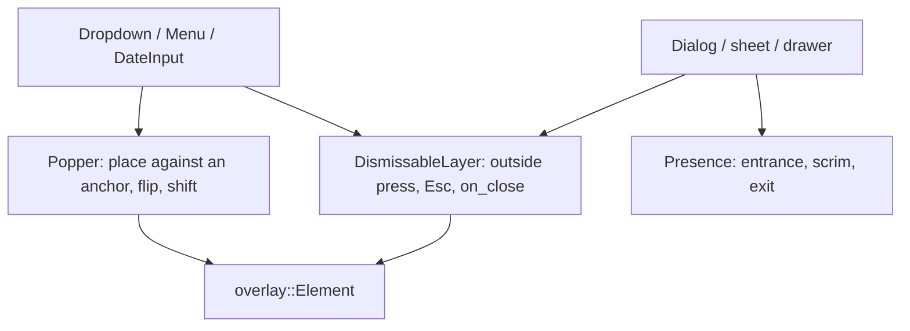

# Primitives

The headless half lives in `src/primitives/` (pure logic, no widgets: `selection`, `meta` and `responsive`, `validation`, `anchor`, `date`, `range`, `lookup`, `sections`, `stepper`, `notifications`, `relative`, `reorder`, `meta_parent`, `tabs`, `tree`, `virtualize`, `loading`); `src/widget/` applies it to the screen. Components are built from a small set of primitives, in the manner of Radix UI: each primitive owns one behavior, is **controlled** (the app owns the state), and carries no look of its own. A component is a primitive plus a look. Before writing a component, find its primitives here; before writing a primitive, check that none of these does it.

| Group               | Primitive (`src/primitives/`)                                                                                                                                                                                       | What it owns                                                                                                                                                                                                                                                                                    | Built on it                                                                                                                                                                                                                     |
| ------------------- | ------------------------------------------------------------------------------------------------------------------------------------------------------------------------------------------------------------------- | ----------------------------------------------------------------------------------------------------------------------------------------------------------------------------------------------------------------------------------------------------------------------------------------------- | ------------------------------------------------------------------------------------------------------------------------------------------------------------------------------------------------------------------------------- |
| **Disclosure**      | `Collapsible`, `reveal` (widgets)                                                                                                                                                                                   | Header always shown, body slides (250 ms)                                                                                                                                                                                                                                                       | `ExpanderRow`, `Accordion`                                                                                                                                                                                                      |
| **Selection**       | `selection::Selection`                                                                                                                                                                                              | Which keys are on: single (required or not) or multiple                                                                                                                                                                                                                                         | `Accordion`, `MultiSelect::selecting`; to adopt: `ToggleGroup`, tabs, view switcher                                                                                                                                             |
| **Validation**      | `validation` (`Validity`, `Interaction`, `present`, `chain`)                                                                                                                                                        | When a field shows valid/invalid (`:user-invalid`: only once touched or submitted), required, chained rules                                                                                                                                                                                     | `Field`, `Entry::presentation`, `DateInput::revealed`                                                                                                                                                                           |
| **Async lookup**    | `lookup` (`Lookup<Q, T>`, `Status`, `Request`, `Highlight`, `validate_pick`)                                                                                                                                        | A query answered later: debounce, `min_chars`, stale-response discarding (only the latest request id is applied), optional last-N cache, retry, the list highlight. Glue to run it as an `iced::Task` and tick while debouncing: `crate::lookup` (`run`, `Lookup::run`, `Lookup::subscription`) | `Autocomplete`; reusable by a searchable select, a command palette or a remote table's filter                                                                                                                                   |
| **Form**            | `form` (`FormSpec`, `FormState`, `Outcome`, `StepStatus`)                                                                                                                                                           | Submit / reset / next / back gating over ordered steps (one step = a single page); a field reveals its validity once touched, its step attempted, or submitted. Uses `validation`; a wizard is a `Trigger::selected(step)` over `meta`                                                          | `Form`, `StepIndicator`, `Field::interaction`                                                                                                                                                                                   |
| **Stepper**         | `stepper` (`Status` = `form::StepStatus`, `Fill`, `StepperState`)                                                                                                                                                   | A row of steps against an `active` index: derived statuses (invalid / loading overrides), click rules (`allow_step_click`, `allow_next_steps_select`), next / back / completed screen, connector fill                                                                                           | `Stepper`, `StepIndicator`, `Form`                                                                                                                                                                                              |
| **Paging**          | `pagination` (`Pagination`, `PageItem`, `window`), `infinite` (`Infinite<Q, T>`, `Request`, `ScrollMetrics`)                                                                                                        | Page numbers and the Mantine page window; incremental loading with request ids that discard stale answers                                                                                                                                                                                       | `Pagination`, `InfiniteList`, `LoadMore`, `ResponsiveTable::footer`                                                                                                                                                             |
| **Sorting**         | `sorting` (`SortState<K>`, `Direction`, comparators)                                                                                                                                                                | Asc / desc / unsorted cycle, multi-sort, stable apply, natural and date comparators                                                                                                                                                                                                             | `ResponsiveTable::sortable` (header buttons, sort control for cards)                                                                                                                                                            |
| **Responsive**      | `meta` (`Trigger`: breakpoint, selected, `\|` `&` `!`), `responsive::When`                                                                                                                                          | Which variant shows: by container size, by app selection, or a group of both                                                                                                                                                                                                                    | `MetaComponent`, `ResponsiveTable`, `SidebarList::cards_below`                                                                                                                                                                  |
| **Tabs** | `tabs` (`TabList`, `Dir`) | Which tab a click activates (a disabled one does not) and where an arrow key goes, skipping disabled tabs, with or without wrapping; Home and End | `Tabs`, the segmented control behind `toggle_group` |
| **Virtualization** | `virtualize` (`Viewport`, `window`, `spacers`) | Which rows of a long fixed-height list to build for a scroll offset (plus overscan), and the two spacers that keep the scroll area as long as the whole list. No established virtualizing widget exists for iced, and libcosmic has none | `Tree::window`, `ResponsiveTable::virtualized` |
| **Async loading** | `loading` (`Loads<K>`, `Chunks`, `Slot`) | Keys in flight and their errors with retry; a list fetched in chunks, asking for each chunk once (a failed one only after an explicit retry) and telling a row whether it is ready, loading (a placeholder) or failed | `Tree` (lazy branches), the gallery's async table |
| **Tree** | `tree` (`TreeNode`, `TreeState`, `Event`, `Effect`, `filter`, `move_node`, `window`, `navigate`) | Hierarchical data: open branches, selection (ranges), checking with indeterminate, search and filter (substring, fuzzy), lazy loading, drag and drop moves and their rules, which rows to build for a scroll offset, GTK tree-expander keys | `Tree` |
| **Reorder**         | `reorder` (`Mode`, `ReorderState`, `move_item`, `target`, `shift`)                                                                                                                                                  | A list with a preview and an edit view (Chakra's Editable): the draft order, submit / cancel, and what dragging a row means (drop slot from the pointer, how the others make room)                                                                                                              | `ReorderableList`                                                                                                                                                                                                               |
| **Meta parent**     | `meta_parent` (`Registry<Id, K>`)                                                                                                                                                                                   | Which children can switch mode: each registers and announces its actions; a notification reaches only those that announced it, never unrelated or non-meta children                                                                                                                             | `MetaParentComponent`                                                                                                                                                                                                           |
| **Resize**          | `resize` (`Grip`, `Constraints`, `drag`, `step`)                                                                                                                                                                    | A handle drag as a size: which edge or corner, min / max, grid, snapping the width to breakpoints                                                                                                                                                                                               | `Resizable` (the gallery's responsive frames)                                                                                                                                                                                   |
| **Placement**       | `anchor` (`Placement` {`Relation` Outside / Inside / Center / Straddle, `Side`, `Align`, `offset`, `cross_offset`}, `Sizing` {`Dim` Auto / Fixed / MatchAnchor / Fraction / Fill, min / max, `fit`}, `place_sized`) | Where a surface sits against an anchor and how big it is: beside it with a gap, flip and shift (popovers); docked inside an edge (footer, banner, drawer, sheet, toast); centered (dialog); straddling a corner (badge, indicator); CSS `anchor-size()`                                         | `Popover` (so `dropdown`, `Menu`, `MultiSelect`, `DateInput`), `Autocomplete`; `Indicator`, `dock_footer` / `dock_banner` / `dock_drawer` / `dock_center`; to adopt: `drawer_layer`, bottom sheet, toast                                               |
| **Dates**           | `date` (`Date`, `parse`, `validate`, month grid, `add_months`/`add_years`) and `calendar` (`CalendarView`, `Level`, `step`, `can_step`, `cells`, `drill_down`, `zoom_out`)                                          | Dependency-free calendar arithmetic and date validity; navigation by level (month, year, decade): stepping and bounds, title zoom out, drill down, the 3 x 4 month and year cells                                                                                                               | `DateInput`, `DateRangeInput`                                                                                                                                                                                                   |
| **Ranges**          | `range` (`Range`, `Track`, `DateRange`)                                                                                                                                                                             | A value with two ends (`lo <= hi`): nearest thumb, move with ordering/gap/push, step snapping, keys, value<->fraction; the date range click rule, hover preview and bounds                                                                                                                      | `RangeSlider`, `RangeSliderRow`, `DateRangeInput`                                                                                                                                                                               |
| **Notifications**   | `notifications` (`Queue<T>`, `Id`)                                                                                                                                                                                  | The queue behind stacked toasts (Mantine notifications store): ids never reused, a `limit` (oldest dropped), `replace` in place, `dismiss` / `clear`, optional auto-dismiss with an explicit `now` (`expire`, `next_expiry` so the app ticks only while something can expire)                   | `toast_stack_from` (over `toast_stack`)                                                                                                                                                                                         |
| **Relative time**   | `relative` (`Relative`, `Unit`)                                                                                                                                                                                     | Wording for a distance from an explicit `now`: just now, today / yesterday / tomorrow, minutes, hours, days, weeks, months, years, past and future (`from_seconds`, `from_dates`)                                                                                                               | gallery file lists; any "modified 12 days ago" label                                                                                                                                                                            |
| **Sections**        | `sections` (`slot_width`, `text_padding`)                                                                                                                                                                           | Space an entry reserves for its left/right sections                                                                                                                                                                                                                                             | `Entry::left_section` / `right_section`                                                                                                                                                                                         |
| **Surface**         | `Card`, `FlexRow`, `divider` (widgets)                                                                                                                                                                              | One bordered/shadowed surface; two-slot wrapping line; hairlines                                                                                                                                                                                                                                | rows, `boxed_list`, groups, cards                                                                                                                                                                                               |
| **Motion**          | `animation` (`Easing`, `TimedAnimation`, `SpringAnimation`, `Tween`, `Progress`, `Spec`, `Trigger`, `enabled`), `transition` (`Sequence`, `Transitions`, `Budgets`)                                                 | One animation engine (springs and eased tweens, reduced motion, the `[motion]` config per trigger) and one coordinator for ordered close / open changes                                                                                                                                         | every animated widget through `Progress` (`widget::motion::advance`, `draw_translated`): reveal, drawers, push stacks, entrances, split views, carousel, switch, popovers; `Adaptive` (app shell layouts) through `Transitions` |
| **Layering** (todo) | dismissable layer, presence/`entrance`                                                                                                                                                                              | Outside-press/Esc/scrim close, entrance and exit                                                                                                                                                                                                                                                | `Popover`, `Menu`, dialogs, sheets, toasts, drawers                                                                                                                                                                            |

#### Layering: what is left

`Popover` (its overlay; `Menu` and `dropdown` build on it), `drawer_layer`, `entrance`, `AdaptiveSplit` and `toast_overlay` each implement some of: render above the tree, position against an anchor or an edge, close on an outside press or Escape, fade a scrim. Radix splits these into **Portal**, **Popper** (anchored placement with flip and shift), **DismissableLayer** and **Presence**. The same split here:

Anchored placement is done (`primitives::anchor`, used by `Popover`, and through it `Menu`), within the content area the popover opened from or the window. Next, a `DismissableLayer` is extracted from `Popover` and `drawer_layer`'s scrim handling.

#### Rules

- Animated widgets do not write their own frame loop or their own translate-and-clip: `Progress` holds the value, `motion::advance` runs it on each redraw (and asks for the next frame or relayout), `motion::draw_translated` draws a child sliding and gives it the viewport to clip to (a layer is not clipped by the one it is in, so a translated child must be handed its visible part).
- Logic goes in `src/primitives/` with its tests; a widget that needs a decision calls it rather than re-deriving it. Widget-level primitives (`Collapsible`, `MetaComponent`) are thin wrappers that apply one.
- A primitive has no style. Its component supplies colors, metrics and typography.
- Pure decisions (which presentation, which keys, where to place) are plain functions with unit tests; the widget only applies them.
- State is controlled: `open`, `selected`, `value` come in; `on_*` messages go out.
