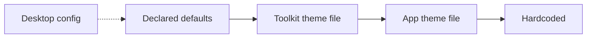

# App theme config

The [desktop config](desktop-config.md) is shared by every app. Sometimes one app needs its own look: custom colors, its own paddings and radii, tokens for objects only it has, or a different vibe from something utilitarian. The app theme config is for that. Code: `iced_adaptive_design::theme_config`.

## The layers

Highest priority first.

1. **Hardcoded**, set in code with `.hardcode(..)`. **Extremely discouraged.** Nobody can change a hardcoded value without a rebuild, and every one is reported on stderr at startup and listed in `ThemeConfig::hardcoded()`. Declare a token and put the value in the app theme instead.
2. **The app theme file**, `$XDG_CONFIG_HOME/<app-id>/theme.conf`. The app declares its tokens and their defaults in a `Schema`, so the file can be deleted: the app writes a fresh one.
3. **The toolkit theme file**, `$XDG_CONFIG_HOME/iced-adaptive-design/theme.conf`. The toolkit declares the tokens it understands (`Schema::toolkit()`) with its own values as defaults, and regenerates the file when it is missing.

Below them a token is its **declared default**, and the toolkit's look is whatever the desktop config makes of it.



A token only changes anything when someone sets it. The generated files are comments: each token appears as `#key=default` under a description, so the file documents the tokens without pinning them. Uncomment a line to change it. Delete the file to start over.

## Tokens

A token is a typed value in the key-file format of the desktop config: a color (`#rrggbb` or `#rrggbbaa`), a number, a bool or text.

**Toolkit tokens**

| Section                      | Keys                                                                                              |
| ---------------------------- | ------------------------------------------------------------------------------------------------- |
| `[colors]`, `[colors-dark]`  | `accent`, `window-bg`, `window-fg`, `view-*`, `card-*`, `headerbar-*`, `sidebar-*`, `popover-*`, `dialog-*`, `success`, `warning`, `destructive`, `error`. `[colors-dark]` wins on a dark scheme |
| `[metrics]`                  | `space-*`, `radius-*`, `button-padding-y/x`, `entry-padding-y/x`, `row-padding-y/x`, `page-padding-y/x`, `card-padding`, `dialog-padding`, `popover-padding`, `*-min-height`, `border-width`, `icon-size`, `group-spacing`, `clamp-maximum`, `headerbar-height`, `sidebar-width`, … |
| `[typography]`               | `text-scale` (multiplies every size), `base-size`                                                 |

Radii are **not** clamped to the HIG maxima here: a different vibe may be rounder or squarer. Every other section is the app's.

**App tokens** are whatever the app declares for its own objects:

```rust
let schema = Schema::new()
    .color("cover", "background", "#9c4ad1", "Behind a missing cover")
    .number("cover", "size", 88.0, "The cover edge in px")
    .boolean("cover", "rounded", true, "Round the cover's corners");
```

## Using it

```rust
let cfg = ThemeConfig::builder("org.example.Player").schema(schema).build();
theme_config::install(cfg.clone());                       // reports hardcoded tokens
config::install(Config::load().with_theme_config(&cfg));  // metric tokens reach every widget
let theme = Theme::from_config(&config::current()).with_theme_config(&cfg);

// anywhere a style function is given the theme
let bg = theme.token_color("cover", "background");
let size = theme.token_number("cover", "size");
```

- **Metric tokens** reach every widget through `Config::with_theme_config`, over the desktop density.
- **Palette and typography tokens** apply to the theme: `Theme::with_theme_config`.
- `cfg.source("cover", "size")` says which layer a value came from (`Source::Hardcoded`, `App`, `Toolkit`, `Default`), and `cfg.entries()` lists every token with it.
- Invalid values are warnings (`cfg.warnings()`): the lower layer is used. Unknown tokens are listed (`cfg.unknown()`), ignored and never deleted: a newer toolkit or app may have written them.
- `.files(false)` with `.app_text(..)` and `.toolkit_text(..)` reads and writes nothing (tests, a settings preview). `.regenerate(false)` reads files but writes none.

The gallery's **App theme config** page (Theming) shows the layers live.

## Typed variables and variations

Declare explicit constraints with `Schema::variable`. Its fallback is optional:
`None` intentionally leaves a property unset when no valid value is available.

```rust
use iced_adaptive_design::theme_config::{Schema, ThemeConfig, VariableType, Value};
let schema = Schema::new().variations(["high-contrast"])
    .variable("panel", "gap",
        VariableType::Length { min: Some(0.0), max: Some(64.0) },
        Some(Value::Length(8.0)), "Space between controls")
    .variable("panel", "badge",
        VariableType::String { values: vec!["preview".into(), "release".into()], accepts_random: false },
        None, "Optional badge");
let template = schema.template("Application theme");
assert!(schema.validate(&template).is_valid());
let cfg = ThemeConfig::builder("org.example.App").schema(schema).files(false)
    .toolkit_text("[panel]\ngap=12px\n")
    .app_text("[panel]\ngap=invalid\n[dark:panel]\ngap=20px\n")
    .variation("dark").build();
assert_eq!(cfg.get("panel", "gap"), Some(&Value::Length(20.0)));
assert_eq!(cfg.get("panel", "badge"), None);
```

| Type | Constraints and file syntax |
| --- | --- |
| `Integer` | Optional `min`/`max`, positive `step`, optional `rounds: Some(Rounding::Ceil/Floor)`; exact `i64` values |
| `Decimal` | `no_decimals` (0–12), optional `min`/`max` and positive `step`, optional rounding |
| `Color` | Hex/hex-alpha including shorthand, `rgb`, `rgba`, `hsv`, `hsva` (`hasva` also accepted), `hsl`, `hsla`; out-of-range channels are invalid |
| `Length` | Optional `min`/`max`; explicit `px` units, such as `12.5px` |
| `Percentage` | Optional `min`/`max` (default 0–100), optional rounding; `42%` or `42` |
| `String` | Enumerated `values`; `accepts_random` additionally permits arbitrary single-line text |

Without rounding, integers and decimals must match their declared precision and
step. Rounding snaps in the chosen direction; bounds are checked afterwards.
Steps are anchored at `min`, or zero if no minimum is declared. A numeric value
outside the range is invalid, never silently clamped. Invalid declarations and
fallbacks are author errors and rejected when creating the schema.

Variations use `[variation-key:property-section]`, for example `[dark:panel]` or
`[high-contrast:metrics]`. `light` and `dark` are built in; declare custom keys with
`Schema::variations`. Resolve each section's values through App → Toolkit →
fallback, then cascade the resolved active variation over the base section.
An invalid variation value falls through to the next valid variation layer,
then the base value. A missing or invalid optional property with no valid lower
layer and no fallback resolves to `None`.

`Builder::variation` and `ThemeConfig::with_variation` select a variation.
`Theme::with_theme_config` automatically selects `light`/`dark` from the theme
scheme unless a variation was explicitly selected. Variations apply to custom
tokens, colors, metrics and typography. Legacy `[colors-dark]` files still work.

`Schema::template` generates a valid, commented `.conf`, including constraints,
optional fallbacks and variation sections. The existing theme loader regenerates
missing files from that template. `Schema::validate` validates text without file
access and returns syntax/value errors plus unknown properties/variation keys.
The loader reports invalid values through `warnings()` and keeps the cascade;
unknown values remain ignored and are never rewritten.
