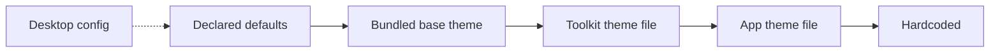

# App theme config

The [desktop config](desktop-config.md) is shared by every app. Sometimes one app needs its own look: custom colors, its own paddings and radii, tokens for objects only it has, or a different vibe from something utilitarian. The app theme config is for that. Code: `iced_adaptive_design::theme_config`.

## Bundling a base theme

Apps should bundle at least one theme `.ron` file and load it as their base theme so their appearance remains consistent even when no desktop theme is installed. We recommend [`libadwaita.ron`](../../themes/libadwaita.ron), which supplies the toolkit's reference libadwaita styling.

```rust
const DEFAULT_BASE_THEME: &str = include_str!("../themes/libadwaita.ron");
config::install(Config::load_with_base_theme(DEFAULT_BASE_THEME));
let theme = Theme::from_config(&config::current());
```

`DEFAULT_BASE_THEME` is an app-owned constant, not a required name or environment variable. iad owns theme discovery and validates each layer separately: the selected external theme overlays the base, and invalid values fall back to it. `IAD_THEME=none` skips the external theme without disabling the bundled base, failing, or warning. Unset `IAD_THEME` discovers the installed XDG theme if available; otherwise the base applies. Without a base or external theme, iad uses the bare look.

For app-owned tokens or explicit layers, use `ThemeConfig::builder(app_id).base_theme(DEFAULT_BASE_THEME)` and install the result through `Config::with_theme_config`. The base also applies with `.files(false)` or `Inheritance::OptOut`; those options disable automatic discovery, not explicitly supplied text. See [Using it](#using-it) and [Independent bases and explicit overlays](#independent-bases-and-explicit-overlays).

## The layers

Highest priority first.

1. **Hardcoded**, set in code with `.hardcode(..)`. **Extremely discouraged.** Nobody can change a hardcoded value without a rebuild, and every one is reported on stderr at startup and listed in `ThemeConfig::hardcoded()`. Declare a token and put the value in the app theme instead.
2. **The app theme file**, `$XDG_CONFIG_HOME/<app-id>/theme.ron`. The app declares its tokens and their defaults in a `Schema`, so the file can be deleted: the app writes a fresh one.
3. **The installed theme file**, found by `theme_config::theme_path()`: `IAD_THEME=<path>` (`IAD_THEME=none` skips this external layer), else `default.ron` in `$XDG_DATA_HOME/iad/themes` (`~/.local/share/iad/themes`), else in `iad/themes` of each `$XDG_DATA_DIRS` entry (`/usr/local/share`, `/usr/share`). The first file found is the only one read. A desktop or distribution installs or symlinks its look there (`themes/` has libadwaita, COSMIC, Solarized, Terminal, Bubblegum and Synthwave). The toolkit declares the tokens it understands in `Schema::toolkit()`; it never writes a theme file.

4. **The bundled base theme**, explicitly supplied through `Builder::base_theme` or `Config::load_with_base_theme`. It has toolkit-theme provenance, not app-override provenance, and remains active even with `IAD_THEME=none`.

Below them a token is its **declared default**. **The toolkit has no built-in look**: without a bundled base or selected theme file it paints like HTML without CSS (black on white, square, 1px grey rules, no shadows) and every widget still lays out and responds.



A token only changes anything when someone sets it. The generated files are comments: each token appears as `#key=default` under a description, so the file documents the tokens without pinning them. Uncomment a line to change it. Delete the file to start over.

## Tokens

A token is a typed value in a RON file (a map of sections to maps of keys, the same shape as the desktop config): a color string (`"#rrggbb"` or `"#rrggbbaa"`), a number (a length is a plain number of px), a bool, text, or a structure such as a gradient: `(angle: 90, stops: [(0.0, "#0a246a"), (1.0, "#a6caf0")])`. This document writes `[section] key` for the key `"key"` in the section `"section"`.

**Toolkit tokens**

| Section                                       | Keys                                                                                                                                                                                                                                                                                                        |
| --------------------------------------------- | ----------------------------------------------------------------------------------------------------------------------------------------------------------------------------------------------------------------------------------------------------------------------------------------------------------- |
| `[colors]`, `[light:colors]`, `[dark:colors]` | `accent`, `window-bg`, `window-fg`, `view-*`, `card-*`, `headerbar-*`, `sidebar-*`, `popover-*`, `dialog-*`, `success`, `warning`, `destructive`, `error`, and their `-fg`/`-text`/`-shade` companions. The variant of the active scheme wins over `[colors]`                                               |
| `[metrics]`                                   | `space-*`, `radius-*`, `circular-button-size`, `button-padding-y/x`, `entry-padding-y/x`, `row-padding-y/x`, `page-padding-y/x`, `card-padding`, `dialog-padding`, `popover-padding`, `*-min-height`, `border-width`, `icon-size`, `group-spacing`, `clamp-maximum`, `headerbar-height`, `sidebar-width`, … |
| `[typography]`                                | `text-scale` (multiplies every size), `base-size`, `title-1`…`monospace` (ratios of the base)                                                                                                                                                                                                               |
| `[shadows]`                                   | `card`, `popover`, `dialog`, `osd`: CSS box-shadow lists (`0 1px 3px 1px rgba(0, 0, 6, 0.07), …`)                                                                                                                                                                                                           |
| `[button.<variant>]`                          | `bg`, `fg`, `border`, `border-width`, `radius`, `hover-bg`, `active-bg`: see _Widget variants_                                                                                                                                                                                                              |
| `[window-decorations]`                                   | `button-layout` (`start:end`, e.g. `:minimize,maximize,close`), `button-size` (px), `button-radius` (% of the size, 50% is a circle), `titlebar-double-click`/`-middle-click`/`-right-click` (`toggle-maximize`, `menu`, `minimize`, `lower`, `none`)                                                       |
| `[theme]`                                     | `name`, `key`, `mode`, `default-variants` (`all`/`none`)                                                                                                                                                                                                                                                    |

Prefer typed numbers (`button-radius=50%`, `button-size=24px`) and enum strings over new switches: a value is validated against its declared type and range, and an invalid one falls back with a warning.

Radii are **not** clamped to the HIG maxima here: a different vibe may be rounder or squarer. Every other section is the app's.

**App tokens** are whatever the app declares for its own objects:

```rust
let schema = Schema::new()
    .color("cover", "background", "#9c4ad1", "Behind a missing cover")
    .number("cover", "size", 88.0, "The cover edge in px")
    .boolean("cover", "rounded", true, "Round the cover's corners");
```

## Using it

```rust
let cfg = ThemeConfig::builder("org.example.Player").schema(schema).build();
theme_config::install(cfg.clone());                       // reports hardcoded tokens
config::install(Config::load().with_theme_config(&cfg));  // metric tokens reach every widget
// An app that supplies no look: Config::load() already carries the installed theme file.
let theme = Theme::from_config(&config::current()).with_theme_config(&cfg);

// anywhere a style function is given the theme
let bg = theme.token_color("cover", "background");
let size = theme.token_number("cover", "size");
```

- **Metric tokens** reach every widget through `Config::with_theme_config`, over the desktop density.
- **Palette and typography tokens** apply to the theme: `Theme::with_theme_config`.
- `cfg.source("cover", "size")` says which layer a value came from (`Source::Hardcoded`, `App`, `Theme`, `Default`), and `cfg.entries()` lists every token with it.
- Invalid values are warnings (`cfg.warnings()`): the lower layer is used. Unknown tokens are listed (`cfg.unknown()`), ignored and never deleted: a newer toolkit or app may have written them.
- `.files(false)` with `.app_text(..)` and `.toolkit_text(..)` reads and writes nothing (tests, a settings preview). `.regenerate(false)` reads files but writes none.

### Independent bases and explicit overlays

`Inheritance::OptOut` skips automatic desktop theme discovery. It does not discard explicitly supplied `.base_theme(base)`, `.toolkit_text(theme)` and `.app_text(overlay)`: both are validated against the combined toolkit/app schema, and valid app entries take precedence over the base. `.files(false)` disables automatic file access; the caller can still read and supply overlay text explicitly.

The [theme toys](../../theme-toys/README.md#theme-resolution) use this pattern for four canonical targets: `win95`, `winxp`, `win7`, `mate` (modern MATE). `gnome2` is a compatibility alias only. Each embeds its own complete `theme-toys/themes/<target>.ron` base, including native styling and app-owned scene geometry. An optional `IAD_THEME` file is read as an overlay, not a replacement base. Without one the bundled base applies; installed `default.ron` files are not consulted. Invalid entries fall back through the validated cascade. Scene-fit checks can reject overlay geometry while retaining native theme edits; see the toy guide for limits and the special handling of `IAD_THEME=none`.

### Editing and applying a theme

The [theme manager](../../theme-manager/README.md) (`cargo run -p iced-adaptive-design-theme-manager -- [FILE]`) edits theme files by section. The selected theme opens a picker for registered files, the bundled set, folders and recents. **All** groups every token on one searchable page. **Modified only** filters unsaved changes; **Overrides only** filters explicit active Light/Dark entries, excluding inherited Base values, and is unavailable for Base.

**Save** updates the current file, following symlinks. **Save as** writes a copy, switches subsequent saves to it. **Set as global theme** (in the theme dialog) points the symlink `default.ron` in the user theme directory, where every iad app looks, at the open theme's file (a bundled theme is copied there first); **Remove global theme** in the same dialog deletes the symlink. There is no embedded preview; the header's play button starts the gallery with the current values (a temp `IAD_THEME` file, nothing saved), and `theme-manager gallery` runs it with the global theme.

For a standalone gallery launch, use `IAD_THEME=path.ron cargo run -p iced-adaptive-design-gallery`.

## Widget variants

Responsive selection uses [breakpoint rules and logical variants](breakpoint-rules.md): `breakpoint-rules=xs:pills,md:outline` selects declared widget variants at the configured width thresholds, independently of light/dark scheme variations.

A **variant** is a named set of typed style tokens that belongs to one widget. In a theme file it is the section `[<widget>.<variant>]`; every key is optional and inherits per key from the widget's base values and resolved theme metrics. Named size/density presets, including `sm`, `md` and `lg`, are config-loaded values, not renderer arithmetic. Custom names use the same resolution path; missing or undeclared names inherit neutral/base values. See [breakpoint rules and logical variants](breakpoint-rules.md).

```ron
{
    "button.suggested": {        // restyle a default variant
        "bg": "#2e7d32",
        "hover-bg": "#388e3c",
    },
    "button.brand": {            // an app's own variant
        "bg": "#6a1b9a",
        "fg": "#ffffff",
        "radius": 4,
    },
    "dark:button.brand": {       // the dark scheme cascades over it like any section
        "bg": "#ce93d8",
        "fg": "#000000",
    },
}
```

Button keys: `bg`, `fg`, `border` (colors), `border-width`, `radius` (lengths in px), `hover-bg`, `active-bg` (colors; derived from `bg` when unset). The toolkit provides these default button variants: `default`, `raised`, `flat`, `headerbar`, `suggested` (the primary color), `destructive`, `opaque`, `pill`, `suggested-pill`, `link`, `osd`, `card` (`DEFAULT_VARIANTS`). They are declared in `Schema::toolkit()`, so the theme editor lists them and a generated template documents them.

Use one with `button(label).variant("brand")` (the `ButtonVariant` trait), `variant_button(label, "brand")`, or `styles::button::variant("brand")` in a `.style(..)`. `suggested_button`, `flat_button`, `raised_button`, `destructive_button`, `pill_button` and `suggested_pill_button` are the default variants of those names. A variant the theme does not declare draws the **neutral** button, never a panic.

**Add or replace in code.** Declare the variant in the app's schema; the tokens given are its declared defaults and a theme file can still change them. A name the toolkit already provides is _replaced_:

```rust
let schema = Schema::new()
    .variant("button", "brand", &[("bg", Value::Color(brand)), ("radius", Value::Length(4.0))])
    .variant("button", "suggested", &[("bg", Value::Color(green))]); // replaces the default
let cfg = ThemeConfig::builder("org.example.App").schema(schema).build();
```

**Opt out of the defaults.** `Builder::default_variants(DefaultVariants::None)`, or `[theme] default-variants=none` in the app file, drops every default variant: the app declares all it uses, and the helper constructors above draw the neutral button for the names it left out. `DefaultVariants::Only(&["button"])` keeps the defaults of those widgets only, `Without(&[..])` of all but those. A theme file that names a dropped variant gets it reported in `unknown()`.

**Unique features are their own widgets.** A variant styles _colors, borders and corners_; it cannot promise a _shape_. A circle needs equal width and height, which a border radius on a button of any size cannot guarantee (a wider button becomes a pill, an oversized radius an ellipse). `CircularButton` is a widget of its own: a square of `[metrics] circular-button-size` px (the button height when unset), content centered and clipped to that square, radius forced to half the size. It takes `.variant(name)` for its colors (default `flat`); `circular_button(icon)` and `suggested_circular_button(content)` are built from it.

The same convention will carry to the other widgets that take a hardcoded style per look: banners and toasts (roles), chips, badges and tags (roles), cards, rows, entries and switches. Each gets a key set of its own and a `.variant(name)`; nothing about a theme file changes.

## Other design languages: gradients, bevels, window frame, font, focus

A theme can take on a look that is not libadwaita's: a classic grey desktop with raised and sunken frames, a glossy 2000s one with gradient buttons and a thick coloured window frame. Nothing is hardcoded for those looks; they are tokens, typed and validated like the rest. Unset optional effects leave the underlying surface styling unchanged.

**Gradients.** A gradient token is `linear-gradient(<angle>deg, <color> <pos>%, ...)`.

```ron
{
    "gradients": {
        "titlebar": (angle: 90.0, stops: [(0.0, "#0a246a"), (1.0, "#a6caf0 100%)   # navy to light blue, left to righ")]),
        "progress": (angle: 180.0, stops: [(0.0, "#5dd05d"), (1.0, "#1e9a1e)           # positions spread evenl")]),
    },
}
```

The angle is CSS's (`0deg` up, `90deg` right, `180deg` down). Two to eight stops; a color is any form a color token takes; a given position is in `0..=100` and does not decrease, a missing one is spread evenly between its neighbours. Anything else is refused with a warning. Surfaces: `[gradients] window`, `view`, `headerbar`, `titlebar` (the title bar of a client-side decorated window, over `headerbar`), `sidebar`, `card`, `popover`, `dialog`, `progress`. A button variant takes `bg-gradient`, `hover-bg-gradient` and `active-bg-gradient`; without the last two the hover and pressed gradients are the base one with each stop lightened or darkened like a flat fill.

**Bevels.** iced draws one border color per quad, so a two-tone frame is drawn by `components::Bevel`. A variant or a frame asks for one with `border-style`:

```ron
{
    "button.default": {
        "border-style": "raised          # solid (the toolkit's own border), raised, sunken, etched, bump, window",
        "border-width": "2px             # 1 or 2 rings (1px each)",
        "border-light": "#ffffff         # outer light edge       (top and left of a raised frame)",
        "border-dark": "#000000          # outer dark edge        (bottom and right)",
        "border-light-inner": "#dfdfdf   # inner light edge",
        "border-dark-inner": "#808080    # inner dark edge",
        "border-style": "sunken",
    },
}
```

```text
raised, 2 rings       sunken, 2 rings
L L L L L L L D       d d d d d d d L        L border-light        l border-light-inner
L l l l l l d D       d D D D D D l L        D border-dark         d border-dark-inner
L l         d D       d D         l L
L l         d D       d D         l L
L l d d d d d D       d D l l l l l L
D D D D D D D D       L L L L L L L L
```

`etched` is a groove and `bump` a ridge (a dark and a light line); `window` is the frame of a window. Unset colors are the classic gray-frame ones (white, black, `#dfdfdf`, `#808080`). A button drawn with a bevel sinks while it is held down. The frames the toolkit's builders use are `[frame.<name>]` for `window`, `card`, `field`, `well`, `panel`, `popover` and `dialog`; a button's is its variant's own section. A `solid` or unset style uses the surface's ordinary border. Limits: the toolkit's own `check_button`, `radio_button` and `progress_bar` are iced widgets that a theme can only restyle, not wrap, so they take colors and gradients but not a bevel.

**Window frame and title bar** (`[window-decorations]`): `frame-border-width` (px), `frame-border` (a solid frame color), `frame-border-style` (`solid` or a bevel, colored by `[frame.window]`), `titlebar-align` (`start`, `center`, `end`), `titlebar-font-weight` (`normal`, `bold`), `titlebar-icon` (the application icon at the start of the title) and `button-style` (the button variant of the window buttons: any `[button.<name>]`, bevel and gradient included).

**Font.** `[typography] font-family` and `monospace-font-family` (1 to 64 characters, no control characters). The toolkit's text helpers apply them; for the text it does not style, set the application's default font: `iced::application(..).default_font(theme_config::default_font())` (iced needs a `&'static str` for a family name, so each distinct name is leaked once). `Theme::font()` and `Theme::monospace_font()` give the fonts to an app's own text.

**Focus.** `[colors] focus-ring` is the color of the indicator (unset: the accent) and `[metrics] focus-style` is `ring` (the default, `focus-ring-width` wide), `dotted` or `none`. iced styles draw a solid line, so `dotted` is a 1px ring; `none` draws no indicator.

### Appearance button geometry

`[theme-toggle] icon-size` is an optional validated length (1–128px). If absent, the appearance button inherits `metrics.icon-size` unchanged; it does not add a built-in offset. The libadwaita config supplies its 18px appearance icon default.

### Classic tab surfaces

A raised `[frame.tab]` selects the classic renderer for the default tab presentation. Its `bg` controls tab faces; the panel uses `[frame.panel] bg`, falling back to the window surface. Set `[tabs] panel-padding` to a validated length (0–512px) to control space inside the page frame independently of tab-label padding. When absent it inherits the supplied metrics' inset. Named tab variants inherit this key through the same per-key cascade.

## Typed variables and variations

Declare explicit constraints with `Schema::variable`. Its fallback is optional: `None` intentionally leaves a property unset when no valid value is available.

```rust
use iced_adaptive_design::theme_config::{Schema, ThemeConfig, VariableType, Value};
let schema = Schema::new().variations(["high-contrast"])
    .variable("panel", "gap",
        VariableType::Length { min: Some(0.0), max: Some(64.0) },
        Some(Value::Length(8.0)), "Space between controls")
    .variable("panel", "badge",
        VariableType::String { values: vec!["preview".into(), "release".into()], accepts_random: false },
        None, "Optional badge");
let template = schema.template("Application theme");
assert!(schema.validate(&template).is_valid());
let cfg = ThemeConfig::builder("org.example.App").schema(schema).files(false)
    .toolkit_text("[panel]\ngap=12px\n")
    .app_text("[panel]\ngap=invalid\n[dark:panel]\ngap=20px\n")
    .variation("dark").build();
assert_eq!(cfg.get("panel", "gap"), Some(&Value::Length(20.0)));
assert_eq!(cfg.get("panel", "badge"), None);
```

| Type         | Constraints and file syntax                                                                                                               |
| ------------ | ----------------------------------------------------------------------------------------------------------------------------------------- |
| `Integer`    | Optional `min`/`max`, positive `step`, optional `rounds: Some(Rounding::Ceil/Floor)`; exact `i64` values                                  |
| `Decimal`    | `no_decimals` (0–12), optional `min`/`max` and positive `step`, optional rounding                                                         |
| `Color`      | Hex/hex-alpha including shorthand, `rgb`, `rgba`, `hsv`, `hsva` (`hasva` also accepted), `hsl`, `hsla`; out-of-range channels are invalid |
| `Length`     | Optional `min`/`max`; explicit `px` units, such as `12.5px`                                                                               |
| `Percentage` | Optional `min`/`max` (default 0–100), optional rounding; `42%` or `42`                                                                    |
| `String`     | Enumerated `values`; `accepts_random` additionally permits arbitrary single-line text                                                     |

Without rounding, integers and decimals must match their declared precision and step. Rounding snaps in the chosen direction; bounds are checked afterwards. Steps are anchored at `min`, or zero if no minimum is declared. A numeric value outside the range is invalid, never silently clamped. Invalid declarations and fallbacks are author errors and rejected when creating the schema.

Variations use `[variation-key:property-section]`, for example `[dark:panel]` or `[high-contrast:metrics]`. `light` and `dark` are built in; declare custom keys with `Schema::variations`. Resolve each section's values through App → Toolkit → fallback, then cascade the resolved active variation over the base section. An invalid variation value falls through to the next valid variation layer, then the base value. A missing or invalid optional property with no valid lower layer and no fallback resolves to `None`.

`Builder::variation` and `ThemeConfig::with_variation` select a variation. `Theme::with_theme_config` automatically selects `light`/`dark` from the theme scheme unless a variation was explicitly selected. Variations apply to custom tokens, colors, metrics and typography.

`Schema::template` generates a valid, commented `.ron`, including constraints, optional fallbacks and variation sections. The existing theme loader regenerates missing files from that template. `Schema::validate` validates text without file access and returns syntax/value errors plus unknown properties/variation keys. The loader reports invalid values through `warnings()` and keeps the cascade; unknown values remain ignored and are never rewritten.
