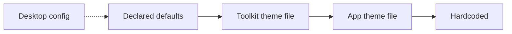

# App theme config

The [desktop config](desktop-config.md) is shared by every app. Sometimes one app needs its own look: custom colors, its own paddings and radii, tokens for objects only it has, or a different vibe from something utilitarian. The app theme config is for that. Code: `iced_adaptive_design::theme_config`.

## The layers

Highest priority first.

1. **Hardcoded**, set in code with `.hardcode(..)`. **Extremely discouraged.** Nobody can change a hardcoded value without a rebuild, and every one is reported on stderr at startup and listed in `ThemeConfig::hardcoded()`. Declare a token and put the value in the app theme instead.
2. **The app theme file**, `$XDG_CONFIG_HOME/<app-id>/theme.conf`. The app declares its tokens and their defaults in a `Schema`, so the file can be deleted: the app writes a fresh one.
3. **The installed theme file**, found by `theme_config::theme_path()`: `IAD_THEME=<path>` (`IAD_THEME=none` means no theme), else `default.conf` in `$XDG_DATA_HOME/iad/themes` (`~/.local/share/iad/themes`), else in `iad/themes` of each `$XDG_DATA_DIRS` entry (`/usr/local/share`, `/usr/share`). The first file found is the only one read. A desktop or distribution installs or symlinks its look there (`themes/` has libadwaita, COSMIC, Solarized, Terminal, Bubblegum and Synthwave). The toolkit declares the tokens it understands in `Schema::toolkit()`; it never writes a theme file.

Below them a token is its **declared default**. **The toolkit has no built-in look**: with no theme file it paints like HTML without CSS (black on white, square, 1px grey rules, no shadows) and every widget still lays out and responds.



A token only changes anything when someone sets it. The generated files are comments: each token appears as `#key=default` under a description, so the file documents the tokens without pinning them. Uncomment a line to change it. Delete the file to start over.

## Tokens

A token is a typed value in the key-file format of the desktop config: a color (`#rrggbb` or `#rrggbbaa`), a number, a bool or text.

**Toolkit tokens**

| Section                                       | Keys                                                                                                                                                                                                                                                                                |
| --------------------------------------------- | ----------------------------------------------------------------------------------------------------------------------------------------------------------------------------------------------------------------------------------------------------------------------------------- |
| `[colors]`, `[light:colors]`, `[dark:colors]` | `accent`, `window-bg`, `window-fg`, `view-*`, `card-*`, `headerbar-*`, `sidebar-*`, `popover-*`, `dialog-*`, `success`, `warning`, `destructive`, `error`, and their `-fg`/`-text`/`-shade` companions. The variant of the active scheme wins over `[colors]`                       |
| `[metrics]`                                   | `space-*`, `radius-*`, `circular-button-size`, `button-padding-y/x`, `entry-padding-y/x`, `row-padding-y/x`, `page-padding-y/x`, `card-padding`, `dialog-padding`, `popover-padding`, `*-min-height`, `border-width`, `icon-size`, `group-spacing`, `clamp-maximum`, `headerbar-height`, `sidebar-width`, … |
| `[typography]`                                | `text-scale` (multiplies every size), `base-size`, `title-1`…`monospace` (ratios of the base)                                                                                                                                                                                       |
| `[shadows]`                                   | `card`, `popover`, `dialog`, `osd`: CSS box-shadow lists (`0 1px 3px 1px rgba(0, 0, 6, 0.07), …`)                                                                                                                                                                                   |
| `[button.<variant>]`                          | `bg`, `fg`, `border`, `border-width`, `radius`, `hover-bg`, `active-bg`: see *Widget variants* |
| `[windows]`                                   | `button-layout` (`start:end`, e.g. `:minimize,maximize,close`), `button-size` (px), `button-radius` (% of the size, 50% is a circle), `titlebar-double-click`/`-middle-click`/`-right-click` (`toggle-maximize`, `menu`, `minimize`, `lower`, `none`)                               |
| `[theme]`                                     | `name`, `key`, `mode`, `default-variants` (`all`/`none`)                                                                                                                                                                                                                                                                       |

Prefer typed numbers (`button-radius=50%`, `button-size=24px`) and enum strings over new switches: a value is validated against its declared type and range, and an invalid one falls back with a warning.

Radii are **not** clamped to the HIG maxima here: a different vibe may be rounder or squarer. Every other section is the app's.

**App tokens** are whatever the app declares for its own objects:

```rust
let schema = Schema::new()
    .color("cover", "background", "#9c4ad1", "Behind a missing cover")
    .number("cover", "size", 88.0, "The cover edge in px")
    .boolean("cover", "rounded", true, "Round the cover's corners");
```

## Using it

```rust
let cfg = ThemeConfig::builder("org.example.Player").schema(schema).build();
theme_config::install(cfg.clone());                       // reports hardcoded tokens
config::install(Config::load().with_theme_config(&cfg));  // metric tokens reach every widget
// An app that supplies no look: Config::load() already carries the installed theme file.
let theme = Theme::from_config(&config::current()).with_theme_config(&cfg);

// anywhere a style function is given the theme
let bg = theme.token_color("cover", "background");
let size = theme.token_number("cover", "size");
```

- **Metric tokens** reach every widget through `Config::with_theme_config`, over the desktop density.
- **Palette and typography tokens** apply to the theme: `Theme::with_theme_config`.
- `cfg.source("cover", "size")` says which layer a value came from (`Source::Hardcoded`, `App`, `Toolkit`, `Default`), and `cfg.entries()` lists every token with it.
- Invalid values are warnings (`cfg.warnings()`): the lower layer is used. Unknown tokens are listed (`cfg.unknown()`), ignored and never deleted: a newer toolkit or app may have written them.
- `.files(false)` with `.app_text(..)` and `.toolkit_text(..)` reads and writes nothing (tests, a settings preview). `.regenerate(false)` reads files but writes none.

Edit a theme file in the theme editor (`theme-editor/`), and see it in the gallery with `IAD_THEME=path.conf`.

## Widget variants

A **variant** is a named set of typed style tokens that belongs to one widget. In a theme file it is the section `[<widget>.<variant>]`; every key is optional, and a key left unset is what the widget's built-in look computes from the palette, so a theme only writes what it changes.

```ini
[button.suggested]        # restyle a default variant
bg=#2e7d32
hover-bg=#388e3c

[button.brand]            # an app's own variant
bg=#6a1b9a
fg=#ffffff
radius=4px

[dark:button.brand]       # the dark scheme cascades over it like any section
bg=#ce93d8
fg=#000000
```

Button keys: `bg`, `fg`, `border` (colors), `border-width`, `radius` (lengths in px), `hover-bg`, `active-bg` (colors; derived from `bg` when unset). The toolkit provides these default button variants: `default`, `raised`, `flat`, `headerbar`, `suggested` (the primary color), `destructive`, `opaque`, `pill`, `suggested-pill`, `link`, `osd`, `card` (`DEFAULT_VARIANTS`). They are declared in `Schema::toolkit()`, so the theme editor lists them and a generated template documents them.

Use one with `button(label).variant("brand")` (the `ButtonVariant` trait), `variant_button(label, "brand")`, or `styles::button::variant("brand")` in a `.style(..)`. `suggested_button`, `flat_button`, `raised_button`, `destructive_button`, `pill_button` and `suggested_pill_button` are the default variants of those names. A variant the theme does not declare draws the **neutral** button, never a panic.

**Add or replace in code.** Declare the variant in the app's schema; the tokens given are its declared defaults and a theme file can still change them. A name the toolkit already provides is *replaced*:

```rust
let schema = Schema::new()
    .variant("button", "brand", &[("bg", Value::Color(brand)), ("radius", Value::Length(4.0))])
    .variant("button", "suggested", &[("bg", Value::Color(green))]); // replaces the default
let cfg = ThemeConfig::builder("org.example.App").schema(schema).build();
```

**Opt out of the defaults.** `Builder::default_variants(DefaultVariants::None)`, or `[theme] default-variants=none` in the app file, drops every default variant: the app declares all it uses, and the helper constructors above draw the neutral button for the names it left out. `DefaultVariants::Only(&["button"])` keeps the defaults of those widgets only, `Without(&[..])` of all but those. A theme file that names a dropped variant gets it reported in `unknown()`.

**Unique features are their own widgets.** A variant styles *colors, borders and corners*; it cannot promise a *shape*. A circle needs equal width and height, which a border radius on a button of any size cannot guarantee (a wider button becomes a pill, an oversized radius an ellipse). `CircularButton` is a widget of its own: a square of `[metrics] circular-button-size` px (the button height when unset), content centered and clipped to that square, radius forced to half the size. It takes `.variant(name)` for its colors (default `flat`); `circular_button(icon)` and `suggested_circular_button(content)` are built from it.

The same convention will carry to the other widgets that take a hardcoded style per look: banners and toasts (roles), chips, badges and tags (roles), cards, rows, entries and switches. Each gets a key set of its own and a `.variant(name)`; nothing about a theme file changes.

## Typed variables and variations

Declare explicit constraints with `Schema::variable`. Its fallback is optional:
`None` intentionally leaves a property unset when no valid value is available.

```rust
use iced_adaptive_design::theme_config::{Schema, ThemeConfig, VariableType, Value};
let schema = Schema::new().variations(["high-contrast"])
    .variable("panel", "gap",
        VariableType::Length { min: Some(0.0), max: Some(64.0) },
        Some(Value::Length(8.0)), "Space between controls")
    .variable("panel", "badge",
        VariableType::String { values: vec!["preview".into(), "release".into()], accepts_random: false },
        None, "Optional badge");
let template = schema.template("Application theme");
assert!(schema.validate(&template).is_valid());
let cfg = ThemeConfig::builder("org.example.App").schema(schema).files(false)
    .toolkit_text("[panel]\ngap=12px\n")
    .app_text("[panel]\ngap=invalid\n[dark:panel]\ngap=20px\n")
    .variation("dark").build();
assert_eq!(cfg.get("panel", "gap"), Some(&Value::Length(20.0)));
assert_eq!(cfg.get("panel", "badge"), None);
```

| Type         | Constraints and file syntax                                                                                                               |
| ------------ | ----------------------------------------------------------------------------------------------------------------------------------------- |
| `Integer`    | Optional `min`/`max`, positive `step`, optional `rounds: Some(Rounding::Ceil/Floor)`; exact `i64` values                                  |
| `Decimal`    | `no_decimals` (0–12), optional `min`/`max` and positive `step`, optional rounding                                                         |
| `Color`      | Hex/hex-alpha including shorthand, `rgb`, `rgba`, `hsv`, `hsva` (`hasva` also accepted), `hsl`, `hsla`; out-of-range channels are invalid |
| `Length`     | Optional `min`/`max`; explicit `px` units, such as `12.5px`                                                                               |
| `Percentage` | Optional `min`/`max` (default 0–100), optional rounding; `42%` or `42`                                                                    |
| `String`     | Enumerated `values`; `accepts_random` additionally permits arbitrary single-line text                                                     |

Without rounding, integers and decimals must match their declared precision and
step. Rounding snaps in the chosen direction; bounds are checked afterwards.
Steps are anchored at `min`, or zero if no minimum is declared. A numeric value
outside the range is invalid, never silently clamped. Invalid declarations and
fallbacks are author errors and rejected when creating the schema.

Variations use `[variation-key:property-section]`, for example `[dark:panel]` or
`[high-contrast:metrics]`. `light` and `dark` are built in; declare custom keys with
`Schema::variations`. Resolve each section's values through App → Toolkit →
fallback, then cascade the resolved active variation over the base section.
An invalid variation value falls through to the next valid variation layer,
then the base value. A missing or invalid optional property with no valid lower
layer and no fallback resolves to `None`.

`Builder::variation` and `ThemeConfig::with_variation` select a variation.
`Theme::with_theme_config` automatically selects `light`/`dark` from the theme
scheme unless a variation was explicitly selected. Variations apply to custom
tokens, colors, metrics and typography.

`Schema::template` generates a valid, commented `.conf`, including constraints,
optional fallbacks and variation sections. The existing theme loader regenerates
missing files from that template. `Schema::validate` validates text without file
access and returns syntax/value errors plus unknown properties/variation keys.
The loader reports invalid values through `warnings()` and keeps the cascade;
unknown values remain ignored and are never rewritten.
