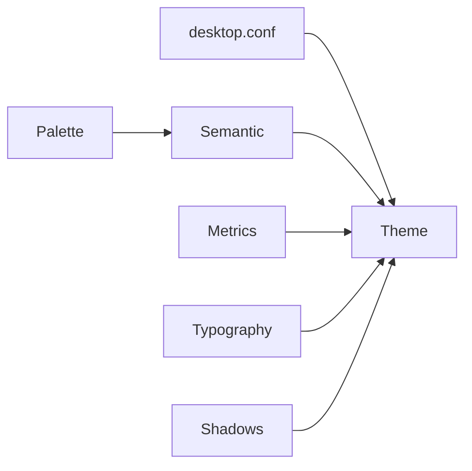

# Theming

Use `iad::Theme` as the application theme. Stock iced widgets are restyled too. Build it from the desktop config unless you have a reason not to: `Theme::from_config(&config::current())`.

## Layers



| Layer        | Type                    | Holds                                                          |
| ------------ | ----------------------- | -------------------------------------------------------------- |
| Named colors | `Palette`               | libadwaita variable names (`accent_bg_color`, …), light and dark |
| Semantic     | `Semantic`              | what components ask for: surfaces, status swatches, opacities  |
| Metrics      | `Metrics`, `Typography` | spacing, radii, sizes, text scale                              |

```rust
let theme = iad::Theme::dark()
    .accent(iad::AccentColor::Purple)
    .with_palette(|p| p.window_bg_color = my_bg)   // semantic is re-derived
    .with_semantic(|s| s.card.bg = my_card)        // apply after the palette
    .with_metrics(iad::Metrics::compact());
```

## Rules

- Use roles, not colors. `Role::{Accent, Success, Warning, Error, Destructive}` for status. Never a fixed hue for meaning.
- Text on colored fills is chosen by contrast (CSS `color-contrast()`): light or dark, whichever contrasts more. Override with a component's `text_color` or `Theme::with_semantic`. Turn off with `with_auto_contrast(false)`.
- Radii are capped at the HIG values (controls 9, cards 12, popovers and windows 15). Lower them (`radius_m`, `radius_l`, `radius_toast`). Do not raise them.
- Shadows are settings: `Shadows::none()`, `.with_scale`, `.with_intensity`. A card draws each layer as its own rounded shape, so the shadow follows the border.
- Density: `Metrics::compact()` or `[appearance] density=compact`.
- Dimmed text is for secondary information and the disabled state. Not for chosen values.

## Accent

One of nine names, or any color: `AccentColor::Custom(0xRRGGBB)`, `AccentColor::custom(r, g, b)`, `AccentColor::parse("#3584e4")`. `[appearance] accent` takes a name or `#rrggbb`. A custom accent derives its standalone text color for light and dark.

`accent_picker(selected, on_select).custom(text, on_text)` adds a swatch that opens a `ColorInput`. `.dialog(true)` opens it as a dialog.

## Transparency

```rust
Theme::light().with_transparency(0.4)    // [appearance] transparency=0.4
```

- Every surface background keeps its color and has its alpha scaled by `1 - t`: window, view, bars, sidebars, cards.
- Popovers and dialogs scale by `1 - t/2`, so their text stays legible.
- Foregrounds, accents and hairlines are not changed.
- Tints derived from a surface (hover, press, `color::lighten`, `darken`, `tint`) keep its alpha. A translucent surface stays translucent in every state.
- The window must be transparent. Client-side windows are. `windows::settings()` makes a server-side one transparent when `transparency` is above 0.

## Tint

```rust
Theme::light().with_tint(Some(Color::from_rgba(1.0, 0.0, 0.0, 0.3)))   // [appearance] tint=#ff00004d
```

Off by default. A color of its own, not the accent. Surfaces move towards it by its alpha. Their own alpha is kept, so tint and transparency combine in either order.

`[appearance] tint` takes `none`, `#rrggbb` (strength 25%) or `#rrggbbaa`.

## Layout tokens are fixed at build time

iced resolves colors at draw time and layout at view-build time. Padding and sizes come from `Metrics::desktop()` unless you pass `.metrics(m)` to a component. Colors, radii and opacities follow the theme.
