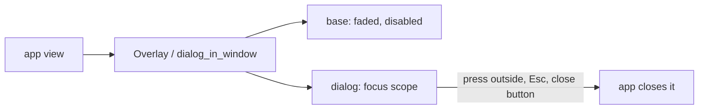

# Windows, header bars, menus

## Decorations

The app draws its own title bar (client-side decorations). Server-side decorations are off by default.

```rust
iced::application(boot, update, view).window(iad::window::settings()).run()

// view: the header bar carries title, controls and drag. `frame` adds rounded corners.
let corner = state.radius(&iad::Metrics::default()); // 0 when maximized or fullscreen
iad::window::frame(
    w::toolbar_view(content).top_bar(
        w::header_bar().title("My App").window_radius(corner)
            .on_drag(Msg::Drag).on_double_click(Msg::ToggleMaximize)
            .window_controls(w::WindowControls {
                on_minimize: Some(Msg::Min),
                on_maximize: Some(Msg::Max),
                on_close: Some(Msg::Close),
            }),
    ),
    state,
    Msg::Resize,
)
```

- Track the window state with `window::changes()` and `refresh()`. Corners round only while the window floats.
- Buttons and their places follow GNOME's `button-layout`. Icons follow the icon theme. In mobile mode they are hidden.
- Anything on a window corner takes the window radius: `NavigationSplitView::window_radius`, `dialog_in_window`, `Dock` (window scope), `HeaderBar::window_corners`.
- In a split view each pane has its own header bar. Only the pane on a window edge shows the window buttons.

## Transparency

`iad::window::settings()` makes the window transparent. Surface transparency is a theme setting (`Theme::with_transparency`, `[appearance] transparency`). See [theming](theming.md).

## Dialogs are modals, not windows

A dialog (alert, about, shortcuts, preferences) is a layer over its parent window, as in `AdwDialog`.



- The base is faded (`scrim`, default on) and cannot be used.
- It closes on its close button, Escape, or a press outside (`close_on_outside`, default true).
- Tab stays inside it. Its first field takes focus (`initial_focus(id)` picks another). Closing it returns focus to what had it. See [focus](#focus).
- The library opens no OS window for a dialog.

```rust
dialog_in_window(
    base,
    AlertDialog::new("Discard changes?").body("They will be lost."),
    Some(Msg::Close),   // sent on a press outside; None: a press outside does nothing
    radius,
)
```

`Overlay` is the same layer with every rule as a parameter:

```rust
Overlay::new(base, layer)
    .scrim(true)
    .on_outside(Msg::Close)
    .initial_focus("name")
```

Nested layers: `overlay_stack`. Rules: `primitives::overlay` (`Stack` routes Escape to the top layer only).

## Dock

A surface on an edge: footer, drawer, bottom sheet.

| Param        | Values                                                         | Default      |
| ------------ | -------------------------------------------------------------- | ------------ |
| `side`       | `Bottom`, `Top`, `Left`, `Right`                               | `Bottom`     |
| `size`       | across the edge: `Auto`, `Fixed(px)`, `Fraction(f)`, `FullScreen` | `Auto`   |
| `length`     | along the edge: same values                                    | `FullScreen` |
| `align`      | where a shorter dock sits: `Start`, `Center`, `End`            | `Start`      |
| `margin`     | px off the docked edge, that edge only                         | `0` (flush)  |
| `mode`       | `Push` (makes room), `Overlay` (over a faded base)             | `Push`       |
| `scope`      | `Content` (the base as given), `Window` (corners take the window radius) | `Content` |
| `border`     | hairline on the sides that are not flush                       | on           |
| `scrim`      | fade the base (`Overlay`)                                      | on           |
| `open`       | show it                                                        | `true`       |
| `on_outside` | message for a press outside (`Overlay`)                        | none         |

`FullScreen` as the size covers the base. All borders are flush: no margin, no border.

```rust
// Bottom sheet over the whole window.
Dock::new(root, sheet)
    .open(self.sheet)
    .mode(DockMode::Overlay)
    .scope(DockScope::Window)
    .window_radius(corner)
    .on_outside(Msg::CloseSheet)

// A floating bar, 480 wide, centered, 12 px off the bottom.
Dock::new(content, bar)
    .mode(DockMode::Overlay)
    .length(DockSize::Fixed(480.0))
    .align(Align::Center)
    .margin(12.0)

// A pane that makes room.
Dock::new(content, pane).side(Side::Right).size(DockSize::Fixed(280.0))
```

`Push` takes the whole edge: length, align, margin and border do not apply. It shares its geometry with the split-view sidebar and drawer (`primitives::dock`).

## Focus

`FocusScope` and `focus_return` apply `primitives::focus`.

| Behavior       | Param                  | Default |
| -------------- | ---------------------- | ------- |
| Tab wraps inside | `trap(bool)`         | on      |
| Take focus on appearing | `auto_focus(bool)` | on    |
| Which child    | `initial_focus(id)`    | first   |
| Focus in/out   | `on_focus_change(f)`   | none    |

Give the child the same id: `entry(..).id("name")`. An id that is not found falls back to the first focusable widget. `Overlay`, `Dock` and `Popover` take `initial_focus` and pass it on. `ColorInput` focuses its code entry.

```rust
// A search field that takes focus when it appears, without trapping Tab.
FocusScope::new(entry("Search", &self.q).id("search").on_input(Msg::Q))
    .trap(false)
    .initial_focus("search")
```

iced buttons are not focusable. Entries and editors are.

## A window that outlives the main window

Not a child. A separate process, started by an action:

```rust
window::Detached::this_exe()?.arg("--settings").spawn()?;
```

It starts this executable again in its own process group. Closing or quitting the parent leaves it running. The app decides from its arguments what the new process shows. `.task(Msg::Spawned)` is the task form.

`Child::window` is a second window of this process. It goes with the process.

Limits: iced has no transient-parent or system-modal window. The compositor does not keep a window above another or center it. Wayland ignores requested positions.

- Forget a window when `window::close_events()` reports it. Quit when the main window closes.

## Header bars

Continuous: no color of their own. They take the pane behind. A header holds the title (or a `title_widget` such as `path_bar`) and menu items, not page content. Put the primary menu at the end of the sidebar header.

## Menus

- `primary_menu(Menu::new(..).section([..]))` is the app menu. Order: setting toggles, Preferences, Keyboard Shortcuts, Help, About. 3–12 items.
- A popover on desktop, a full page when narrow (`MenuPresentation::resolve`).
- Disable unavailable items: `MenuItem::disabled()`.

## Shortcuts

The toolkit handles them. The app needs no subscription and no `update` arm.

- A menu (`MenuButton`, `primary_menu`, `split_button`) registers the accelerators it shows: `MenuItem::action("Preferences", Msg::Prefs).accel("Ctrl+,")` works while the menu button is in the view, even with its popover closed or its sidebar hidden.
- A widget shows a shortcut only when it can honor it: item enabled, accelerator valid, shortcuts on, a keyboard likely (hidden in the touch full-page menu under `[shortcuts] hints=auto`).
- `shortcut::Standard` lists GNOME's usual ones:
  ```rust
  Standard::new().quit(Msg::Quit).fullscreen(Msg::Fullscreen)
      .into_shortcuts().bind("Esc", Msg::Escape).scope(window)
  ```
- A focused widget wins. A text input or an open popover that handles the key stops the shortcut. Plain-character shortcuts never fire while typing.
- Accelerators are the character typed and are layout independent. A key press is read three ways, best first. The best-ranked binding wins, then the earliest.
  1. The key as typed, Shift counted: letters, named keys, an explicit `Ctrl+Shift+,`.
  2. The character it produces, Shift consumed: `Ctrl+?` fires for Ctrl+Shift+`/` (US) and Ctrl+Shift+`,` (AZERTY). `Ctrl+,` then does not also fire.
  3. The Latin letter or digit at the physical key: `Ctrl+Q` on a Cyrillic layout, `Ctrl+1` on AZERTY's unshifted number row.

| Action             | Accelerator |
| ------------------ | ----------- |
| Quit               | `Ctrl+Q`    |
| Close window       | `Ctrl+W`    |
| Fullscreen         | `F11`       |
| Preferences        | `Ctrl+,`    |
| Help               | `F1`        |
| Keyboard shortcuts | `Ctrl+?`    |

## Toasts

Place with `Toast::position` (default `[toasts] position`) in the whole window or the content area (`[toasts] target`). Wrap the window or the content pane with `toast_stack`. Keep both layers mounted.
