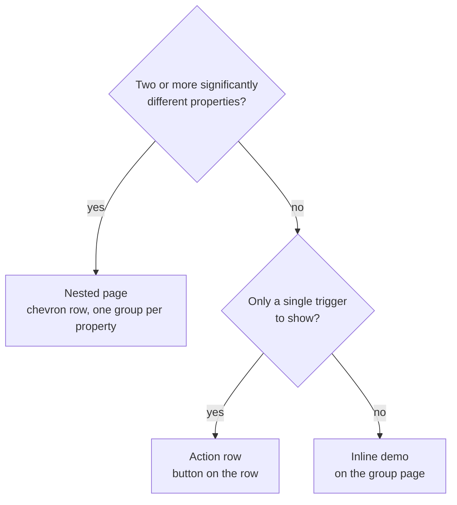

# Gallery

`cargo run --example gallery` is a tour of the components. These notes describe how the
gallery itself is organized; they are about the example, not the library.

## Navigation

Two levels:

1. **Sidebar: functional groups** (Buttons, Inputs, Rows & Lists, Layout, Navigation,
   Feedback, Dialogs & Sheets). Components are grouped by what they are *for*, not by what
   they look like: every text field, switch, check and radio is under Inputs. Typography and
   Theming are single pages.
2. **A group page** lists its components in sections. Each component is presented in one of
   three ways, chosen by the rule below.

`nav.rs` holds the tree (`Page` → sections of `Entry`); `details.rs` holds the content.

## Presentation rule

Count a component's **properties**: things you can vary that change what it is or how it is
built, such as validation state, password mode, color override, width, icon, shape, style,
placeholder, read-only, children. **States** (enabled, disabled, checked, selected) are values
of a property and do not count as separate properties. Then:

| The component has… | It is shown as | `Entry` |
|---|---|---|
| **Two or more significantly different properties** | a row with a chevron that opens a **nested page**; the page has one group per property | `Nested(Detail)` |
| **One trigger and nothing else to show** (a dialog, a sheet, a toast) | a row with the **button on it** (`Open`, `Show`) instead of a chevron | `Action(Action)` |
| **One demo** (a single property, with its states) | its demo **inline** on the group page, under its own heading | `Inline(Inline)` |



Examples: Text input (validation, password, color override, width) is nested; a Check button
(checked, unchecked, disabled) is inline; Alert dialog is an action row; the whole Feedback group
is inline or actions, so it has no nested pages.

Guidelines:

* Show the **disabled** state of every control that can be disabled, next to its enabled
  form, on whichever page presents it.
* A nested page is a group per property, each with a heading, not a flat list.
* Do not add a nested page to hold a single card. If a component grows a second property,
  promote it from `Inline` to `Detail` (move its demo into `detail_page`, add the groups).
* Keep demos small. Anything that only repeats another component's demo belongs there.

## Running

```text
cargo run --example gallery
cargo run --example gallery -- --screenshot DIR      # every page, light, and the groups in dark
GALLERY_PAGE=inputs GALLERY_DETAIL=textinput cargo run --example gallery
```

Other environment switches: `GALLERY_SIZE=WxH`, `GALLERY_SIDEBAR_MODE=first-page`,
`GALLERY_SIDEBAR=1` (start on the sidebar when collapsed), `GALLERY_MENU=page|dropdown`,
`GALLERY_DIALOG=alert|about|shortcuts|preferences`, `GALLERY_ANIM=switch|drawer|reveal|dialog|toast|carousel|page|push`.
