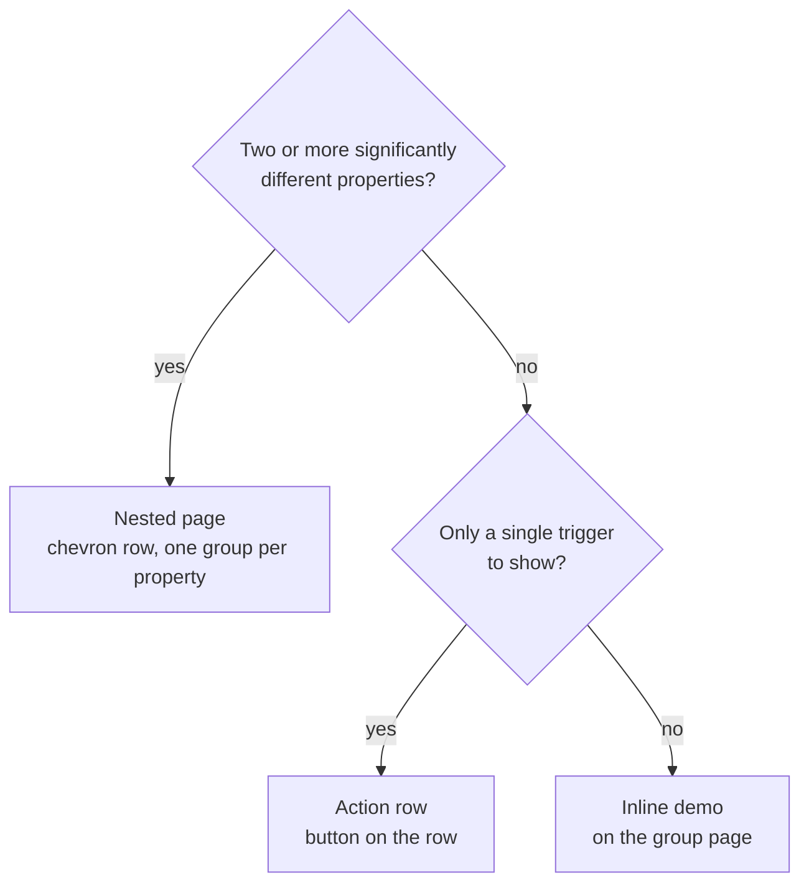

# Gallery

`cargo run -p iced-libadwaita-gallery` is a tour of the components. These notes describe how the gallery itself is organized; they are about the gallery crate, not the library.

## Navigation

Two levels:

1. **Sidebar: functional groups** (Buttons, Inputs, Rows & Lists, Layout, Navigation, Feedback, Dialogs & Sheets). Components are grouped by what they are _for_, not by what they look like: every text field, switch, check and radio is under Inputs. Typography and Theming are single pages.
2. **A group page** lists its components in sections. Each component is presented in one of three ways, chosen by the rule below.

`nav.rs` holds the tree (`Page` → sections of `Entry`); `details.rs` holds the content.

## Presentation rule

Count a component's **properties**: things you can vary that change what it is or how it is built, such as validation state, password mode, color override, width, icon, shape, style, placeholder, read-only, children. **States** (enabled, disabled, checked, selected) are values of a property and do not count as separate properties. Then:

| The component has…                                                    | It is shown as                                                                         | `Entry`          |
| --------------------------------------------------------------------- | -------------------------------------------------------------------------------------- | ---------------- |
| **Two or more significantly different properties**                    | a row with a chevron that opens a **nested page**; the page has one group per property | `Nested(Detail)` |
| **One trigger and nothing else to show** (a dialog, a sheet, a toast) | a row with the **button on it** (`Open`, `Show`) instead of a chevron                  | `Action(Action)` |
| **One demo** (a single property, with its states)                     | its demo **inline** on the group page, under its own heading                           | `Inline(Inline)` |



A component that is **large** (a nested page's worth of demo), even with one property group, also gets a nested page; the group page lists only small ones inline.

Examples: Text input (validation, password, color override, width) is nested; a Check button (checked, unchecked, disabled) is inline; Alert dialog is an action row; the whole Feedback group is inline or actions, so it has no nested pages.

#### Playgrounds

A nested page for a component whose properties a single instance can express is a **playground** (`playground.rs`, after Mantine's docs configurators): one live component in a plain bordered frame (no card, no shadow), a **Properties** panel (a switch per boolean, a toggle group per choice, a slider per number, with Reset) and the **Code** that builds what is shown, which follows the controls. Do not replicate the component once per property value. Keep separate static demos only where a playground cannot show it: several states at once (disabled next to enabled), a different layout per size, or anything that needs more than one instance to make sense.

Every nested page has a playground except those that cannot be expressed by one instance: Form, Field, Stepper, Autocomplete, Sorting and pagination, Text view, Carousel, Docked, Indicator, Responsive table, Accordion, Card button, Date input and range, Range slider, Multi select, Anchored popover, Surfaces, Toast, the Theming pages, Meta component and Resizable (these show their own demos).

Guidelines:

- Show the **disabled** state of every control that can be disabled, next to its enabled form, on whichever page presents it.
- A nested page is a group per property, each with a heading, not a flat list.
- Do not add a nested page to hold a single card. If a component grows a second property, promote it from `Inline` to `Detail` (move its demo into `detail_page`, add the groups).
- Keep demos small. Anything that only repeats another component's demo belongs there.

## Running

```text
cargo run -p iced-libadwaita-gallery
cargo run -p iced-libadwaita-gallery -- --screenshot DIR      # every page, light, and the groups in dark
GALLERY_PAGE=inputs GALLERY_DETAIL=textinput cargo run -p iced-libadwaita-gallery
```

Other environment switches: `GALLERY_SIZE=WxH`, `GALLERY_SIDEBAR_MODE=parent-page`, `GALLERY_SIDEBAR=1` (start on the sidebar when collapsed), `GALLERY_MENU=page|dropdown`, `GALLERY_DIALOG=alert|about|shortcuts|preferences`, `GALLERY_ANIM=switch|drawer|reveal|dialog|toast|carousel|page|push`. `GALLERY_AUTOCOMPLETE=idle|loading|results|empty|error|disabled` opens that state of the Autocomplete page (`GALLERY_DETAIL=autocomplete`); `GALLERY_AUTOCOMPLETE=type:san>sant` types into its live entry (see `autocomplete_demo.rs`).

#### The Data group

Everything about large or remote data is on one page, *Data*: the tables (responsive, sorting and pagination, a 100,000-row virtualized table, a table whose rows load asynchronously in chunks) and the trees (with async branches, virtualization, a files tree and a docs editor). The virtualization and async pages are the two primitives, `primitives::virtualize` and `primitives::loading`, used on a table; the tree uses the same ones.

#### Adding a property

When a component gets a new property, add it to its playground in `plays.rs` in the same change: a control in `specs`, its use in `build`, and its line in the generated code. A property with a toolkit default is a plain value that starts at it and that the builder overrides (see Expander row > Indent, default 24 px from `[rows] expander-indent`): its control shows the default, and the generated code only adds the call once the value is changed. The method's doc comment (and so its generated man page: `cargo xtask man`) and the component's docs page are updated with it; see [CONTRIBUTING.md](../../CONTRIBUTING.md#working-on-a-component).

#### Preview / Code on every page

Every nested page has a **Preview | Code** tabs (separate buttons with an accent underline, as in Mantine's docs) above its content; `GALLERY_CODE=1` starts on Code. On a playground page the code is generated from its controls (the Properties panel stays visible on both tabs); a page without a playground shows its own demo as the Preview and a fixed snippet (`plays::snippet`) of the calls it makes as the Code. Dialogs, the bottom sheet and the AppShell are nested pages too: an Open button and their code. Add a snippet whenever a page is added.
