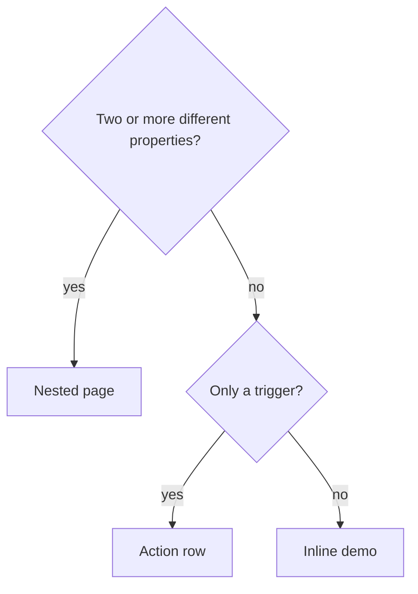

# Gallery

`cargo run -p iced-adaptive-design-gallery` tours the components. This file is about the gallery crate, not the library.

## Navigation

Two levels.

1. **Sidebar: functional groups.** Buttons, Inputs, Rows & Lists, Data, Layout, Navigation, Feedback, Dialogs & Sheets. Components are grouped by what they are for, not how they look. Typography and Rich text are single pages.
2. **Group page.** Lists its components in sections. Each is shown one of three ways (below).

`nav.rs` holds the tree (`Page` → sections → entries). `details.rs` holds the content. The header search finds any component.

## Presentation rule

Count a component's **properties**: things you can vary that change what it is or how it is built (validation, password mode, color, width, icon, shape, children). States (enabled, disabled, checked) are values of a property. They do not count.

| The component has                                  | Shown as                                                 | `Entry`          |
| -------------------------------------------------- | -------------------------------------------------------- | ---------------- |
| Two or more significantly different properties     | a chevron row opening a nested page, one group per property | `Nested(Detail)` |
| One trigger and nothing else (dialog, sheet, toast) | a row with the button on it (`Open`, `Show`)            | `Action(Action)` |
| One demo (a single property and its states)        | the demo inline on the group page, under its heading     | `Inline(Inline)` |



A large component gets a nested page even with one property group.

Examples: Text input (validation, password, color, width) is nested. Check button is inline. Alert dialog is an action row.

## Playgrounds

A nested page whose component one instance can express is a playground (`playground.rs`):

- one live component in a plain bordered frame,
- a **Properties** panel with Reset.

Controls:

| Property is        | Control                                              |
| ------------------ | ---------------------------------------------------- |
| boolean            | switch                                               |
| one of a few       | toggle group                                         |
| a number           | number input (`Spec::number`)                        |
| a value to scrub   | slider (`Spec::slider`): progress, opacity, a level  |
| text               | entry                                                |

`Spec::number` uses whole numbers, or two decimals when the range or default is fractional. The range gives min and max. Typing, the handles and dragging all work.

Do not repeat the component once per value. Keep static demos only where one instance cannot show it: several states at once, a layout per size, anything that needs more than one instance.

Without a playground (these show their own demos): Form, Field, Stepper, Autocomplete, Sorting and pagination, Text view, Carousel, Indicator, Responsive table, Accordion, Card button, Date input and range, Range slider, Multi select, Anchored popover, Surfaces, Toast, the Theming pages, Meta component, Resizable.

Rules:

- Show the disabled state of every control that can be disabled, next to the enabled one.
- A nested page has a group per property, each with a heading.
- Do not add a page for a single card. When a component gets a second property, move it from `Inline` to `Detail`.
- Keep demos small. Do not repeat another component's demo.

## Dialogs and overlays

- Alert, About, Shortcuts and Preferences open as modal dialogs in the gallery window. The window is faded and disabled behind them.
- **Docked surfaces** (Dialogs & Sheets) is a playground for `Dock`: side, size, length, position, mode (Push or Overlay), scope, margin, border, open, fade.
- The AppShell opens in its own process (`gallery --appshell`). Closing the gallery leaves it running.

## The Data group

Large or remote data, on one page: tables (responsive, sorting and pagination, a 100,000-row virtualized table, a table loading in chunks) and trees (async branches, virtualization, a files tree, a docs editor). The virtualized and async pages use `primitives::virtualize` and `primitives::loading`. Tree and table use the same ones.

## Look and window pages

The gallery has no theming controls: its look is the theme file (`IAD_THEME=path.conf`, else the installed default; edit one in the theme manager, which can make it the global theme; `theme-manager gallery` runs this gallery). Layout > **Window & sidebar** has the menu presentation, the mobile sidebar (drawer or parent page), sidebar row padding and the path bar title. Layout > **Motion** has the animations switch and an easing/spring player.

## Committed-widget coverage audit

Audited `src/widgets/mod.rs` at `7a6817b`, including the preceding theme/token
change (`83b7945`) and recent widget history. Coverage includes widgets embedded
in other examples: ChoiceRow in playground controls, TagFilter in Entries,
TagGroupList in Rich text, and ToolbarView in the application shell. Re-exported
configuration types, events, constants and convenience helpers do not each need
a separate demo.

`stable_demo.rs` adds searchable detail pages for the missing examples:

| Group | Details |
| --- | --- |
| Inputs | Accent picker (named/custom colors, local selection only) |
| Rows & Lists | Expander row with nested settings |
| Data | Standalone SortHeader with three-state sorting of actual rows |
| Layout | Collapsible, SectionDivider, ProfileHeader (wide/narrow), ToolbarView with HeaderBar and ActionBar |
| Navigation | FloatingIndicator, SlidePages (forward/back), OverlaySplitView with NavigationPage/navigation_view |

This scope excludes uncommitted library additions and theme-toys-specific
rendering components (classic/block/pixel/bevel/pixmap treatments). Charts removed
by `7a6817b` are intentionally not restored. Existing library edits are not part
of the gallery changes. The accent picker demonstrates input; it does not alter
the gallery's theme.

## Running

```text
cargo run -p iced-adaptive-design-gallery
cargo run -p iced-adaptive-design-gallery -- --screenshot DIR      # every page in light, groups in dark
GALLERY_PAGE=inputs GALLERY_DETAIL=textinput cargo run -p iced-adaptive-design-gallery
```

More switches are in [CONTRIBUTING.md](../CONTRIBUTING.md#the-gallery). `GALLERY_DIALOG=alert|about|shortcuts|preferences` opens that dialog. `GALLERY_AUTOCOMPLETE=idle|loading|results|empty|error|disabled` opens that state of the Autocomplete page. `GALLERY_AUTOCOMPLETE=type:san>sant` types into its entry (`autocomplete_demo.rs`).

## Adding a property

Add it to the playground in the same change: a control in `specs` and its use in `build`. A property with a toolkit default is a plain value that starts at it. The control shows the default. Example: Expander row > Indent, default 24 px from `[rows] expander-indent`.

Also update the method's doc comment (`cargo xtask man`) and the component's page. See [CONTRIBUTING.md](../CONTRIBUTING.md#working-on-a-component).

The gallery uses `iad::utils::theme`, `detect_theme`, and `follow_theme` for shared desktop appearance. Normal startup follows the system color scheme and icon theme. The single appearance icon button cycles System → Light → Dark → System. `GALLERY_SHOT_ONLY=Entries` captures the detected scheme. Light and Dark apply a process-local override; System clears it and follows desktop appearance changes.

The Inputs page opens with **Application forms**: **Entries** demonstrates every
typed EntryRow control, including both date presentations and full-row selections;
**Form** uses Entries for its single-page and wizard examples. Low-level controls are grouped under
**Base input elements (for custom widgets)**; use Entries for application forms. To open Entries directly, run
`GALLERY_DETAIL=Entries cargo run -p iced-adaptive-design-gallery`.
