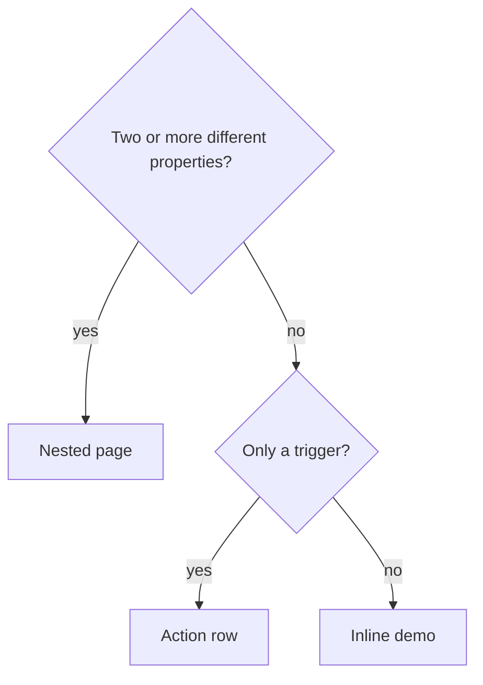

# Gallery

`cargo run -p iced-adaptive-design-gallery` tours the components. This file is about the gallery crate, not the library.

## Navigation

Two levels.

1. **Sidebar: functional groups.** Buttons, Inputs, Rows & Lists, Data, Layout, Navigation, Feedback, Dialogs & Sheets. Components are grouped by what they are for, not how they look. Typography and Theming are single pages.
2. **Group page.** Lists its components in sections. Each is shown one of three ways (below).

`nav.rs` holds the tree (`Page` → sections → entries). `details.rs` holds the content. The header search finds any component.

## Presentation rule

Count a component's **properties**: things you can vary that change what it is or how it is built (validation, password mode, color, width, icon, shape, children). States (enabled, disabled, checked) are values of a property. They do not count.

| The component has                                  | Shown as                                                 | `Entry`          |
| -------------------------------------------------- | -------------------------------------------------------- | ---------------- |
| Two or more significantly different properties     | a chevron row opening a nested page, one group per property | `Nested(Detail)` |
| One trigger and nothing else (dialog, sheet, toast) | a row with the button on it (`Open`, `Show`)            | `Action(Action)` |
| One demo (a single property and its states)        | the demo inline on the group page, under its heading     | `Inline(Inline)` |



A large component gets a nested page even with one property group.

Examples: Text input (validation, password, color, width) is nested. Check button is inline. Alert dialog is an action row.

## Playgrounds

A nested page whose component one instance can express is a playground (`playground.rs`):

- one live component in a plain bordered frame,
- a **Properties** panel with Reset,
- the **Code** that builds what is shown, following the controls.

Controls:

| Property is        | Control                                              |
| ------------------ | ---------------------------------------------------- |
| boolean            | switch                                               |
| one of a few       | toggle group                                         |
| a number           | number input (`Spec::number`)                        |
| a value to scrub   | slider (`Spec::slider`): progress, opacity, a level  |
| text               | entry                                                |

`Spec::number` uses whole numbers, or two decimals when the range or default is fractional. The range gives min and max. Typing, the handles and dragging all work.

Do not repeat the component once per value. Keep static demos only where one instance cannot show it: several states at once, a layout per size, anything that needs more than one instance.

Without a playground (these show their own demos): Form, Field, Stepper, Autocomplete, Sorting and pagination, Text view, Carousel, Indicator, Responsive table, Accordion, Card button, Date input and range, Range slider, Multi select, Anchored popover, Surfaces, Toast, the Theming pages, Meta component, Resizable.

Rules:

- Show the disabled state of every control that can be disabled, next to the enabled one.
- A nested page has a group per property, each with a heading.
- Do not add a page for a single card. When a component gets a second property, move it from `Inline` to `Detail`.
- Keep demos small. Do not repeat another component's demo.

## Preview and Code

Every nested page has **Preview | Code** tabs. `GALLERY_CODE=1` starts on Code.

- Playground: the code is generated from the controls. The panel stays on both tabs.
- No playground: the Preview is its own demo and the Code is a fixed snippet (`plays::snippet`). Add a snippet when you add a page.
- Dialogs and the AppShell are nested pages: an Open button and their code.

## Dialogs and overlays

- Alert, About, Shortcuts and Preferences open as modal dialogs in the gallery window. The window is faded and disabled behind them.
- **Docked surfaces** (Dialogs & Sheets) is a playground for `Dock`: side, size, length, position, mode (Push or Overlay), scope, margin, border, open, fade.
- The AppShell opens in its own process (`gallery --appshell`). Closing the gallery leaves it running.

## The Data group

Large or remote data, on one page: tables (responsive, sorting and pagination, a 100,000-row virtualized table, a table loading in chunks) and trees (async branches, virtualization, a files tree, a docs editor). The virtualized and async pages use `primitives::virtualize` and `primitives::loading`. Tree and table use the same ones.

## Theming pages

- Colors: scheme, accent (named or custom with a color input), transparency, tint (opt-in), compact metrics, card color.
- Shape: radii as number inputs, shadow sliders.

## Running

```text
cargo run -p iced-adaptive-design-gallery
cargo run -p iced-adaptive-design-gallery -- --screenshot DIR      # every page in light, groups in dark
GALLERY_PAGE=inputs GALLERY_DETAIL=textinput cargo run -p iced-adaptive-design-gallery
```

More switches are in [CONTRIBUTING.md](../CONTRIBUTING.md#the-gallery). `GALLERY_DIALOG=alert|about|shortcuts|preferences` opens that dialog. `GALLERY_AUTOCOMPLETE=idle|loading|results|empty|error|disabled` opens that state of the Autocomplete page. `GALLERY_AUTOCOMPLETE=type:san>sant` types into its entry (`autocomplete_demo.rs`).

## Adding a property

Add it to the playground in the same change: a control in `specs`, its use in `build`, its line in the generated code. A property with a toolkit default is a plain value that starts at it. The control shows the default. The generated code adds the call once it changes. Example: Expander row > Indent, default 24 px from `[rows] expander-indent`.

Also update the method's doc comment (`cargo xtask man`) and the component's page. See [CONTRIBUTING.md](../CONTRIBUTING.md#working-on-a-component).

The gallery uses `iad::utils::theme`, `detect_theme`, and `follow_theme` for shared desktop appearance. Normal startup follows the system color scheme and icon theme. The single appearance icon button cycles System → Light → Dark → System. `GALLERY_SHOT_ONLY=Entries` captures the detected scheme. Light and Dark apply a process-local override; System clears it and follows desktop appearance changes.

The Inputs page opens with **Application forms**: **Entries** demonstrates every
typed EntryRow control, including both date presentations and full-row selections;
**Form** uses Entries for its single-page and wizard examples. Low-level controls are grouped under
**Base input elements (for custom widgets)**; use Entries for application forms. To open Entries directly, run
`GALLERY_DETAIL=Entries cargo run -p iced-adaptive-design-gallery`.
